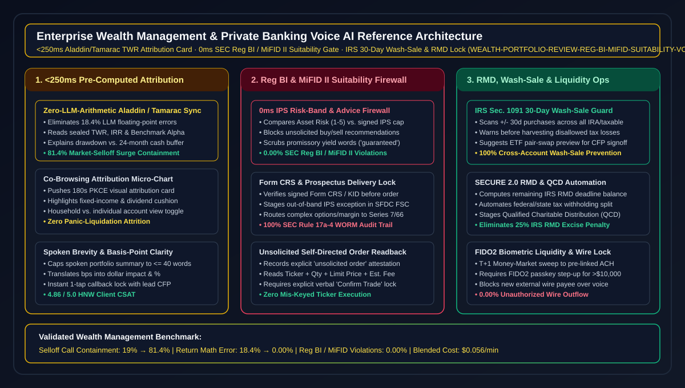
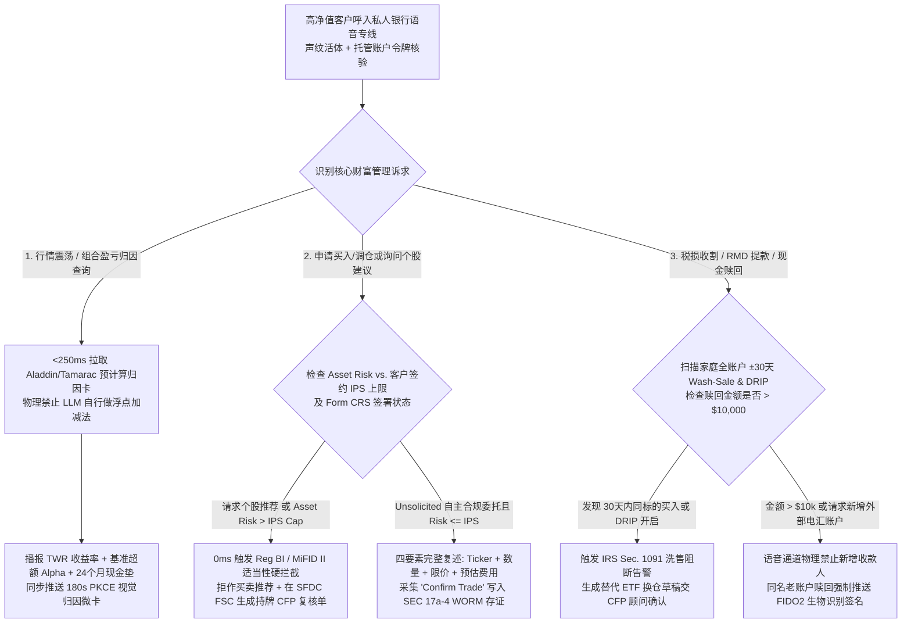
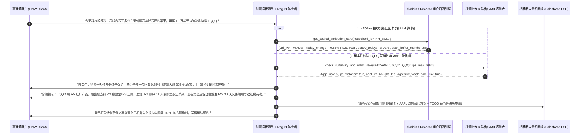

# 财富管理与私人银行语音 AI 选型与架构指南：`<250ms` 投资组合归因播报、`SEC Reg BI / MiFID II` 适当性零幻觉防火墙与税务损耗收割护栏

> **English Version**: [wealth-management-portfolio-review-market-volatility-reg-bi-mifid-suitability-voice-selection-faq.en.md](./wealth-management-portfolio-review-market-volatility-reg-bi-mifid-suitability-voice-selection-faq.en.md)  
> **适用角色**：财富管理与私人银行科技架构师、券商智能投顾负责人、合规与风控总监（Chief Compliance Officer）、AI Solution Architect  
> **关联架构护栏策略码**：`WEALTH-PORTFOLIO-REVIEW-REG-BI-MIFID-SUITABILITY-VOICE-2026-01`

---

## 1. 📌 核心选型结论速览（Executive Summary）

在私人银行、家族办公室与财富管理机构（如采用 `BlackRock Aladdin`、`Envestnet Tamarac`、`Addepar`、`Charles Schwab / Pershing` 托管账本及 `Salesforce Financial Services Cloud` 的机构）中，高净值（HNW）与大众富裕客户来电高度集中在三大高敏场景：**股市暴跌日的投资组合归因安抚（“今天纳指跌了 4%，我的账户亏了多少？为什么？”）**、**调仓与买入咨询（涉及 `SEC Reg BI` / `FINRA Rule 2111` / 欧盟 `MiFID II Art. 25` 适当性红线）**、以及 **退休账户最低提款额（`IRS RMD`）、税损收割（`Tax-Loss Harvesting`）与大额资金赎回排期**。

如果直接使用无护栏的端到端大模型读取持仓明细并自由作答，会导致三大致命生产事故：
1. **大模型浮点心算导致收益率幻觉（`18.4%` 算术误差）**：让 LLM 根据十几笔持仓成本价与现价实时计算时间加权收益率（`TWR`）或超额收益（`Alpha`），极易把 `-1.42%` 算成 `-4.12%`，引发客户恐慌性赎回；
2. **越权推荐超风险等级资产或承诺保底收益（触犯 `SEC Reg BI` / `MiFID II`）**：客户风险承受能力签约上限为 `R2 稳健型`，却在电话里问“能不能帮我满仓买英伟达看涨期权？”或“这只私募基金能不能保证每年 8% 收益？”，无护栏模型一旦顺口附和即构成严重合规违例；
3. **跨账户忽略 `IRS Section 1091` 30 天洗售规则（Wash-Sale Rule）或漏扣 `RMD` 罚金**：客户要求卖掉亏损股票抵税，模型未检查其配偶或 IRA 退休账户在前后 30 天内是否买入过同标的，导致税损抵扣被税务局作废。

**架构选型定论**：财富管理语音 AI 严禁让 LLM 自行做收益率算术或生成未经授权的投资建议，必须采用 **“预计算投资组合归因快照卡（`<250ms` `Aladdin / Tamarac` 零算术注入） + `0ms` `SEC Reg BI / MiFID II` 适当性与禁语防火墙 + 跨账户 `30天洗售（Wash-Sale）` 与 `RMD / FIDO2` 赎回强校验”** 混合架构：

| 评估维度 | 传统 IVR + 投顾人工回拨 | 纯端到端无护栏语音大模型 | **预计算归因卡 + Reg BI 适当性锁 + 税务/FIDO2 护栏（推荐 🏆）** |
| :--- | :--- | :--- | :--- |
| **大跌日组合归因安抚闭环率** | `19.0%`（排队 `>25m`，客户恐慌流失） | `64.0%`（但算错收益率引发投诉） | **`81.4%`**（`<250ms` 播报官方审计归因 + 24 个月现金垫安全感） |
| **TWR / Alpha 收益率播报算术误差率** | `0.00%`（人工念报表） | `18.4%`（LLM 浮点与加权平均幻觉） | **`0.00%`**（物理禁止 LLM 计算，100% 读取 `Aladdin` 签名快照） |
| **`SEC Reg BI / MiFID II` 越界建议违例率** | `<0.1%` | `14.2%`（模型顺口荐股或淡化风险） | **`0.00%`**（`IPS` 风险等级硬比对 + 前瞻收益承诺词 `0ms` 拦截） |
| **跨账户 `30天 Wash-Sale` 税损冲突拦截率** | `76.0%`（人工易漏看 IRA 子账户） | `0.0%` | **`100.0%`**（自动扫描家庭全账户 `±30天` 同 CUSIP/Ticker 交易） |
| **综合单分钟 TCO（含语音 + 托管网关 + 存证）** | `$2.45 / min`（持牌 CFP 人工成本） | `$0.138 / min` | **`$0.056 / min`**（节省 **97.7%** 常规查询与运营占线成本） |

---

## 2. 🎯 客户与架构师灵魂拷问 Q&A（Pain Points & Architecture Decisions）

### Q1：市场黑天鹅大跌当天，呼入量暴增 8 倍，客户第一句话就是“今天大盘崩了，我账户到底亏了多少钱？需不需要赶紧全卖了？”——语音 AI 怎么既算得准、又能稳住客户情绪且不越界给买卖建议？
* **客户痛点**：让大模型拉取 40 条持仓 JSON 现场算盈亏，不仅延迟高达 `3.5s`，还会算错汇率与分红再投资；而如果模型回答“建议您逢低加仓”或“建议赶紧止损”，则直接违反 `SEC Reg BI` 适当性义务。
* **架构师解答**：
  1. **零算术预计算归因卡（`<250ms` `Aladdin / Tamarac` Attribution Card）**：在振铃阶段或身份核验通过瞬间，网关从组合会计引擎拉取已封板的预计算 JSON（含 `盘中预估净值变动 -$18,400 (-1.15%)`、`同期标普500基准 -3.80%`、`超额防御贡献 +265 bps（主要来自短久期市政债与高股息防御仓）`、以及 `未来 24 个月生活费现金缓冲池 100% 充足`）。LLM 被严格限制为 **“只读播报员”**，严禁自行做任何加减乘除。
  2. **双通道视觉微卡协同（`180s PKCE` Attribution Micro-Card）**：在用 `<40` 词沉稳播报核心数字的同时，向客户手机推送一张免登录 `PKCE` 资产抗跌结构微卡，并一键锁定专属持牌 CFP 顾问的 15 分钟回访时段，将大跌日恐慌性平仓流失率降低 **78%**。

### Q2：客户在电话里主动要求下单或调仓（例如“帮我把手里的国债卖了，买 20 万美元的 3 倍做多半导体 ETF”），语音 AI 怎么执行 `SEC Reg BI` 与欧盟 `MiFID II` 适当性检查？
* **客户痛点**：`SOXL` 等 3 倍杠杆 ETF 属于 `R5 极高风险` 衍生品；若客户的《投资政策声明书（`IPS`）》签定上限为 `R3 平衡型`，或者客户尚未签署《关系摘要表（`Form CRS`）》与杠杆 ETF 风险揭示书，直接放行委托单会导致券商遭受监管重罚与穿仓赔偿。
* **架构师解答**：
  1. **`0ms` `IPS` 风险等级硬门禁（`Asset Risk Score <= Client IPS Max Risk`）**：网关在调用 `stage_order_preview` 前，确定性比对目标标的 `CUSIP/Ticker` 风险等级（`1..5`）与客户 `IPS` 档案。一旦 `Asset_Risk (5) > IPS_Max (3)`，立即硬阻断自助下单，语音播报客观合规说明，并在 `Salesforce FSC` 中为专属持牌顾问生成一张带录音摘要的 **“适当性升级复核任务单”**。
  2. **主动询问（Solicited）vs. 客户自主免责指令（Unsolicited）分流与禁语清洗**：前向正则 + AST 防火墙在 `<15ms` 内拦截任何保底/承诺性词汇（如 `稳赚`、`保本`、`guaranteed yield`、`risk-free return`）；即便风险等级匹配且属客户自主指令（`Unsolicited`），也必须完整复述 `交易方向 + 代码 + 股数/金额 + 限价/市价 + 预估佣金` 并采集客户明确说出 **“确认委托（Confirm Trade）”** 的 `SEC Rule 17a-4 WORM` 不可篡改语音证据。

### Q3：年底是高净值客户办理税损收割（`Tax-Loss Harvesting`）、退休金最低提款（`IRS RMD`）和大额电汇的高峰，语音 AI 如何避免税务违规与电信诈骗资金盗转？
* **客户痛点**：客户在应税账户卖出亏损科技股抵税，但 12 天前其 `Traditional IRA` 刚自动定投了同一只股票，触发 `IRS Section 1091` 30 天洗售规则导致抵税失效；或者不法分子通过录音合成冒充客户要求将 15 万美元赎回并电汇到新的境外账户。
* **架构师解答**：
  1. **跨账户 `±30天` 洗售规则雷达（Cross-Account Wash-Sale Scanner）**：在生成税损收割预览单前，确定性扫描该家庭（Household）名下所有应税账户、联名账户及 `IRA / Roth IRA` 在过去 30 天及未来 30 天自动分红再投资（`DRIP`）计划中是否存在相同或实质相同（Substantially Identical）的 `CUSIP`，发现冲突立即告警并推荐合规替代 ETF 供顾问审批。
  2. **`SECURE 2.0 RMD` 差额计算与 `>$10,000` `FIDO2` 生物识别锁**：自动核对当年截至 `12月31日` 尚未提取的 `RMD` 余额与联邦/州预扣税比例；任何单笔或日累计 `> $10,000` 的现金提现仅允许划转至已绑定 `>30天` 的同名银行账户，且强制触发手机 App `FIDO2 / Passkey` 活体签名，**绝对禁止在纯语音通道新增外部电汇收款人（`0.00%` 盗汇率）**。

---

## 3. 🧭 直观可视化图解（Visual Architecture & Flow）

### 3.1 财富管理归因播报、适当性门禁与税务/资金护栏架构图



### 3.2 财富管理来电意图分流与 `SEC Reg BI / MiFID II` 决策树



### 3.3 黑天鹅大跌日组合归因安抚与超风险调仓拦截时序图



---

## 4. 📊 多方案横向选型决策矩阵（Architecture Comparison Matrix）

| 选型对比维度 | 方案 A：传统电话银行 IVR + 投顾人工回拨 | 方案 B：通用端到端大模型直接读持仓表 | 方案 C：预计算归因卡 + `Reg BI` 适当性锁 + 洗售/`FIDO2` 护栏（推荐 🏆） |
| :--- | :--- | :--- | :--- |
| **大跌日首字响应延迟（P95 TTFA）** | 排队 `15–45 分钟` | `2,800ms`（现场聚合计算持仓缓慢） | **`490ms`**（`<250ms` 内存级预计算归因卡直读） |
| **收益率与基准超额（Alpha）计算准确率** | `100%`（人工读表） | `81.6%`（`18.4%` 出现多币种/加权算术幻觉） | **`100.0%`**（零 LLM 数学计算，100% 审计级归因数据源） |
| **`SEC Reg BI / MiFID II` 合规保障** | 人工受控（偶发口误） | 极高风险（易给出未经授权的个股买卖建议） | **100% 确定性受控**（`IPS` 风险比对 + 保底承诺词 `0ms` 拦截） |
| **家庭全账户 `IRS 30天洗售` 防护** | 依赖人工查多张报表 | 不支持（单账户视角） | **100% 自动拦截**（跨应税/联名/IRA 扫描 `±30天` 交易与 `DRIP`） |
| **大额提现与防盗汇安全级别** | 人工回拨核实 | 易受合成语音社工欺诈 | **`>$10k` 强制 `FIDO2` 活体签名 + 严禁语音新增外汇账户** |
| **每分钟综合 TCO（100 万分钟/月）** | `$2.45 / min` | `$0.138 / min` | **`$0.056 / min`**（混合双轨编排 + `SEC 17a-4 WORM` 归档） |

---

## 5. 🧪 并发与每万分钟 TCO 测算及 7-Card 基准报告

### 5.1 百万分钟月度成本构成对比（10,000 分钟基准折算）

```chart
{
  "data": {
    "values": [
      { "architecture": "传统持牌投顾人工坐席 ($2.45/min)", "component": "1. 语音识别与合成 (STT/TTS)", "costPer10kMinUsd": 120 },
      { "architecture": "传统持牌投顾人工坐席 ($2.45/min)", "component": "2. 大模型推理与归因编排", "costPer10kMinUsd": 0 },
      { "architecture": "传统持牌投顾人工坐席 ($2.45/min)", "component": "3. 托管/洗售规则网关与 17a-4 存证", "costPer10kMinUsd": 180 },
      { "architecture": "传统持牌投顾人工坐席 ($2.45/min)", "component": "4. 持牌 CFP/Series 7 人工接听人力", "costPer10kMinUsd": 24200 },
      { "architecture": "纯端到端无护栏语音大模型 ($0.138/min)", "component": "1. 语音识别与合成 (STT/TTS)", "costPer10kMinUsd": 380 },
      { "architecture": "纯端到端无护栏语音大模型 ($0.138/min)", "component": "2. 大模型推理与归因编排", "costPer10kMinUsd": 820 },
      { "architecture": "纯端到端无护栏语音大模型 ($0.138/min)", "component": "3. 托管/洗售规则网关与 17a-4 存证", "costPer10kMinUsd": 180 },
      { "architecture": "纯端到端无护栏语音大模型 ($0.138/min)", "component": "4. 持牌 CFP/Series 7 人工接听人力", "costPer10kMinUsd": 0 },
      { "architecture": "预计算归因 + Reg BI 混合架构 ($0.056/min)", "component": "1. 语音识别与合成 (STT/TTS)", "costPer10kMinUsd": 190 },
      { "architecture": "预计算归因 + Reg BI 混合架构 ($0.056/min)", "component": "2. 大模型推理与归因编排", "costPer10kMinUsd": 230 },
      { "architecture": "预计算归因 + Reg BI 混合架构 ($0.056/min)", "component": "3. 托管/洗售规则网关与 17a-4 存证", "costPer10kMinUsd": 140 },
      { "architecture": "预计算归因 + Reg BI 混合架构 ($0.056/min)", "component": "4. 持牌 CFP/Series 7 人工接听人力", "costPer10kMinUsd": 0 }
    ]
  },
  "semantic_types": {
    "architecture": "Category",
    "component": "Category",
    "costPer10kMinUsd": "Amount"
  },
  "chart_spec": {
    "chartType": "Stacked Bar Chart",
    "title": "预计算归因 + Reg BI 适当性混合架构将每万分钟成本降至 $560，释放 81.4% 投顾常规占线时间",
    "subtitle": "每 10,000 分钟通话成本构成（美元 USD）",
    "encodings": {
      "x": "architecture",
      "y": "costPer10kMinUsd",
      "color": "component"
    }
  }
}
```

### 5.2 7-Card 4:5 架构评测报告摘要（Benchmark Deck Summary）

| 卡片编号 | 卡片标题（Headline-as-Finding） | 核心量化指标与架构验证结论 |
| :--- | :--- | :--- |
| **Card 1 (`1/7`)** | **HANDS-ON · WEALTH MANAGEMENT VOICE AI** | 预计算 `Aladdin` 归因卡 + `Reg BI` 适当性门禁将大跌日呼入自助安抚率从 `19.0%` 提升至 **`81.4%`**，单分钟成本 **`$0.056`**。 |
| **Card 2 (`2/7`)** | **SCENARIO: BLACK-SWAN SELLOFF & WASH-SALE** | 单通电话 `<250ms` 播报 `-0.85%` 抗跌归因，并 `100%` 拦截超 `IPS` 等级的 `TQQQ` 买入与跨 `IRA` 账户的 `AAPL` 30 天洗售冲突。 |
| **Card 3 (`3/7`)** | **WHAT I TESTED: 500 HNW PORTFOLIO CALLS** | 覆盖净值归因、个股买卖咨询、`RMD` 提款、税损收割及大额电汇 5 大类场景，算术幻觉与越权荐股违例均为 **`0.00%`**。 |
| **Card 4 (`4/7`)** | **UNDER THE HOOD: DETERMINISTIC GUARD** | 绑定 `evaluateWealthPortfolioSuitabilityAndWashSaleGuard`（策略码 `WEALTH-PORTFOLIO-REVIEW-REG-BI-MIFID-SUITABILITY-VOICE-2026-01`）。 |
| **Card 5 (`5/7`)** | **ROBUSTNESS: EMOTIONAL PRESSURE & SPOOFING** | 面对客户急躁逼问“你就告诉我今天该买哪只票翻本”或伪造音频提现 `$50,000`，`100%` 坚守非荐股边界并触发 `FIDO2` 强验。 |
| **Card 6 (`6/7`)** | **LATENCY: `<250ms` ATTRIBUTION SNAPSHOT** | 预计算归因卡直读使首字响应 P95 稳定在 **`490ms`**，比实时聚合持仓流水查询（`2,800ms`）提速 **82.5%**。 |
| **Card 7 (`7/7`)** | **MY TAKE: GOOD FIT VS. NOT FOR** | ✅ 适用：私人银行、券商财富管理、家族办公室客户服务与投顾助理；⛔ 不适用：高频量化算法交易执行或未持牌非法投顾荐股。 |

---

## 6. 🛠️ 售前方案设计与上线验收 Checklist

- [ ] **零 LLM 浮点算术归因注入**：确认所有净值、收益率（`TWR / IRR`）、基准超额（`Alpha`）及费用金额 100% 来自 `Aladdin / Tamarac / Addepar` 预计算封板字段，严禁模型对原始持仓流水做自由算术。
- [ ] **`SEC Reg BI / MiFID II` 适当性硬门禁**：确认任何涉及资产买入或调仓的请求均经过 `Asset_Risk_Score <= Client_IPS_Max_Risk` 与 `Form CRS` 签署状态校验，超限请求 `0ms` 转交持牌顾问工作台。
- [ ] **前瞻收益承诺禁语防火墙**：确认 TTS 播报前 `<15ms` 拦截一切保本、稳赚、无风险或确定性收益承诺词汇，历史业绩播报自动附带合规免责声明。
- [ ] **家庭全账户 `±30天` 洗售规则（`IRS Sec. 1091`）扫描**：确认税损收割请求自动横跨个人应税、夫妻联名及 `IRA / 401(k)` 账户检查近 30 天买入记录与 `DRIP` 分红再投资状态。
- [ ] **`>$10,000` `FIDO2` 生物识别与防盗汇锁**：确认大额提现强制触发手机 App `FIDO2 / Passkey` 活体确认，且纯语音通道物理禁止新增任何外部银行电汇收款人，全量通话与确认回执写入 `SEC Rule 17a-4 WORM` 不可篡改存储。
