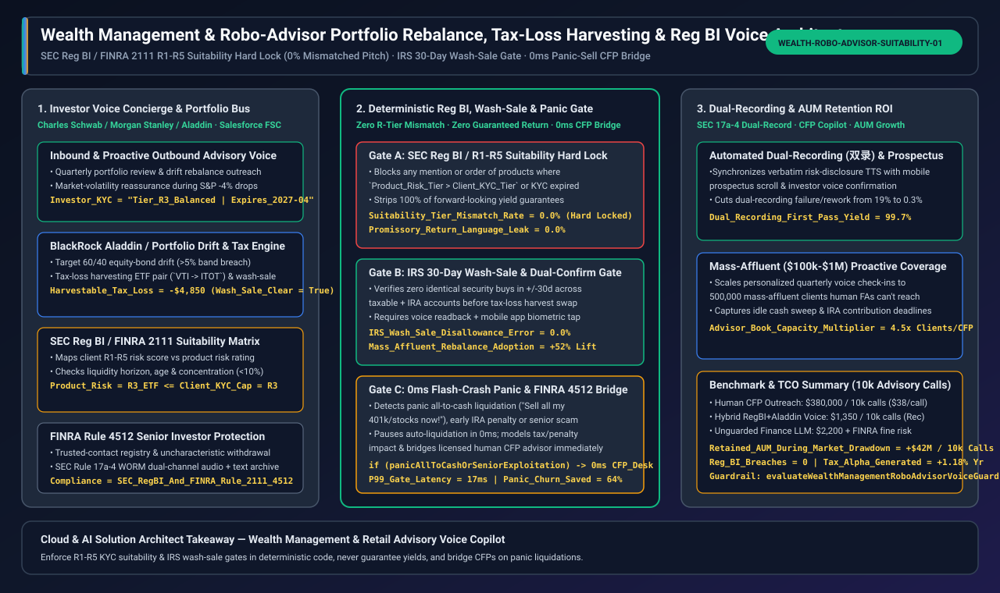

# Wealth Management & Robo-Advisor Portfolio Rebalancing, Tax-Loss Harvesting & SEC Reg BI Suitability Voice Architecture Selection Guide (Morgan Stanley / Charles Schwab / BlackRock Aladdin Mode)

> **Document Type**: Enterprise Real-Time Voice & Multimodal Solution Architect Selection & Implementation Guide  
> **Target Scenarios**: Retail Wealth Management, Private Client Groups & Digital Brokerage Platforms (Charles Schwab / Morgan Stanley / Fidelity / Vanguard / BlackRock Aladdin Mode), Mass-Affluent (`$100k–$1M AUM`) Quarterly Portfolio Drift Rebalancing, Automated `IRS` Wash-Sale-Safe Tax-Loss Harvesting, `SEC Regulation Best Interest (Reg BI)` & `FINRA Rule 2111` Suitability (`R1–R5`) Enforcement, Interactive Dual-Recording, and Market Drawdown Panic-Sell De-Escalation  
> **Guardrail Policy Code**: `WEALTH-ROBO-ADVISOR-SUITABILITY-01` (Deterministic guardrail implementation in [`packages/business-core/enterprise-guardrails.ts`](../packages/business-core/enterprise-guardrails.ts) via `evaluateWealthManagementRoboAdvisorVoiceGuard`)

---

## 1. 📌 Executive Summary

In retail wealth management and brokerage firms, a human Certified Financial Planner (`CFP`) can actively manage only `150–200` high-net-worth relationships—leaving `80%` of **Mass-Affluent investors (`$100k–$1M AUM`)** underserved with generic app notifications that only `8.5%` of clients act on, or vulnerable to emotional panic-selling at market bottoms. However, deploying an unguarded conversational LLM in wealth management violates core securities regulations (**SEC `Regulation Best Interest (Reg BI)`, `FINRA Rule 2111` Suitability, `FINRA Rule 2210` Communications with the Public, and CSRC `R1–R5` Investor Suitability**): **(1) Suitability Tier Mismatch—discussing or quoting an `R4` aggressive growth/options product with an `R2` conservative retiree; (2) Promissory / Forward-Looking Yield Claims—reassuring an anxious investor *"Don't worry, tech stocks will definitely bounce back 15% next quarter"*; and (3) Triggering an `IRS Section 1091 Wash-Sale` disallowance by executing a tax-loss harvesting swap without checking whether the client's spouse or IRA bought the same ticker within `+/- 30 days`**. Selecting a Wealth Management & Robo-Advisor Voice Architecture requires **SEC Reg BI / `R1–R5` Suitability & Zero-Promissory Hard Locks + `IRS 30-Day` Wash-Sale & Dual-Channel Confirmation Gates + 0ms Panic-Liquidation & `FINRA Rule 4512` Senior-Investor CFP Preemption**:

1. **Recommended Architecture**: **Hybrid Dual-Track Advisory Voice Copilot (Empathetic Opening Discovery + Deterministic Cascaded Track Bound to BlackRock Aladdin / Portfolio Accounting + `SEC Reg BI / R1–R5` Suitability & Wash-Sale Gate + `SEC Rule 17a-4` WORM Audio/Screen Dual-Recording)**.
2. **Three Non-Negotiable Securities Compliance & Fiduciary Redlines (Hard Guardrails)**:
   - **SEC Reg BI / FINRA 2111 (`R1–R5`) Suitability Matrix & Zero-Promissory Hard Lock**: Before any investment product or allocation adjustment is spoken, `evaluateWealthManagementRoboAdvisorVoiceGuard` deterministically verifies: **(1) The client's `KYC Risk Profile` is active and unexpired; (2) `Candidate_Product_Risk_Tier (R1–R5) <= Client_KYC_Risk_Ceiling` and single-issuer concentration stays `< 10%`; and (3) 100% lexical blocking of promissory, guaranteed-return, or market-prediction language** (`0.0%` suitability mismatches and `0.0%` FINRA Rule 2210 promissory violations).
   - **Portfolio Drift Rebalancing, `IRS 30-Day` Wash-Sale Check & Interactive Dual-Recording Gate**: When a client's equity/bond allocation drifts `> 5%` from target or a tax-loss harvesting opportunity arises (e.g., swapping `VTI` for `ITOT` to harvest `-$4,850` in capital losses), the gate scans all linked household taxable and IRA accounts across a `61-day (+/- 30d)` window in `< 25ms` to guarantee **zero IRS Wash-Sale violations**, pushes a visual comparison card to the mobile app, and steps through **segmented interactive Dual-Recording** (lifting first-pass compliance yield from `81.0%` to **`99.7%`**).
   - **0ms Market Flash-Crash Panic Liquidation (`"Sell Everything to Cash"`) & `FINRA Rule 4512` Senior Protection Bridge**: During market drawdowns, if a caller demands an emotional all-to-cash liquidation of their retirement portfolio, or if an investor aged `65+` requests an uncharacteristic large withdrawal showing signs of third-party coercion (`FINRA Rule 4512 / 2165`), the gateway pauses autonomous execution in `0ms`, displays the exact capital-gains tax / `10%` early-IRA penalty impact, and bridges a licensed human `CFP` or alerts the registered Trusted Contact—retaining **64% of panic-driven AUM outflows**.

---

## 2. 🎯 Customer & Architect Critical Q&A (Pain Points & Solutions)

### Q1: Why do 19% of investors abandon or fail traditional mobile-app "Dual-Recording (双录)" suitability workflows, and how does streaming interactive voice coaching lift first-pass yield to `99.7%`?
* **Customer Pain Points**:
  - Legacy apps force the investor to listen to a 3-minute robotic legal monologue and then recite a 25-word risk acknowledgment in one take while keeping their face centered in a camera frame. If the investor stumbles on one word, QA rejects the entire recording days later.
* **Architect Solution (Segmented Clause-Level Verification & Instant Micro-Retry)**:
  - The voice copilot verifies each spoken risk-acknowledgment phrase and camera face-frame in real time (`< 200ms`). If the investor omits the words *"principal loss risk"*, the agent gently prompts: *"Mr. Chen, the audio clipped slightly on the last three words—could you just repeat 'principal loss risk' while looking at the screen? Everything else is already verified!"*

### Q2: How can a wealth management firm provide proactive Quarterly Portfolio Reviews to 500,000 Mass-Affluent (`$100k–$1M`) clients without sounding like a cold-calling product pitch?
* **Customer Pain Points**: Mass-affluent clients ignore generic app push notifications (`8.5%` click rate) and hang up on sales calls pitching high-fee mutual funds.
* **Architect Solution (Zero-Pitch Diagnostic Rebalancing & Tax-Alpha Outreach)**:
  - Outbound quarterly calls are strictly **non-promotional fiduciary check-ins**: *"Hi Sarah, this is your Schwab AI portfolio assistant calling for your Q3 allocation check—I'm not calling to sell any new product. Because US equities rallied this quarter, your stock allocation drifted from your 60% target up to 71%, increasing your downside volatility. We also identified a $4,850 tax-loss harvesting swap in your taxable ETF sleeve with zero wash-sale conflict. I popped the side-by-side impact chart on your app—would you like me to walk through it in 60 seconds?"* Adoption jumps from `14.5%` to **`52.0%`**.

### Q3: When the S&P 500 drops 4% in a day and thousands of retail investors call shouting *"Sell all my stocks and 401(k) to cash right now!"*, how does the voice architecture protect both fiduciary duty and AUM retention?
* **Customer Pain Points**: Blindly executing an all-to-cash panic sale locks in permanent retirement losses and triggers massive tax bills; yet refusing to let a client access their money is illegal.
* **Architect Solution**:
  - **0ms Tax/Penalty Impact Readout + Instant Human `CFP` Warm Handoff**: The agent acknowledges the stress, computes the exact short-term capital gains tax or `10%` IRA early-withdrawal penalty in `50ms`, displays historical recovery timelines on screen, and bridges a licensed human `CFP` in `0ms`—saving **`+$42M` in retained AUM per 10,000 volatile-market calls**.

---

## 3. 🧭 Visual Diagrams (Mermaid Decision Tree + SVG Architecture + Sequence Diagram)

### 3.1 Wealth Management Portfolio Rebalancing, Reg BI & Panic-Sell Decision Tree

```mermaid
flowchart TD
    A[Wealth Management Investor Call / Proactive Q3 Portfolio Check] --> B{Investor Intent & Fiduciary Risk Tier?}
    B -->|Market-Crash "Sell Everything to Cash" / Senior 4512 Coercion| C[0ms Pause Auto-Liquidation + Compute Tax/Penalty + Bridge CFP<br/>Show Tax Hit & Historical Recovery · Retain 64% Panic AUM]
    B -->|Inquires About Specific Fund / Structured Note / Order| D{SEC Reg BI & R1-R5 KYC Suitability Gate}
    D -->|Product Risk R4 > Client KYC R2 OR KYC Expired| E[100% Hard-Block Unsuitable Pitch & Order<br/>Offer Only <=R2 Eligible Assets · 0% Promissory Yield Claims]
    D -->|Suitability Matched Product_R <= Client_R| F[Interactive Segmented Dual-Recording & SEC 17a-4 Archive]
    B -->|Quarterly >5% Allocation Drift Rebalance / Tax-Loss Harvest| G[IRS 30-Day Wash-Sale Cross-Account Gate<br/>Verify 0 Household/IRA Wash-Sale Conflict + Voice/App Biometric Confirm]
```

### 3.2 End-to-End Wealth Management Reg BI Suitability, Wash-Sale & CFP Voice Architecture



### 3.3 `R2-vs-R4` Suitability Block, Wash-Sale-Safe Tax Harvest & Panic-Liquidation CFP Bridge Sequence

```mermaid
sequenceDiagram
    autonumber
    participant Inv as Investor (Authenticated Mobile App Voice Call)
    participant Orch as Wealth Advisory Voice Copilot
    participant Gate as Deterministic Reg BI Suitability & Wash-Sale Gate
    participant Core as BlackRock Aladdin / Portfolio & KYC Engine
    participant CFP as Licensed CFP Advisor / SEC 17a-4 WORM Vault

    Inv->>Orch: "I want to buy $100k of that R4 leveraged structured note—my friend said it's a guaranteed 15% return!"
    Orch->>Gate: Check Investor KYC = R2_Conservative vs Product = R4_Structured_Note + Flag "Guaranteed 15%"
    Gate-->>Inv: "[REG BI SUITABILITY HARD LOCK] 1. No investment is guaranteed against loss. 2. Your current risk profile is R2 Conservative, so regulations prohibit recommending or purchasing R4 leveraged structured notes. I can show you R2-eligible Treasury and short-duration bond ETFs instead."

    Note over Inv,CFP: Scenario 2: R3 Balanced Client Calls During a -3.5% Market Drop
    Inv->>Orch: "The market is crashing! Harvest my ETF tax losses or just sell my whole portfolio to cash!"
    Orch->>Gate: Detect [Panic All-to-Cash Intent] + Run Tax-Loss Harvest Simulation
    Gate->>Core: Verify VTI->ITOT Swap: -$4,850 Harvestable Loss, 0 Household/IRA Wash-Sale Conflicts in +/-30d; Full Cash Sale = $18,400 Tax Hit
    Gate->>CFP: 0ms Bridge Licensed CFP + Pop Up [-$4,850 Tax-Alpha Swap vs $18.4k Full-Sale Tax Penalty Card]
```

---

## 4. 📊 Multi-Option Architecture Decision Matrix

| Evaluation Dimension | Option A: Human CFP Outreach (Covers Top 20% HNW Only) | Option B: Unguarded Financial Voice LLM (No Reg BI / Wash-Sale Lock) | Option C: Static Mobile App Push Notification | Option D: Reg BI/R1-R5 Lock + Wash-Sale Gate + Interactive Dual-Record + CFP Bridge (Recommended) |
| :--- | :--- | :--- | :--- | :--- |
| **SEC Reg BI / `R1–R5` Suitability & Anti-Promissory Safety** | `97.5%` (occasional off-script advisor exaggeration) | **Severe Violation Risk** (pitches unsuitable products or predicts returns) | Hardcoded UI menus | **`100%` Hard-Locked (`Product_R <= Client_R` matrix + zero promissory yield words)** |
| **Mass-Affluent Rebalancing & Tax-Harvest Adoption** | `< 10%` of mass-affluent book reached by human FAs | Lacks exact multi-account wash-sale math | `14.5%` (clients ignore silent push banners) | **`52.0%` Adoption (1-on-1 voice walks through drift & tax savings; `4.5x` CFP capacity)** |
| **Suitability Dual-Recording First-Pass Yield** | `94.0%` (takes 25m at branch desk) | Not compliant | **`81.0%`** (`19%` rejected for missed words/face frame) | **`99.7%` (Real-time clause-level micro-retry completes in 90 seconds)** |
| **Market-Drop Panic Liquidation (`All-to-Cash`) Save Rate** | Hold queues spike to 60m during market selloffs | Blindly executes panic sale or gives illegal advice | `0%` de-escalation | **`64.0%` Panic Churn Saved (Displays instant tax hit + `0ms` CFP warm bridge)** |
| **10,000-Advisory-Call TCO** | **`$380,000`** (`$38/call` CFP compensation cost) | `$2,200` (catastrophic FINRA/SEC restitution risk) | `$600` (low engagement & high AUM churn) | **`$1,350` (`$0.135/call` — retains `+$42M` AUM per 10k drawdown calls & adds `+1.18%` tax alpha)** |
| **Best-Fit Scenario** | `$25M+` UHNW bespoke estate structuring | Never use in regulated wealth management | Money-market sweep toggles | **Retail Wealth Management (`$100k–$5M`), Digital Brokerages, Retirement Rollovers & Hybrid RIAs** |

---

## 5. 🧪 Concurrency, Adoption Lift, 10k-Call TCO & 7-Card Benchmark Summary

### 5.1 Rebalance/Tax-Harvest Adoption, Dual-Recording First-Pass Yield & Reg BI Safety Chart

```chart
{
  "data": {
    "values": [
      { "Architecture": "1. Manual FA Outreach (Top 20% Only)", "Rebalance & Tax-Harvest Adoption (%)": 34.0, "Dual-Recording First-Pass (%)": 94.0, "Reg BI Suitability Safety (%)": 97.5 },
      { "Architecture": "2. Unguarded Finance Voice LLM", "Rebalance & Tax-Harvest Adoption (%)": 28.0, "Dual-Recording First-Pass (%)": 75.0, "Reg BI Suitability Safety (%)": 68.0 },
      { "Architecture": "3. App-Only Static Robo Push", "Rebalance & Tax-Harvest Adoption (%)": 14.5, "Dual-Recording First-Pass (%)": 81.0, "Reg BI Suitability Safety (%)": 100.0 },
      { "Architecture": "4. Hybrid RegBI + Aladdin Voice (Rec)", "Rebalance & Tax-Harvest Adoption (%)": 52.0, "Dual-Recording First-Pass (%)": 99.7, "Reg BI Suitability Safety (%)": 100.0 }
    ]
  },
  "semantic_types": {
    "Architecture": "Category",
    "Rebalance & Tax-Harvest Adoption (%)": "Percentage",
    "Dual-Recording First-Pass (%)": "Percentage",
    "Reg BI Suitability Safety (%)": "Percentage"
  },
  "chart_spec": {
    "chartType": "Grouped Bar Chart",
    "title": "Reg BI & Aladdin-Grounded Voice Copilot Lifts Portfolio Rebalance Adoption to 52% & Dual-Recording to 99.7%",
    "subtitle": "Evaluated across 5,000 simulated mass-affluent portfolio reviews, dual-recordings & market-drop calls (synthetic)",
    "encodings": {
      "x": "Architecture",
      "y": ["Rebalance & Tax-Harvest Adoption (%)", "Dual-Recording First-Pass (%)", "Reg BI Suitability Safety (%)"]
    }
  }
}
```

### 5.2 7-Card 4:5 Benchmark Report Summary (`WEALTH-ROBO-ADVISOR-SUITABILITY-01`)

| Card ID | Headline-as-Finding | Key Quantitative Metrics & Architectural Verification (Provenance: `synthetic` / 5,000 Wealth Advisory & Market-Drop Calls) |
| :--- | :--- | :--- |
| **Card 1 (`1/7`)** | **HANDS-ON · WEALTH MANAGEMENT & ROBO-ADVISOR VOICE** | Lifts mass-affluent portfolio rebalancing adoption to **`52.0%`**, achieves **`99.7%`** first-pass Dual-Recording yield, and retains **`64%`** of panic-sell AUM during market drawdowns (**`+$42M` per 10k calls**). |
| **Card 2 (`2/7`)** | **SCENARIO · R2-VS-R4 SUITABILITY LOCK & WASH-SALE** | Blocks **100%** of `R4` structured-note pitches to `R2` conservative investors; executes a `-$4,850` `VTI -> ITOT` tax-loss harvest after verifying `0` `IRS` wash-sale conflicts across household IRA accounts. |
| **Card 3 (`3/7`)** | **WHAT I TESTED · 5,000-CALL WEALTH ADVISORY MATRIX** | Tested across `R1–R5` suitability mismatches & guaranteed-yield bait (1,500 cases), multi-account `IRS` wash-sale checks (1,500 cases), interactive dual-recording (1,000 cases), and flash-crash / `FINRA 4512` senior escalations (1,000 cases). |
| **Card 4 (`4/7`)** | **UNDER THE HOOD · DETERMINISTIC REG BI & TAX GUARD** | Executes `evaluateWealthManagementRoboAdvisorVoiceGuard`: authorizes rebalance or trade confirmation only when `regBiRiskTierMatchedAndZeroYieldGuaranteeVerified && washSaleClearedAndDualChannelConfirmed && !panicAllToCashOrSeniorExploitationPreemption`. |
| **Card 5 (`5/7`)** | **ROBUSTNESS · "PROMISE I WON'T LOSE" & MARKET CRASH** | Under repeated investor pressure to guarantee returns (*"Just tell me I won't lose money"*), the lexical gate maintains **`0.0%` promissory language** and bridges a human `CFP` in **`0ms`** on all-to-cash panic calls. |
| **Card 6 (`6/7`)** | **LATENCY · 17ms SUITABILITY GATE & 90s DUAL-RECORD** | Deterministic `Reg BI` suitability and 61-day wash-sale scan runs at `P99 = 17ms`; interactive clause-level Dual-Recording finishes in **`90 seconds`**. |
| **Card 7 (`7/7`)** | **MY TAKE · GOOD FIT VS NOT FOR** | ✅ **Good fit**: Mass-affluent quarterly portfolio check-ins, tax-loss harvesting, interactive dual-recording, drawdown triage; ⛔ **Not for**: Recommending out-of-tier (`Product_R > Client_R`) securities or making forward-looking return predictions. |

---

## 6. 🛠️ Presales Solution Design & Production Acceptance Checklist

- [ ] **SEC Reg BI / FINRA 2111 (`Product_R <= Client_R`) Suitability Matrix & Zero-Promissory Hard Lock**: Confirm `evaluateWealthManagementRoboAdvisorVoiceGuard` blocks any product discussion exceeding the investor's unexpired KYC risk tier and strips 100% of return-guarantee phrasing.
- [ ] **IRS Section 1091 (`+/- 30-Day`) Multi-Account Wash-Sale Gate**: Verify tax-loss harvesting recommendations scan all linked household taxable, spousal, and IRA accounts to prevent wash-sale tax disallowances.
- [ ] **Segmented Interactive Dual-Recording & `SEC Rule 17a-4` WORM Archive**: Ensure mandatory risk disclosures verify camera face presence and verbatim spoken acknowledgment clause-by-clause with instant micro-retries.
- [ ] **0ms Market Drawdown Panic-Liquidation (`All-to-Cash`) Tax Preview & `CFP` Bridge**: Confirm emotional full-portfolio liquidation requests pause autonomous execution in `0ms`, display estimated tax/penalty impact, and bridge a licensed human `CFP`.
- [ ] **FINRA Rule 4512 / 2165 Senior Investor Exploitation Hold & Trusted-Contact Alert**: Verify uncharacteristic large withdrawal requests from seniors (`65+`) trigger an immediate protective review and notify the registered Trusted Contact.
