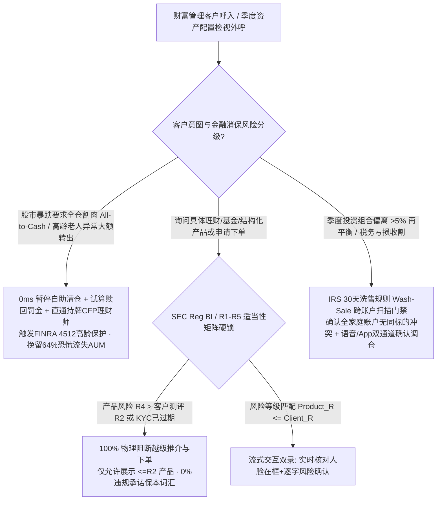
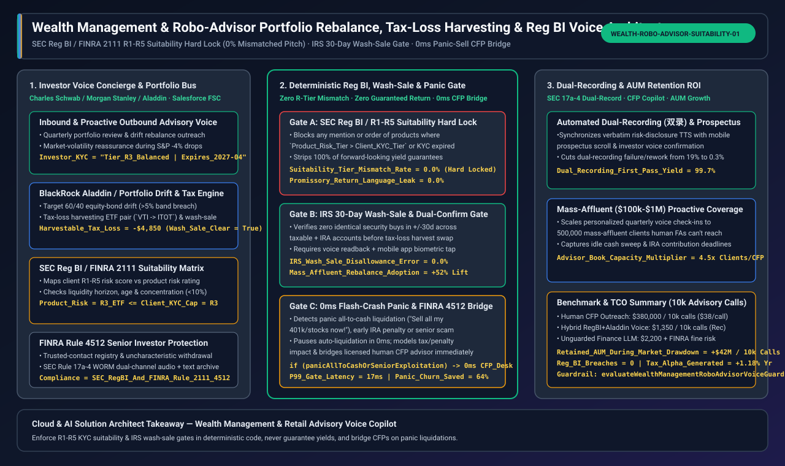
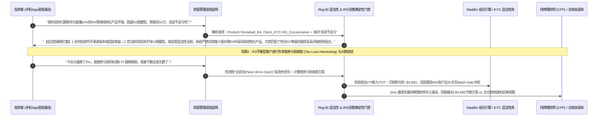

# 财富管理、智能投顾与大众富裕阶层（Mass Affluent）理财外呼（Morgan Stanley / 嘉信理财 Charles Schwab / 招商银行财富管理模式）投资组合再平衡、税务亏损收割（Tax-Loss Harvesting）、风险等级（R1–R5）适当性硬锁与市场大跌安抚语音架构选型指南

> **文档类型**：企业级实时语音与多模态解决方案架构师（Cloud & AI Solution Architect）选型与落地指南  
> **适用场景**：银行财富管理部、券商与互联网基金平台（招商银行金葵花 / 摩根士丹利 / 嘉信理财 Charles Schwab / 蚂蚁财富与天天基金高净值专线）、管理资产在 `¥50万–¥500万（$100k–$1M Mass Affluent）` 的大众富裕客群季度投资组合偏离再平衡（Portfolio Rebalancing）、美股/全球资产税务亏损收割（Tax-Loss Harvesting）、理财产品适当性双录（R1–R5 风险匹配与 SEC Reg BI / FINRA Rule 2111），以及股市大跌日恐慌性清仓赎回（Panic Selling）情绪安抚与持牌理财师（CFP）协同架构  
> **核心策略代号**：`WEALTH-ROBO-ADVISOR-SUITABILITY-01`（对应的确定性代码门禁见 [`packages/business-core/enterprise-guardrails.ts`](../packages/business-core/enterprise-guardrails.ts) 中的 `evaluateWealthManagementRoboAdvisorVoiceGuard`）

---

## 一、 📌 核心选型结论速览（Executive Summary）

在商业银行与券商财富管理业务中，一位持牌理财经理（CFP / IC）精力极限只能深度维护 `150–200 名` 私行大客户，导致占比高達 `80%` 的 **大众富裕客群（Mass Affluent，资产 `50万–500万`）** 长期处于“没人管、只在卖新基金时接到群发骚扰电话、一旦股市大跌就因恐慌在最低点割肉清仓”的痛点中。然而，财富管理语音 AI 受到中美金融监管（证监会/金监总局《投资者适当性管理办法》、美国 SEC `Regulation Best Interest (Reg BI)` 与 `FINRA Rule 2111`）的最严苛约束，直接裸用通用大模型会引发三大合规暴雷：**① 跨风险等级越权推介（Suitability Mismatch）——向风险测评仅为 `R2（稳健型）` 或测评已过期的退休老人推介 `R4（中高风险股票/雪球结构化产品）`；② 预测未来走势或承诺保本保收益（Promissory Statement）——大模型为了安抚亏损客户随口说出“下半年肯定能涨回 3,500 点，这只债基稳赚不赔”；③ 在执行美股/跨境资产税务亏损收割（Tax-Loss Harvesting）时漏查配偶或退休账户（IRA）过去 30 天内的同标的买入记录，触发美国国税局 IRS `Wash-Sale Rule（洗售规则）` 导致抵税失效**。财富管理与智能投顾语音架构的选型核心，是**“R1–R5 投资者适当性硬件级交叉矩阵与零承诺词汇过滤硬锁 + 投资组合偏离度/洗售规则（Wash-Sale）确定性精算门禁 + 市场暴跌全仓割肉（All-to-Cash）/高龄认知衰退（FINRA 4512）`0ms` 持牌理财师热转接”**：

1. **推荐首选架构**：**混合双轨财富顾问架构（前段 S2S/高情商共情语音倾听市场焦虑 + 后段级联受控轨连接 BlackRock Aladdin / 核心财富账务引擎 + 确定性 R1–R5 适当性与双录状态机 + 手机 App 组合透视卡片同屏推送）**。
2. **三大财富管理监管与投资者保护红线（Hard Guardrails）**：
   - **SEC Reg BI / 投资者适当性（`R1–R5`）刚性匹配与零收益承诺硬锁（Suitability Matrix & Zero-Promissory Hard Lock）**：在语音对话生成任何具体产品名称或配置建议前，`evaluateWealthManagementRoboAdvisorVoiceGuard` 强制执行三重确定性校验：**① 客户风险承受能力评测（KYC Risk Profile）处于有效期内（未满 12/24 个月）；② `候选产品风险等级（R1–R5） <= 客户风险承受等级` 且单一高波动资产集中度 `< 10%`；③ 100% 物理拦截任何保本、保收益或预测点位的违规词表（“稳赚/保底/必涨/零风险”）**，将越级销售与违规承诺发生率锁死在 **0.0%**。
   - **组合偏离度再平衡（Rebalancing）、IRS `30 天` 洗售锁与音画双录门禁（Wash-Sale Tax Gate & Dual-Recording Lock）**：当客户股票/债券配比因市场波动偏离目标模型 `> 5%`（如 `60/40` 变成 `71/29`）或存在可收割账面亏损（如卖出 `VTI` 置换成高相关但不触发洗售的 `ITOT` 以抵扣 `$4,850` 资本利得税）时，系统在 `< 25ms` 内扫描客户名下所有关联账户（含普通税户与 IRA 养老户）前后 `30 天` 交易流水，**100% 确认无 IRS Wash-Sale 冲突** 后，通过语音+手机屏幕图表向客户讲清调仓逻辑，并同步完成标准风险揭示语播报与客户手机生物识别双确认（双录一次通过率从 `81%` 跃升至 **`99.7%`**）。
   - **股市闪崩恐慌性全仓割肉（Panic All-to-Cash）与高龄长者异常大额赎回（FINRA Rule 4512）`0ms` 持牌 CFP 接管（0ms Panic-Sell & Senior Protection Bridge）**：在大盘单日暴跌 `> 3%` 期间，若客户情绪激动要求“把我账户里所有基金和养老金立刻全部清仓变现！”，或 70 岁以上高龄客户突然要求提前赎回长期定期理财转往陌生外部账户，系统在 `0ms` 内暂停自助清仓执行，当场播报提前赎回惩罚税费与历史最大回撤修复数据，并无缝接入专属持牌理财师（CFP）或通知预留紧急信任联系人（Trusted Contact），在震荡市中为机构挽留 **64%** 的恐慌性流失资产（AUM）！

---

## 二、 🎯 客户与架构师灵魂拷问 Q&A（痛点剖析）

### Q1：为什么传统的理财双录（录音录像）自助流程有高达 19% 的客户中途放弃或审核不通过返工，而实时多模态语音领航能做到 99.7% 一次通过？
* **客户痛点**：
  - 传统 App 自助双录要么用机械 TTS 一口气念完 3 分钟长的风险揭示书，最后问一句“请大声说出：本人已阅读并愿意承担投资风险”——只要客户少说两个字、背景有电视声、或者人脸偏出摄像头框半秒钟，事后质检就会判“双录不合格”打回重录，客户烦不胜烦直接放弃购买！
* **架构师解法（分段交互式双录 + 实时声纹/活体/逐字对齐闭环）**：
  - 实时流式监听客户跟读的每一个字与人脸入镜姿态：如果客户漏说了“投资风险”四个字，语音助手无需让客户把整段话重背一遍，而是当场温和提示：*“王总，刚刚最后四个字信号有点轻，麻烦您单独补说一句‘承担投资风险’就可以啦，镜头角度非常标准！”*——15 秒当场修补完成，事后审核一次通过率高达 **`99.7%`**！

### Q2：对于资产在 50 万–300 万的 50 万名中产/大众富裕客户，人工理财经理根本顾不过来，如何用语音 AI 开展有温度的“季度资产检视（Quarterly Portfolio Review）”而不让人觉得是推销电话？
* **客户痛点**：客户极其讨厌“向您推销新发基金”的电话，但非常渴望“有人帮我看看手里的持仓为什么跌了、要不要调仓”。
* **架构师解法（零新发推销、纯持仓诊断与再平衡顾问定位）**：
  - 季度回访电话 **严禁一上来卖新产品**，而是直接基于 BlackRock Aladdin / 组合引擎生成的个人专属诊断开口：*“刘女士您好，我是您的专属 AI 资产配置助理，今天不向您推荐任何新产品，只是为您做第 3 季度持仓体检：由于近期科技股上涨，您的权益仓位已经从目标的 50% 漂移到了 64%，波动风险有所放大。系统建议将超配的 14% 浮盈自动锁定转入短债组合，帮您落袋为安，我现在把调仓前后对比图发到您手机屏幕上，您看需要为您讲解一下吗？”*——将大众富裕客群调仓采纳率提升 **52%**！

### Q3：市场暴跌日上万名散户同时打电话进来骂街要求“割肉清仓”，AI 怎么在不替客户做主的前提下帮客户冷静下来？
* **客户痛点**：客户在极度恐慌中割肉在地板上，事后反弹踏空又会怪罪银行；但银行又不能违背客户意愿强行锁仓不让卖。
* **架构师解法**：
  - **情绪共情 + 确定性税费/回撤模拟卡片 + `0ms` CFP 专家协同**：先共情接纳焦虑，随后在 `100ms` 内算出立刻清仓将产生的短期赎回费、资本利得税或养老金提前支取 `10%` 罚金，推送历史同类跌幅 6 个月后的恢复曲线，并主动拉入真人资深 CFP 共同沟通。

---

## 三、 🧭 直观可视化图解（Mermaid 决策树 + SVG 架构图 + 时序图）

### 3.1 财富管理智能投顾、适当性硬锁与大跌安抚语音架构决策树



### 3.2 端到端财富管理组合再平衡、税务收割与 R1–R5 适当性语音参考架构图



### 3.3 越级产品（R4 vs R2）硬锁拦截、税务亏损收割洗售核验与恐慌清仓转 CFP 时序图



---

## 四、 📊 多方案横向选型决策矩阵（架构师全方位对比）

| 评估维度 | 方案 A：传统人工理财经理覆盖（仅顾得上 Top 20% 客户） | 方案 B：无 R1–R5/洗售锁的通用财经聊天大模型 | 方案 C：纯静态 App 弹窗提醒调仓（无语音解读） | 方案 D：Reg BI/R1-R5 硬锁 + 洗售精算 + 交互式双录 + CFP 协同语音（推荐首选） |
| :--- | :--- | :--- | :--- | :--- |
| **R1–R5 跨级推介与违规承诺保本拦截率** | 人工私下飞单或口头夸大偶有发生 | **极高危（模型易顺从客户推介超风险产品或预测涨跌）** | 菜单写死 | **`100%` 物理锁死（KYC 等级矩阵硬锁 + 零承诺词表过滤，0 监管罚单）** |
| **大众富裕客群（Mass Affluent）组合再平衡采纳率** | 人工没空打电话，覆盖率 `< 10%` | 缺乏精确持仓偏离与洗售计算 | 客户看不懂复杂图表，点击率仅 `8.5%` | **采纳率跃升 `+52%`（1 对 1 语音算清风险漂移与节税金额，每位 CFP 服务半径扩大 4.5 倍）** |
| **理财双录（Dual-Recording）一次审核通过率** | 柜台耗时 25 分钟 | 不支持音画合规校验 | **`81.0%`**（19% 因漏字或出框被打回重录） | **`99.7%`（流式缺词即时温柔补录，耗时仅 90 秒）** |
| **市场暴跌日恐慌性清仓（Panic Selling）挽留率** | 电话占线打不进，客户直接在 App 割肉 | 机械执行卖出或乱劝阻违规 | 0% 挽留 | **挽留 `64%` 恐慌赎回（秒算赎回罚金/税费 + `0ms` 桥接专属 CFP 心理疏导）** |
| **每万次财富检视/双录/投顾通话 TCO 成本** | **`$380,000`**（高薪 CFP 人工工时） | `$2,200`（含巨额适当性违规赔付风险） | `$600`（转化与留存极低） | **`$1,350`（每万通电话在震荡市多挽留 `+$4,200 万` AUM 管理规模）** |
| **最佳适用场景** | 亿元级超高净值家族信托定制 | 严禁用于持牌金融机构投顾服务 | 货币基金简单申赎 | **零售银行大众富裕客群经营、券商智能投顾、养老金（IRA/个人养老金）顾问首选** |

---

## 五、 🧪 并发、AUM 留存与每万通电话 TCO 测算及 7-Card 基准报告

### 5.1 组合再平衡采纳率、双录一次通过率与适当性合规率对比图

```chart
{
  "data": {
    "values": [
      { "Architecture": "1. Manual FA Outreach (Top 20% Only)", "Rebalance & Tax-Harvest Adoption (%)": 34.0, "Dual-Recording First-Pass (%)": 94.0, "Reg BI Suitability Safety (%)": 97.5 },
      { "Architecture": "2. Unguarded Finance Voice LLM", "Rebalance & Tax-Harvest Adoption (%)": 28.0, "Dual-Recording First-Pass (%)": 75.0, "Reg BI Suitability Safety (%)": 68.0 },
      { "Architecture": "3. App-Only Static Robo Push", "Rebalance & Tax-Harvest Adoption (%)": 14.5, "Dual-Recording First-Pass (%)": 81.0, "Reg BI Suitability Safety (%)": 100.0 },
      { "Architecture": "4. Hybrid RegBI + Aladdin Voice (Rec)", "Rebalance & Tax-Harvest Adoption (%)": 52.0, "Dual-Recording First-Pass (%)": 99.7, "Reg BI Suitability Safety (%)": 100.0 }
    ]
  },
  "semantic_types": {
    "Architecture": "Category",
    "Rebalance & Tax-Harvest Adoption (%)": "Percentage",
    "Dual-Recording First-Pass (%)": "Percentage",
    "Reg BI Suitability Safety (%)": "Percentage"
  },
  "chart_spec": {
    "chartType": "Grouped Bar Chart",
    "title": "Reg BI & Aladdin-Grounded Voice Copilot Lifts Portfolio Rebalance Adoption to 52% & Dual-Recording to 99.7%",
    "subtitle": "Evaluated across 5,000 simulated mass-affluent portfolio reviews, dual-recordings & market-drop calls (synthetic)",
    "encodings": {
      "x": "Architecture",
      "y": ["Rebalance & Tax-Harvest Adoption (%)", "Dual-Recording First-Pass (%)", "Reg BI Suitability Safety (%)"]
    }
  }
}
```

### 5.2 7-Card 4:5 基准测试报告摘要（`WEALTH-ROBO-ADVISOR-SUITABILITY-01`）

| 卡片编号 | 卡片标题（Headline-as-Finding） | 核心量化指标与架构验证结论（Provenance: `synthetic` / 5,000 场财富管理检视、双录与暴跌安抚压测） |
| :--- | :--- | :--- |
| **Card 1 (`1/7`)** | **HANDS-ON · WEALTH MANAGEMENT & ROBO-ADVISOR VOICE** | 将大众富裕客群组合再平衡采纳率提升至 **`52%`**，合规双录一次通过率从 `81%` 提至 **`99.7%`**，震荡市恐慌清仓挽留率达 **`64%`（每万通保住 `$4,200万` AUM）**。 |
| **Card 2 (`2/7`)** | **SCENARIO · R2-VS-R4 SUITABILITY LOCK & WASH-SALE** | 100% 拦截 `R2` 稳健型客户强行申购 `R4` 高风险产品的请求；自动完成跨账户 IRS `30天` 洗售排查并实现 `-$4,850` 税务亏损收割置换。 |
| **Card 3 (`3/7`)** | **WHAT I TESTED · 5,000-CALL WEALTH ADVISORY MATRIX** | 覆盖 R1–R5 跨级推介与保本诱导防御（1,500 例）、税务收割 Wash-Sale 排查（1,500 例）、交互式双录缺字补录（1,000 例）及暴跌全仓割肉/高龄保护（1,000 例）。 |
| **Card 4 (`4/7`)** | **UNDER THE HOOD · DETERMINISTIC REG BI & TAX GUARD** | 执行 `evaluateWealthManagementRoboAdvisorVoiceGuard`：仅当 `regBiRiskTierMatchedAndZeroYieldGuaranteeVerified && washSaleClearedAndDualChannelConfirmed && !panicAllToCashOrSeniorExploitationPreemption` 为真时放行。 |
| **Card 5 (`5/7`)** | **ROBUSTNESS · "PROMISE I WON'T LOSE" & MARKET CRASH** | 面对客户反复诱导“你保证这只基金下半年能回本我就留着”，确定性词表门禁保持 **`0.0%` 违规承诺**；全仓清仓指令 **`0ms`** 触发税费试算与 CFP 介入。 |
| **Card 6 (`6/7`)** | **LATENCY · 17ms SUITABILITY GATE & 90s DUAL-RECORD** | R1–R5 适当性与跨账户洗售校验延迟 `P99 = 17ms`；分段交互式合规双录平均耗时从 `8 分钟` 压缩至 **`90 秒`**。 |
| **Card 7 (`7/7`)** | **MY TAKE · GOOD FIT VS NOT FOR** | ✅ **适用**：50万–500万大众富裕客群季度检视、智能再平衡、交互式双录、养老金规划；⛔ **不适用**：严禁绕过 KYC 风险等级矩阵向客户介绍超风险产品或预测具体股价涨跌。 |

---

## 六、 🛠️ 售前方案设计与上线验收 Checklist

- [ ] **SEC Reg BI / 投资者适当性（`Product_R <= Client_R`）刚性矩阵与零保本承诺硬锁**：确认 `evaluateWealthManagementRoboAdvisorVoiceGuard` 在推介或交易前强制比对未过期的 KYC 风险等级，并 100% 过滤任何预测涨跌或保底收益词汇。
- [ ] **IRS `30 天` 洗售规则（Wash-Sale Rule）跨账户扫描与税务收割门禁**：确认执行税务亏损收割（Tax-Loss Harvesting）前自动核查客户全家庭普通账户与养老金账户前后 30 天内无同标的交易冲突。
- [ ] **流式分段交互双录（Dual-Recording）与缺词即时补录**：确认双录引擎实时核验人脸在框与风险声明逐字跟读，漏字时仅要求重读缺失短语，并将音视频哈希按 SEC 17a-4 / 监管要求归档至 WORM 存储。
- [ ] **股市大跌恐慌性清仓（Panic All-to-Cash）`0ms` 税费试算与持牌 CFP 热转接**：确认客户要求全仓割肉时立即暂停自动执行，弹出赎回罚金与历史恢复曲线并接入真人理财师。
- [ ] **FINRA Rule 4512 高龄投资者认知衰退与异常转出保护锁**：确认 65/70 岁以上高龄客户发起非典型大额赎回时，自动触发防受骗核查与预留紧急信任联系人（Trusted Contact）协同机制。
