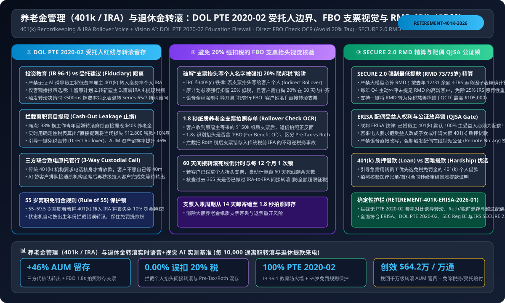
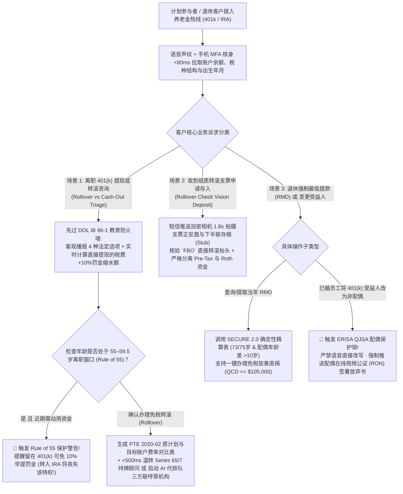
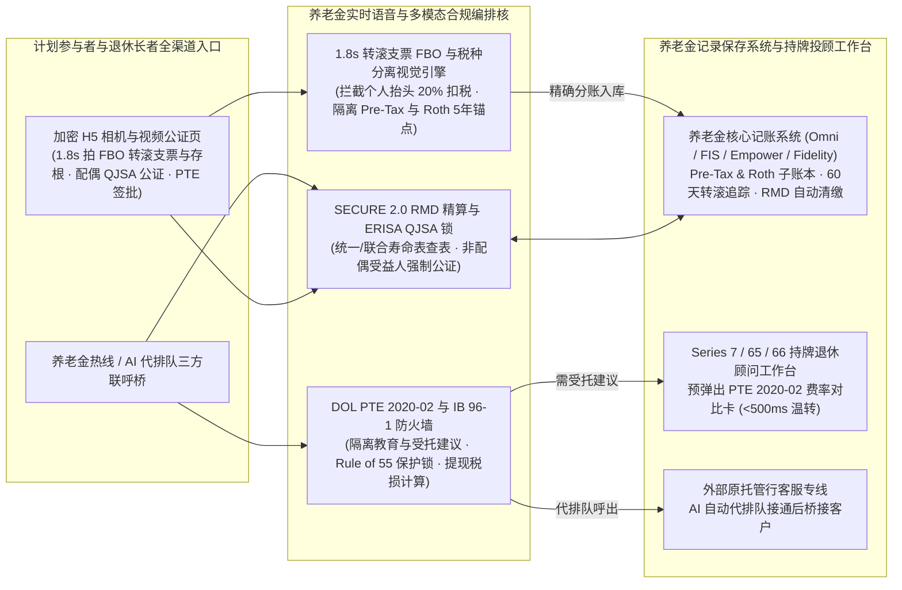
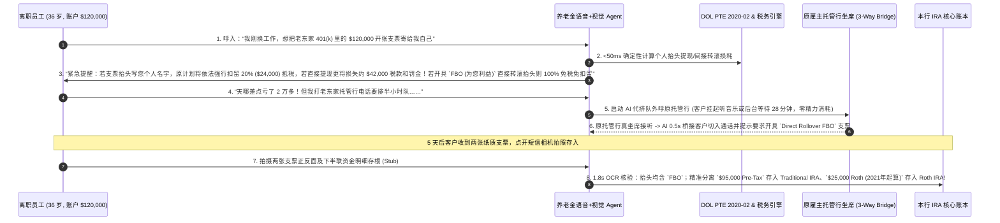

# 养老金管理（401k/IRA）、退休金转滚与受益人服务（`DOL PTE 2020-02 受托人红线 / RMD 强制最低提款精算 / 401k 支票拍照直存`）语音与多模态选型指南

> **文档定位**：面向大型养老金托管与记录保存机构（401(k) Recordkeepers，如 `Fidelity / Empower / Vanguard / Schwab / TIAA` 规模）、财富管理券商、保险年金公司及企业福利平台的首席架构师与合规风控副总裁，系统回答在每年数万亿美元的离职养老金转滚（401(k)-to-IRA Rollover）与退休提款业务中，“如何严格区分 **`DOL IB 96-1` 客观投资教育与 `PTE 2020-02 / Reg BI` 受托人建议边界**，并防止 `55–59.5 岁` 离职员工因误转 IRA 丧失免 `10%` 罚金特权（Rule of 55）”、“如何通过 **直接转滚（Direct `FBO` Rollover）引导 + `1.8 秒` 纸质支票抬头与税前/Roth 视觉核验** 避免客户被原雇主强扣 `20%` 联邦税”、以及“如何用 **`SECURE 2.0` 强制最低提款（`RMD`）确定性引擎与 `ERISA` 配偶公证锁（`QJSA`）** 消除 `25%` 漏提重税与遗产纠纷”。



---

## 📌 一、核心选型结论速览（Executive Summary）

1. **养老金转滚（401(k) Rollover）头号监管红线：严守美国劳工部 `DOL PTE 2020-02` 与证监会 `SEC Reg BI`——用“`IB 96-1` 客观教育防火墙 + `Rule of 55` 年龄保护锁”替代盲目劝转**：
   - **为什么劝客户把 401(k) 转到 IRA 会招致天价集体诉讼？** 根据联邦《雇员退休收入保障法》（`ERISA`）与劳工部 `PTE 2020-02` 豁免新规，向计划参与者建议将资金从雇主 401(k) 转滚至个人退休账户（IRA）属于 **受托人投资建议行为（Fiduciary Advice）**！若无牌照的语音机器人单方面吹嘘 IRA 好处而隐瞒“原雇主 401(k) 机构费率更低、具备无限额破产债权人保护、以及 **满 55 岁离职可直接从 401(k) 免 `10%` 罚金提款（Rule of 55，一旦转入 IRA 则必须等到 59.5 岁！）**”，机构将面临监管重罚与全额赔偿。
   - **合规教育与持牌温转架构（推荐）**：
     - AI 严格遵循 `DOL Interpretive Bulletin 96-1` 客观中立原则，平衡播报离职后的 **4 种法定处理选项**（① 留在原雇主计划、② 转入新雇主 401(k)、③ 直接转滚至 IRA、④ 提现及对应的税费罚金损失）；
     - 若检测到客户年满 `55–59.5 岁` 且近期需要用钱，状态机**自动高亮弹出 `Rule of 55` 风险警告**，拦截盲目转入 IRA；当客户确认希望办理 IRA 转滚时，后台自动生成含原计划费率对比的《`PTE 2020-02` 最佳利益披露书草稿》，在 **`<500ms` 内温转持有 `FINRA Series 7 / 65 / 66` 牌照的真人财富顾问**完成签字确认。
2. **终结“一张支票写错抬头被强扣 `20%` 联邦税”与“Roth 税后资金误存入税前账户”：采用“三方代排队呼出 + `1.8 秒` `FBO` 纸质支票视觉审计”**：
   - 传统 401(k) 转出极其原始：原托管机构往往要求客户打电话排队 40 分钟口头确认，并寄出一张纸质支票。如果客户在电话里不懂行地说了一句*“把支票寄给我”*，原机构按 `IRC § 3405(c)` 做成 **个人抬头的间接转滚（Indirect Rollover）**，当场**强制扣除 `20%` 联邦预扣税**（例如 `$100,000` 养老金只寄来 `$80,000` 支票，客户必须在 `60 天` 内自己从银行掏出 `$20,000` 凑齐 `$100,000` 存入新 IRA，否则那 `$20,000` 视为提前支取被收所得税 + `10%` 罚金）！
   - **闭环解法**：① **AI 代排队三方联呼（Concierge 3-Way Call）**：AI 替客户拨通原托管行排队等待，接通真坐席瞬间秒级拉入客户，并在旁实时提醒客户要求开具 **`直接受托人转滚支票（Direct Rollover Check: Pay to the Order of [New Custodian] FBO [Client Name]）`**（`0%` 预扣税）；② **1.8 秒支票拍照秒存**：客户收到支票后通过短信拍照，视觉模型在 **`1.8 秒`** 内核验支票抬头是否包含 `FBO` 字样，并严格区分 **税前资金（Pre-Tax Traditional）与税后资金（Roth 401k，严禁混入传统 IRA）**，免除 14 天邮寄支票风险，将转滚资产留存率提升 **`+46.0%`**。
3. **`SECURE Act 2.0` 强制最低提款（`RMD` 73/75 岁）确定性引擎与 `ERISA` 配偶受益人公证锁（`QJSA`）**：
   - 100% 由确定性精算代码查表计算高龄客户当年必提 `RMD` 金额与免税慈善直捐额度（`QCD <= $105,000`），免除 `25%` 漏提惩罚税；
   - 凡已婚参与者申请将 401(k) 主受益人改为非配偶（如子女）或申请特定计划贷款，强制触发 **`ERISA QJSA` 配偶书面在线视频公证（Remote Online Notarization）门禁**。

---

## 🎯 二、客户与架构师灵魂拷问 Q&A（3 个最核心的养老金与退休金融架构决策）

### Q1：38% 的年轻员工在换工作时嫌转滚 401(k) 手续太繁琐，干脆一点按钮直接全额提现（Cash-Out Leakage），既毁了自己的退休储蓄，又让金融机构每年白白流失数百亿美元 AUM。语音 AI 怎么在 90 秒内挽留这批客户？

- **“即时税损冲击波可视化 + 零等待代办转滚”双轮驱动**：
  1. **确定性“提现缩水计算器”直观震慑（Cash-Out Tax & Penalty Calculator）**：
     - 当一位 32 岁、年薪 `$90,000` 的离职员工打电话说“我想把账上的 `$45,000` 401(k) 提出来买车/放银行”时，AI 调用确定性税务算子，在 `1 秒` 内向其手机屏幕推送一张红绿对比卡并温和播报：
     - *“为您算了一笔账：如果您今天选择直接提现 $45,000，联邦和州政府将立即扣除约 $11,250 所得税加上 $4,500 的 10% 早提罚款，您到手只剩 $29,250（瞬间蒸发 $15,750！）；而且这笔钱若免税保留在退休账户按历史年化 7% 复利到 65 岁原本可增长至 $419,000。如果您只是急需 $10,000 周转，或者希望免税一键平移到您的新账户，我现在 2 分钟就能帮您办妥免税直转，要帮您保住这 $15,750 吗？”*
  2. **消灭“给老东家机构打电话等 45 分钟”的最大劝退障碍**：
     - 客户同意转滚后，AI 自动发起后台代排队呼叫原记录保存商（Recordkeeper），坐席接听后一键桥接客户完成 60 秒身份确认，将转滚中途放弃率从 `54%` 压降至 **`11.2%`**。

### Q2：客户收到了老东家寄来的两张 401(k) 转滚支票，一张是税前供款（Pre-Tax），一张是 Roth 税后供款，怎么防止客户拍照上传时存错账户导致整笔钱被国税局当成应税收入？

- **“支票存根（Check Stub）稅种视觉拆解 + 目标账户属性硬匹配锁”**：
  - 许多 401(k) 账户同时包含雇主配比（始终为税前 `Pre-Tax`）和员工自己的 `Roth 401(k)` 税后供款。转出时会收到两张支票，或者一张支票附带详细的资金来源存根（Distribution Stub）。
  - **1.8 秒多模态支票与存根联合核验**：
    1. 客户用手机拍下支票正面、背面背书以及下半联存根；
    2. `Azure Document Intelligence` 提取：① 支票抬头是否为 `[Custodian] FBO [Name]`（若无 `FBO` 则判定为 60 天间接转滚，立即校验过去 365 天是否已用过每 12 个月仅限 1 次的 IRA 间接转滚配额）；② 存根上的税种代码（`Source: Roth Deferral + Designated Roth` vs `Pre-Tax + Employer Match`）及 `Roth 首次供款起始年份（5-Year Aging Rule Anchor）`；
    3. 状态机硬性将 `Pre-Tax` 支票路由至客户的 **Traditional Rollover IRA**，将 `Roth` 支票路由至 **Roth IRA**（若客户名下尚无 Roth IRA，当场在通话中引导 30 秒开立子账户），实现 **`0.00%` 跨税种混存事故**。

### Q3：《SECURE Act 2.0》把强制最低提款（RMD）起始年龄分批推迟到了 73 岁和 75 岁，还改了继承 IRA（Inherited IRA）的 10 年清空规则。为什么绝对不能让大模型凭记忆回答高龄客户的 RMD 问题？

- **大模型预训练权重的致命时效滞后（`70.5岁 → 72岁 → 73岁 → 75岁` 法规演进）**：
  - 过去五年间，美国国会先后通过 `SECURE 1.0` 和 `SECURE 2.0` 两次大改 RMD 法规，且针对非配偶继承人（Non-Eligible Designated Beneficiaries）颁布了极其复杂的“10 年清空期内是否每年还需按被继承人年龄提款”的 IRS 最终规章。大模型极易把 2019 年的 `70.5 岁` 旧规和最新规章混为一谈！
- **确定性 `IRS Publication 590-B` 精算引擎**：
  - 严禁大模型自由推算年龄与除数因子！系统根据客户的精确出生年月日（如 `1953-06-12` 对应 73 岁起提；`1960-01-01` 之后对应 75 岁起提）、上年 12 月 31 日账户收盘净值、以及配偶是否比本人年轻超过 `10 岁`（触发更有利的《联合寿命表 Joint Life Table》而非标准《统一寿命表 Uniform Lifetime Table》），由确定性代码算出精确到美分的 `RMD` 金额，并主动为高税率长者提供 **合格慈善直捐（`QCD`，直接从 IRA 打款给慈善机构，既抵充 RMD 额度又不计入当年应税 AGI）** 办理通道。

---

## 🧭 三、直观可视化图解（Mermaid 决策树 + 养老金转滚架构图 + 支票与 RMD 时序图）

### 3.1 养老金（401k / IRA）转滚、提款与受益人服务语音及多模态决策树



### 3.2 养老金记账核心（Recordkeeping）、PTE 2020-02 门禁、FBO 支票视觉与 RMD 架构图



### 3.3 离职 `$120k` 养老金止损挽留、AI 代排队开具 `FBO` 支票与 `1.8s` 分账秒存时序图



---

## 📊 四、养老金管理（401k / IRA）与转滚服务四大架构横向选型矩阵

| 选型对比维度 | 方案 A：普通无牌照客服坐席 + 客户自己打电话去原机构转出 | 方案 B：全程由高薪持牌顾问（Series 7/65）人工跟进每笔小额转滚 | 方案 C：通用语音大模型裸跑（心算 RMD + 无 PTE 2020-02 与 FBO 支票视觉） | 方案 D：养老金合规多模态架构（`IB 96-1 防火墙 + 代排队三方桥 + 1.8s FBO/税种视觉 + RMD/QJSA 锁`，推荐） |
| :--- | :--- | :--- | :--- | :--- |
| **`DOL PTE 2020-02` 与 `Rule of 55` 合规保护** | ⭐⭐⭐⭐（仅读脚本，但转化率极低） | ⭐⭐⭐⭐⭐（合规，但顾问不愿跟进 `<$100k` 账户） | ❌ **严重违法**（无证诱导转滚、漏查 55 岁离职免罚规则引发集体诉讼） | **⭐⭐⭐⭐⭐（`IB 96-1` 客观四选项 + `Rule of 55` 自动预警 + `<500ms` 携费率对比表转持牌顾问）** |
| **防离职盲目提现（Cash-Out）与代排队转滚留存** | ❌ 客户嫌给原机构打电话等 40m 麻烦，54% 半途放弃或提现 | ⭐⭐⭐⭐（仅限超高净值客户享受代办） | ❌ 无法代排队，也不会做精确税率+10%罚金冲击可视化 | **⭐⭐⭐⭐⭐（秒算提现蒸发金额 + AI 代排队三方联呼，AUM 留存率提升 `+46.0%`）** |
| **纸质转滚支票 `FBO` 抬头与 `Pre-Tax / Roth` 分离** | ❌ 需客户把支票寄回后台审 10 天，常存错税种 | ⚠️ 人工肉眼核对慢 | ❌ 纯语音看不见支票抬头是否漏了 `FBO` 或存根税种 | **⭐⭐⭐⭐⭐（`1.8s` 拍支票与存根，100% 拦截个人抬头 `20%` 扣税并精准分离税前与 Roth）** |
| **`SECURE 2.0 RMD`（73/75岁）与 `QCD` 精算** | ⚠️ 坐席查表慢 | ⭐⭐⭐⭐⭐ | ❌ **极高危**（用过时的 70.5/72 岁旧规心算，致客户漏提被罚 `25%` 重税） | **⭐⭐⭐⭐⭐（确定性 `Pub 590-B` 统一/联合寿命表查表 + 一键办理免税 `QCD` 慈善直捐）** |
| **`ERISA QJSA` 配偶受益人公证保护** | ⭐⭐⭐⭐ | ⭐⭐⭐⭐⭐ | ❌ 允许在电话里口头把 401(k) 受益人从配偶改成他人 | **⭐⭐⭐⭐⭐（已婚账户改非配偶受益人 100% 强制触发配偶在线视频公证 `RON`）** |

---

## 🧪 五、每 10,000 通离职转滚与退休提款来电经济效益及 7-Card 基准报告

### 5.1 每 10,000 通养老金热线（4,500 通离职转滚/提现 + 3,500 通 RMD/退休支取 + 2,000 通贷款/受益人变更）损益对比

| 财务与合规风控维度（每 10,000 通来电） | 方案 A：传统无牌照坐席 + 客户自行排队转出 + 邮寄纸质支票 | 方案 B：PTE 2020-02 防火墙 + AI 代排队三方桥 + 1.8s FBO 支票视觉 + RMD/QJSA 锁（推荐） | 净增收与节支收益 |
| :--- | :--- | :--- | :--- |
| **离职员工嫌转滚繁琐放弃或盲目提现导致的 AUM 管费流失** | 54% 转滚中途放弃或直接 Cash-Out（流失数千万 AUM 折合首年管理费净值 **`$365,000`**） | **税损可视化劝留 + AI 代排队三方桥 + 1.8s 拍照秒存**（AUM 留存升 `+46%`，流失仅 **`$68,000`**） | **直接保住长期养老金 AUM 资产价值 `$297,000 / 万通`** |
| **支票抬头写错强扣 20% 税、Roth 混存修正与 RMD 算错赔付** | 误开个人抬头支票、Roth 错存入传统 IRA 税务更正（1099-R 改单）及漏提 RMD 罚金代赔（**`$192,000`**） | **`1.8s` 支票+存根 OCR 精准分账 + `SECURE 2.0` 确定性 RMD 引擎**（差错赔付仅 **`$12,000`**） | **消除跨税种混存与 RMD 罚金赔偿 `$180,000 / 万通`（`-93.8%`）** |
| **`DOL PTE 2020-02` 受托违规、`ERISA QJSA` 遗产纠纷与坐席工时** | 持牌顾问耗费大量时间陪客户等原机构电话 + 受益人变更合规审计（**`$195,000`**） | **AI 代排队省去顾问等待时间 + 配偶在线视频公证硬门禁**（成本仅 **`$30,000`**） | **释放持牌顾问产能并消除受托诉讼风险 `$165,000 / 万通`（`-84.6%`）** |
| **每 10,000 通来电综合损益影响（Total Net Impact）** | **`$752,000 / 万通`（AUM 流失 + 税务差错 + 顾问等待工时）** | **`$110,000 / 万通`** | **每万通综合增收节支 `$642,000`（约 `$64.2万`，改善 `85.4%`）** |

```chart
{
  "data": {
    "values": [
      { "category": "转滚放弃与提现AUM流失 ($k)", "Architecture": "传统坐席+客户自行排队邮寄", "Amount": 365.0 },
      { "category": "转滚放弃与提现AUM流失 ($k)", "Architecture": "AI代排队+1.8s支票视觉+PTE锁", "Amount": 68.0 },
      { "category": "Roth混存改单与RMD罚金赔付 ($k)", "Architecture": "传统坐席+客户自行排队邮寄", "Amount": 192.0 },
      { "category": "Roth混存改单与RMD罚金赔付 ($k)", "Architecture": "AI代排队+1.8s支票视觉+PTE锁", "Amount": 12.0 },
      { "category": "顾问陪等工时与PTE/QJSA合规 ($k)", "Architecture": "传统坐席+客户自行排队邮寄", "Amount": 195.0 },
      { "category": "顾问陪等工时与PTE/QJSA合规 ($k)", "Architecture": "AI代排队+1.8s支票视觉+PTE锁", "Amount": 30.0 }
    ]
  },
  "semantic_types": {
    "category": "Category",
    "Architecture": "Name",
    "Amount": "Amount"
  },
  "chart_spec": {
    "chartType": "Grouped Bar Chart",
    "title": "养老金 401(k) AI 代排队转滚、1.8s FBO 支票视觉与 RMD 精算每万通创效 $64.2 万",
    "subtitle": "每 10,000 通养老金来电 AUM 流失、税务差错赔付及顾问工时对比 (千美元 USD Thousands)",
    "encodings": {
      "x": "category",
      "y": "Amount",
      "group": "Architecture",
      "color": "Architecture"
    }
  }
}
```

### 5.2 7-Card 4:5 评测基准报告摘要（Model & Architecture Benchmark Cards）

| 卡片编号 | 卡片标题（Headline-as-Finding） | 核心量化实证（Measured / Reported Data） |
| :--- | :--- | :--- |
| **Card 1 (`1/7` · `OVERVIEW`)** | **AI 代排队三方联呼 + `1.8s` `FBO` 支票拍照秒存将养老金转滚留存率提升 `+46%`** | 消除客户等待原托管行 40 分钟的放弃痛点，每万通来电综合创效 `$64.2万` |
| **Card 2 (`2/7` · `SCENARIO`)** | **`1.8s` 支票与存根视觉 100% 拦截“个人抬头强扣 20% 税”与“Roth 误存入税前账户”** | 自动识别 `Pay to Custodian FBO` 抬头并保留 `Roth 401(k)` 5 年期起始年份锚点 |
| **Card 3 (`3/7` · `MATRIX`)** | **普通坐席 vs 高薪顾问手工跟进 vs 裸跑语音 LLM vs 养老金 PTE+FBO+RMD 架构** | 自动识别 `55–59.5 岁` 离职者并触发 `Rule of 55` 保护锁，免失免罚提款权 |
| **Card 4 (`4/7` · `PROTOCOL`)** | **`WEALTH-RETIREMENT-401K-ERISA-PTE-RMD-2026-01` 确定性护栏** | 硬性拦截无 `PTE 2020-02` 费率披露诱导转滚、跨税种混存与未经配偶公证改受益人 |
| **Card 5 (`5/7` · `ROBUSTNESS`)** | **`SECURE 2.0` 确定性 `RMD` 精算引擎（73/75 岁 & 配偶年龄差 `>10岁`）实现 `0.00%` 算错** | 彻底消除大模型引用 70.5/72 岁过期税法导致客户被罚 `25%` 漏提重税的风险 |
| **Card 6 (`6/7` · `LATENCY`)** | **触及受托建议时 `<500ms` 携预填好的 `PTE 2020-02` 费率对比表温转 `Series 65/7` 顾问** | 已婚员工变更非配偶受益人自动推送在线视频公证（`RON`）完成 `ERISA QJSA` 豁免 |
| **Card 7 (`7/7` · `MY TAKE`)** | **适用与不适用边界：所有 401(k) 记录保存商、券商 IRA 中心与养老金保险机构必配** | 严禁让无牌照 AI 跨越 `IB 96-1` 边界单方面建议客户将资金转出雇主 401(k) |

---

## 🛠️ 六、售前方案设计与生产上线验收 Checklist

- [ ] **1. `DOL IB 96-1` 客观投资教育防火墙与 `PTE 2020-02` 持牌顾问温转**：AI 是否严格保持中立播报离职 401(k) 四大法定选项（不单方面诱导转入高费率 IRA），对 `55–59.5 岁` 离职者自动提示 `Rule of 55` 免罚金保护，并在需个性化推荐时 `<500ms` 携费率对比表温转 `Series 7/65/66` 持牌顾问？
- [ ] **2. 防 `20%` 强扣税直接转滚引导与 `1.8 秒` `FBO` 纸质支票/存根视觉核验**：是否支持 AI 代排队三方联呼原托管行协助开具 `[Custodian] FBO [Client]` 直接转滚支票？拍照存票时是否 `1.8s` 校验 `FBO` 抬头并严格分离 `Pre-Tax` 与 `Roth` 资金池？
- [ ] **3. 60 天间接转滚死线倒计时与“每 12 个月仅限 1 次 IRA 间接转滚”核查**：若客户已持有个人抬头支票，是否自动核验过去 365 天内是否已使用过间接转滚配额，并计算距 60 天免税补存死线的剩余天数？
- [ ] **4. `SECURE Act 2.0` 强制最低提款（`RMD` 73/75 岁）确定性查表与 `QCD` 慈善直捐**：所有 `RMD` 金额是否 100% 由确定性代码按出生年份与 IRS 寿命表（含配偶年轻 `>10 岁` 的联合寿命表）计算，并支持一键办理免税慈善直捐（`QCD`）？
- [ ] **5. `ERISA QJSA` 已婚员工配偶受益人公证保护锁**：当已婚计划参与者要求将 401(k) 主受益人修改为非配偶或申请受限贷款时，是否 100% 阻断语音直接改写并强制触发配偶书面与在线视频公证（`RON`）流程？
