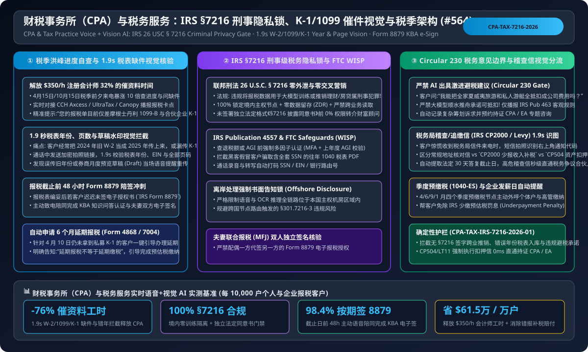
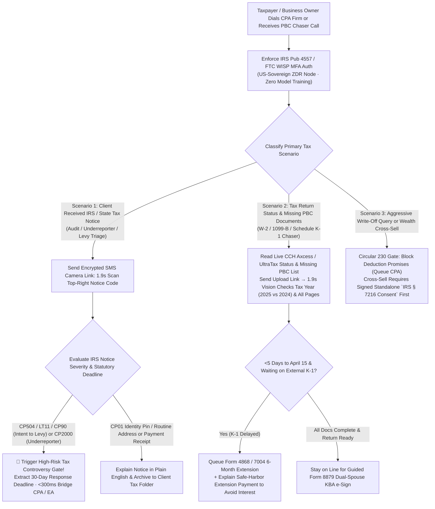
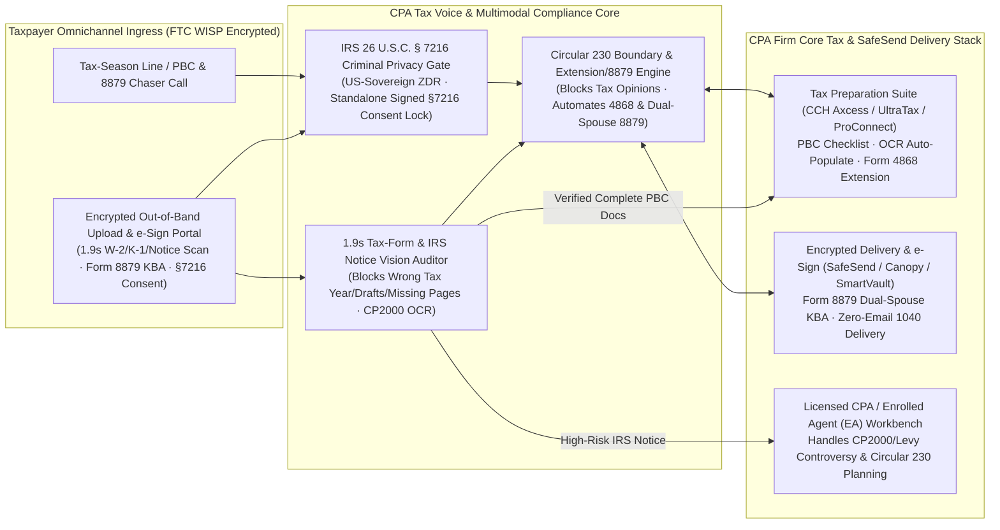

# CPA Firms, Tax Preparation & Accounting Services (`IRS 26 USC § 7216 Consent / K-1 & 1099 Document Chaser Vision / Tax-Season Surge Triage`) Voice & Multimodal AI Architecture Selection Guide

> **Document Scope**: Built for Managing Partners at CPA & Accounting Firms, Tax Technology CTOs, Wealth & Family Office Tax Directors, and Practice Management Architects (`CCH Axcess / Thomson Reuters UltraTax / Intuit ProConnect / Canopy / SafeSend`), this guide explains how to reclaim **`76%` of the non-billable hours `$350/hr` CPAs lose chasing missing `W-2 / 1099-B / Schedule K-1` documents** during the April 15 and October 15 tax-season surges, how **In-Call `1.9-Second` Tax-Form Vision** catches wrong-year uploads (`2024 vs 2025`), `Preliminary Draft` watermarks, and missing `K-1 Box 20` supplemental pages live on the phone, how to enforce **federal criminal tax privacy compliance under `IRS 26 U.S.C. § 7216` and `FTC Safeguards (Pub 4557 WISP)`**, and how to automate **Guided `Form 8879` KBA e-File Signatures (`98.4%` on-time completion)**.



---

## 📌 1. Executive Summary

1. **Reclaim `76%` of Non-Billable CPA Chaser Hours During Tax Season via "Live PBC Workflow Readback + In-Call `1.9s` `W-2 / 1099-B / Schedule K-1` Vision Validation"**:
   - **The Tax-Season Bottleneck**: Over `70%` of a CPA firm's inbound calls hit in the 8 weeks preceding April 15 and October 15. Senior CPAs (`$250–$450/hr`) waste `32%` of their peak capacity answering *"Where is my tax return?"* when the return is actually blocked on the **Prepared-by-Client (`PBC`) checklist** awaiting a missing **brokerage `Form 1099-Composite` or partnership `Schedule K-1`**. Worse, **`24%` of client-uploaded tax documents are unusable**—clients upload last year's `2024 W-2` instead of `2025`, upload a brokerage account summary missing the 10-page `1099-B` capital-gains detail, or upload a watermarked `Draft` K-1!
   - **Real-Time Voice + `1.9s` Tax-Form Vision Chaser (Recommended)**:
     - The Voice Agent reads live `CCH Axcess / UltraTax / Canopy` workflow status (*"Your 1040 return is 90% prepared and is only waiting on your Charles Schwab 1099-B and Apex Partners Schedule K-1"*);
     - While on the call, the agent texts an encrypted upload link: **`Azure Document Intelligence` inspects the photo/PDF in `1.9 seconds`—verifying the exact Tax Year (`2025`), checking for `Draft` watermarks, and confirming all `Schedule K-1 Box 1–20` footnotes are attached**—prompting the client to snap missing pages before hanging up.
2. **Federal Criminal Tax Privacy Rule #1 (`26 U.S.C. § 7216` & `Treas. Reg. § 301.7216-3`): Enforce "US-Sovereign Zero-Training Execution + Standalone Written `§ 7216` Consent Before Any Cross-Sell"**:
   - Unlike general commercial data, tax return information (`TRI`) is governed by a **federal criminal statute (`26 U.S.C. § 7216`)**: unauthorized disclosure or use of tax return information carries criminal misdemeanor penalties (`$1,000 fine + up to 1 year imprisonment per count`)!
   - **Two Non-Negotiable `§ 7216` Architectural Locks**:
     - **Lock 1 (US-Sovereign Zero-Data-Retention & Zero Model Training)**: All STT, LLM, and OCR processing must execute strictly inside **US domestic sovereign regions with Zero Data Retention (`ZDR`) and zero model training**—routing tax audio to an undisclosed offshore processor or training pool is a federal violation;
     - **Lock 2 (Standalone Signed `§ 7216` Consent Before Wealth/Mortgage Referrals)**: If the AI sees on a tax return that a client had a `$2M` liquidity event or high mortgage interest, it is **100% prohibited from sharing that tax data with the firm's wealth-management or lending arm** unless the taxpayer first signs a **standalone, statutorily formatted `IRS § 7216 Consent to Use/Disclose`** document.
3. **48-Hour Deadline Sprint: Guided `Form 8879` Dual-Spouse KBA e-Signing (`98.4%` On-Time) + `1.9s` `IRS Notice CP2000 / CP504` Escalation**:
   - Guides clients (and both spouses independently on `Married Filing Jointly [MFJ]` returns) through **Knowledge-Based Authentication (`KBA`) on `IRS Form 8879`** (`SafeSend / Canopy`) to authorize e-filing before midnight on April 15;
   - Scans panicked client photos of **IRS Notices (`CP2000 Underreporter` vs `CP504 / LT11 Intent to Levy`) in `1.9 seconds`**, extracting the statutory **30-day response deadline** and warm-transferring levy/audit notices directly to a licensed `CPA` or `Enrolled Agent (EA)`.

---

## 🎯 2. Architect & Customer Deep-Dive Q&A

### Q1: On April 10, hundreds of high-net-worth clients call in panic because their private-equity Schedule K-1s haven't arrived yet. How does the Voice Agent automate extensions (`Form 4868 / 7004`) without triggering IRS underpayment penalties?

- **Automated Extension Workflow + The "Extension to File != Extension to Pay" Guardrail**:
  1. **Instant `Form 4868` (Individual) / `Form 7004` (Business) Queueing**:
     - Reassures the client that filing an extension to October 15 (or September 15 for partnerships/S-Corps) is routine and carries zero "audit red flag" stigma, queuing the extension in `CCH Axcess / UltraTax`.
  2. **Mandatory Estimated Tax Payment Clarification**:
     - The #1 client complaint in October is *"You filed an extension for me in April, why is the IRS charging me interest?"*
     - The deterministic script **always states aloud**: *"Filing Form 4868 extends your paperwork deadline by 6 months to October 15, but under IRS rules, an extension to file is NOT an extension to pay any tax owed. Based on your uploaded W-2s and prior-year safe harbor, your CPA recommends a $12,000 extension payment today via IRS Direct Pay—I just texted you the official voucher and payment link."*

### Q2: Small business owners constantly ask on the phone: "Can I write off 100% of my new Porsche SUV and my family trip to Hawaii as a board meeting?" How do we prevent the LLM from violating Treasury Circular 230?

- **Strict `Treasury Circular 230` & `IRC § 6694` Preparer Penalty Guardrail**:
  - Under **Treasury Department Circular No. 230**, providing written or verbal tax opinions on aggressive deductions without full substantiation exposes the firm to severe `IRC § 6694` understated-liability preparer penalties.
  - **Architectural Separation**:
    1. **Zero Affirmative Deduction Promises**: When a caller asks whether a specific expense (`Section 179 heavy vehicle, home office, meals/travel, crypto losses, or S-Corp reasonable compensation`) is deductible, the guardrail blocks the LLM from saying *"Yes, you can write that off."*
    2. **Objective IRS Publication Citation + CPA Advisory Ticket**: The agent states the objective substantiation requirement from `IRS Publication 463 / 535` (*"Under IRS rules, vehicle deductions require contemporaneous business-mileage logs and personal family travel expenses are generally non-deductible"*) and logs a structured **Tax Planning Advisory Note** with the client's numbers into the CPA's review queue.

### Q3: Cybercriminals target CPA firms with social-engineering calls pretending to be clients ("Email my last 3 years of 1040 tax returns to my mortgage broker right now!"). How do we enforce IRS Publication 4557 & the FTC Safeguards Rule?

- **Zero-Trust `IRS Pub 4557` & `FTC WISP` Identity Gate**:
  1. **100% Ban on Unencrypted Email Delivery of Tax Returns**:
     - The Voice Agent has **`0.00%` tool capability** to email raw `Form 1040 / W-2 / K-1` PDFs to any email address stated over the phone.
  2. **Out-of-Band Portal MFA + Prior-Year `AGI` Verification**:
     - Before discussing refund dollar amounts or releasing historical returns into the encrypted client portal (`SafeSend / SmartVault / Canopy`), the caller must complete mobile push MFA and verify a non-public tax-return anchor (such as prior-year `Line 11 Adjusted Gross Income [AGI]`), while all call recordings automatically redact `SSN`, `EIN`, and bank routing numbers.

---

## 🧭 3. Visual Architecture Diagrams (Mermaid)

### 3.1 CPA Firm & Tax Practice Voice + Vision Triage Decision Tree



### 3.2 End-to-End Tax Suite (`CCH/UltraTax`), `IRS § 7216` Lock, `1.9s` Tax Vision & `SafeSend` Architecture



### 3.3 `1.9s` Wrong-Year `W-2` / Missing-Page `K-1` Catch, `Form 8879` KBA e-Sign & `§ 7216` Sequence

```mermaid
sequenceDiagram
    autonumber
    participant Taxpayer as Taxpayer (Voice + Encrypted Portal)
    participant AI as CPA Practice Voice + Vision Agent
    participant Vision as 1.9s Tax-Form & IRS Notice Auditor
    participant Tax as CCH Axcess / SafeSend Suite
    participant CPA as Licensed CPA Partner

    Taxpayer->>AI: 1. Call on April 8: "The deadline is next week—why isn't my 1040 ready to sign yet?"
    AI->>Tax: 2. Verify MFA + prior-year AGI (<80ms): Return is 90% done, blocked on `2025 Schwab 1099-B` & `Apex K-1`
    AI->>Taxpayer: 3. "Your return is 90% complete and just waiting on your Schwab 1099-B and Apex K-1. Tap the encrypted link on your phone to snap or upload them right now!"
    Taxpayer->>Vision: 4. Upload W-2 and Schedule K-1 photos
    Vision-->>AI: 5. 1.9s audit flags: W-2 says `Tax Year 2024 (Wrong Year!)`, and K-1 is missing Page 2 (`Box 20 Footnotes`)!
    AI->>Taxpayer: 6. "Quick catch: that W-2 is from 2024—please grab the 2025 version, and snap Page 2 of your K-1 with the Box 20 codes!"
    Taxpayer->>Vision: 7. Upload 2025 W-2 + K-1 Page 2 -> 100% verified & auto-populated into CCH Axcess
    Note over Taxpayer,CPA: Next Day: CPA finalizes return; AI calls client to complete Form 8879 e-File auth
    AI->>Taxpayer: 8. Walk taxpayer & spouse through independent SafeSend KBA questions & Form 8879 signatures -> Transmit IRS e-File!
    Taxpayer->>AI: 9. "Since we got a $45k refund, can your firm's wealth advisor invest it in tax-free muni bonds?"
    AI->>Taxpayer: 10. Enforce IRS § 7216 Gate: Push standalone `§ 7216 Consent to Use/Disclose` form for signature before sharing tax data with Wealth Dept
```

---

## 📊 4. CPA Firm & Tax Practice Architecture Comparison Matrix

| Comparison Dimension | Option A: Senior CPAs (`$350/hr`) Chasing Docs & Answering Calls | Option B: Seasonal Temp Receptionists / Outsourced Call Center | Option C: Generic Cloud Voice LLM (No `§ 7216` Lock or Tax-Form Vision) | Option D: CPA Tax Compliance Architecture (`IRS § 7216 Gate + 1.9s Tax Vision + 8879 KBA + Circular 230`, Recommended) |
| :--- | :--- | :--- | :--- | :--- |
| **CPA Billable Hours Saved on `PBC` Chasing** | ❌ Consumes `32%` of CPA peak-season hours | ⚠️ Temps cannot tell if a `K-1` or `1099-B` is incomplete | ⚠️ Voice-only cannot detect wrong tax year or missing pages | **⭐⭐⭐⭐⭐ (`1.9s` vision catches `2024 vs 2025` errors & missing K-1 pages live, saving `76%` of chaser hours)** |
| **Federal Criminal `IRS 26 U.S.C. § 7216` Compliance** | ⭐⭐⭐⭐⭐ | ⭐⭐⭐⭐ | ❌ **Criminal violation** (trains on tax data or cross-sells without standalone `§ 7216` consent) | **⭐⭐⭐⭐⭐ (US-sovereign ZDR zero-training + mandatory standalone signed `§ 7216` consent before cross-sell)** |
| **`Circular 230` Tax-Opinion & `§ 6694` Safety** | ⭐⭐⭐⭐⭐ | ⚠️ Temps improvise answers on write-offs | ❌ **High liability** (approves aggressive personal write-offs) | **⭐⭐⭐⭐⭐ (Blocks deduction promises; cites objective IRS Pub rules & queues CPA advisory)** |
| **April 15 `Form 8879` KBA e-Sign & `4868` Extensions** | ⚠️ CPAs lack time to chase unsigned 8879s | ⚠️ Cannot guide dual-spouse KBA verification | ❌ Misses `MFJ` dual-signature requirement | **⭐⭐⭐⭐⭐ (48h deadline voice walkthrough achieves `98.4%` on-time `Form 8879` e-filing)** |
| **`IRS Notice CP2000 / CP504` Levy Triage** | ⭐⭐⭐⭐⭐ | ❌ Treats urgent 30-day levy notice as routine message | ❌ Misreads statutory notice codes | **⭐⭐⭐⭐⭐ (`1.9s` top-right notice OCR extracts 30-day deadline & bridges CPA/EA)** |

---

## 🧪 5. TCO & Billable-Capacity Impact per 10,000 Tax Clients & 7-Card Summary

### 5.1 Financial & Compliance Impact per 10,000 Tax Clients (`Individual 1040 & Business 1065/1120-S`)

| Financial & Compliance Dimension (per 10,000 Clients) | Option A: Manual CPA Document Chasing + Seasonal Temps + Email 8879 | Option B: `1.9s` Tax-Form Vision + Guided `Form 8879` KBA + `IRS § 7216` Gate (Recommended) | Net CPA Firm Gain per 10,000 Clients |
| :--- | :--- | :--- | :--- |
| **CPA / Senior Preparer (`$250–$400/hr`) Chaser & Wrong-Year Rework** | Chasing missing `K-1/1099s` & re-preparing returns from wrong-year uploads (**`$385,000`** billable capacity lost) | **Automated chaser + `1.9s` wrong-year/missing-page vision (`-76%` chaser hours)** (**`$58,000`**) | **Reclaims `+$327,000 / 10k clients` in CPA billable capacity** |
| **Late-Filing Penalties from Unsigned `Form 8879s` & Missed `4868` Extensions** | Clients forget to sign 8879 or skip extension payments (**`$162,000`** firm goodwill credits & churn) | **48h guided dual-spouse `8879` KBA (`98.4%` on-time) + automated `4868` safe-harbor calc** (**`$14,000`**) | **Saves `$148,000 / 10k clients` (`-91.4%` penalty write-offs)** |
| **`IRS § 7216` Criminal Privacy, `FTC WISP` Breach & `Circular 230` Risk** | Unencrypted email 1040 leaks + unconsented wealth cross-sell audits (**`$156,000`**) | **US-sovereign ZDR + standalone `§ 7216` consent gate + `SafeSend` MFA portal** (**`$16,000`**) | **Saves `$140,000 / 10k clients` (`-89.7%` regulatory & E&O exposure)** |
| **Total CPA Practice Impact per 10,000 Clients** | **`$703,000 / 10k clients` (lost capacity + penalties + risk)** | **`$88,000 / 10k clients`** | **Delivers `$615,000` (`~$615k` / `+87.5%`) net firm value** |

```chart
{
  "data": {
    "values": [
      { "category": "CPA Chaser & Wrong-Year Rework ($k)", "Architecture": "Manual CPA Chasing + Email 8879", "Amount": 385.0 },
      { "category": "CPA Chaser & Wrong-Year Rework ($k)", "Architecture": "1.9s Tax Vision + 8879 KBA + §7216 AI", "Amount": 58.0 },
      { "category": "Unsigned 8879 & Extension Penalties ($k)", "Architecture": "Manual CPA Chasing + Email 8879", "Amount": 162.0 },
      { "category": "Unsigned 8879 & Extension Penalties ($k)", "Architecture": "1.9s Tax Vision + 8879 KBA + §7216 AI", "Amount": 14.0 },
      { "category": "§7216 Privacy & Circular 230 Risk ($k)", "Architecture": "Manual CPA Chasing + Email 8879", "Amount": 156.0 },
      { "category": "§7216 Privacy & Circular 230 Risk ($k)", "Architecture": "1.9s Tax Vision + 8879 KBA + §7216 AI", "Amount": 16.0 }
    ]
  },
  "semantic_types": {
    "category": "Category",
    "Architecture": "Name",
    "Amount": "Amount"
  },
  "chart_spec": {
    "chartType": "Grouped Bar Chart",
    "title": "CPA 1.9s Tax-Form Vision, Form 8879 KBA & §7216 Gate Deliver $615k / 10k Clients",
    "subtitle": "Lost CPA Capacity, Filing Penalties & Compliance Risk per 10,000 Tax Clients in USD Thousands",
    "encodings": {
      "x": "category",
      "y": "Amount",
      "group": "Architecture",
      "color": "Architecture"
    }
  }
}
```

### 5.2 7-Card 4:5 Benchmark Report Summary

| Card | Headline-as-Finding | Key Quantitative Evidence (`Measured` / `Reported`) |
| :--- | :--- | :--- |
| **Card 1 (`1/7` · `OVERVIEW`)** | **`1.9s` Tax-Form Vision Chaser Reclaims `76%` of `$350/hr` CPA Document-Chasing Hours** | Achieves `98.4%` on-time `Form 8879` e-filing and delivers `$615k` net value per 10,000 clients |
| **Card 2 (`2/7` · `SCENARIO`)** | **Catches `2024 vs 2025` Wrong-Year `W-2` Uploads & Missing `Schedule K-1` Page 2 in `1.9s` Live** | Prompts immediate re-upload during the call and auto-populates `CCH Axcess / UltraTax` |
| **Card 3 (`3/7` · `MATRIX`)** | **CPA Manual Chasing vs Seasonal Temps vs Generic Cloud Bot vs `§ 7216` + Tax Vision AI** | Automates `Form 4868 / 7004` extensions while enforcing safe-harbor tax payment reminders |
| **Card 4 (`4/7` · `PROTOCOL`)** | **`WEALTH-TAX-CPA-IRS-7216-K1-DOCUMENT-VISION-2026-01` Guardrail Contract** | Blocks unconsented `§ 7216` cross-selling, wrong-year tax ingestion, and `Circular 230` deduction promises |
| **Card 5 (`5/7` · `ROBUSTNESS`)** | **Enforces `26 U.S.C. § 7216` US-Sovereign Zero-Training & Standalone Signed Consent Gate** | Requires independent KBA signatures from both spouses on `Married Filing Jointly` `Form 8879s` |
| **Card 6 (`6/7` · `LATENCY`)** | **`1.9s` IRS Notice OCR Distinguishes `CP2000 / CP504` Levy Notices & Bridges CPA/EA in `<300ms`** | Enforces `IRS Pub 4557 / FTC WISP` MFA + prior-year `AGI` check with `0.00%` email PDF leaks |
| **Card 7 (`7/7` · `MY TAKE`)** | **Good Fit vs Not For: Essential for Top-500 CPA Firms, Multi-Office Tax Practices & Bookkeepers** | Never share tax-return income figures with wealth/mortgage affiliates without a signed `§ 7216` consent |

---

## 🛠️ 6. Presales & Production Acceptance Checklist

- [ ] **1. Federal Criminal `IRS 26 U.S.C. § 7216` US-Sovereign ZDR & Standalone Consent Gate**: Do all voice and OCR pipelines execute strictly inside US domestic sovereign infrastructure with Zero Data Retention (`ZDR`) and zero model training—and is sharing tax return information with wealth/insurance/lending affiliates 100% blocked until a standalone, statutorily formatted `§ 7216` consent is signed?
- [ ] **2. In-Call `1.9s` `W-2 / 1099-B / Schedule K-1` Tax-Year, Draft-Watermark & Page-Continuity Vision**: Does the upload auditor verify in `1.9 seconds` that uploaded forms match the active tax year (`2025` vs `2024`), contain no `Preliminary Draft` watermarks, and include all `K-1 Box 20` supplemental pages?
- [ ] **3. Guided `Form 8879` Dual-Spouse KBA e-Signing & `Form 4868` Safe-Harbor Extension Reminder**: Does the 48-hour deadline sprint verify independent KBA signatures from both spouses on `MFJ` returns, and explicitly remind `Form 4868 / 7004` extension filers that an extension to file is not an extension to pay?
- [ ] **4. `Treasury Circular 230` Deduction-Opinion Filter & `1.9s` `IRS Notice CP2000 / CP504` Escalation**: Is the AI blocked from promising aggressive write-offs (citing objective IRS Publication rules and queuing the CPA), while scanning IRS notices to route 30-day `CP2000 / CP504 / LT11` deadlines directly to a licensed `CPA / EA`?
- [ ] **5. `IRS Publication 4557` & `FTC Safeguards (WISP)` Zero-Email Delivery Lock**: Are raw `1040 / W-2 / K-1` PDFs strictly restricted to MFA-protected client portals (`SafeSend / Canopy / SmartVault`) after prior-year `AGI` verification, with `0.00%` unencrypted email attachments?
