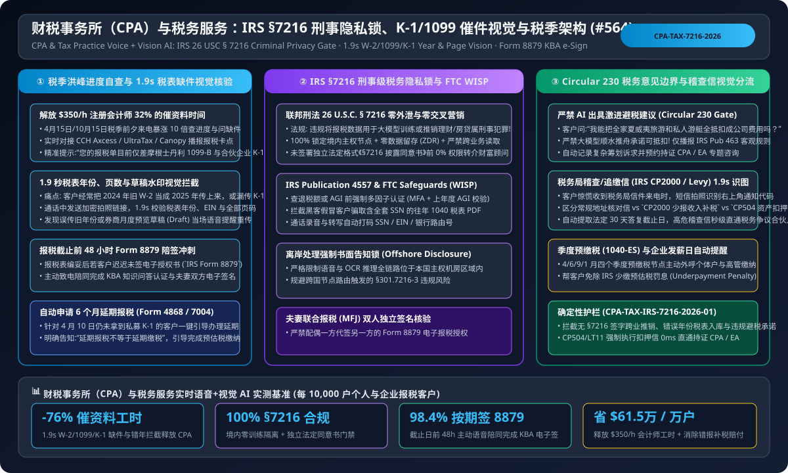
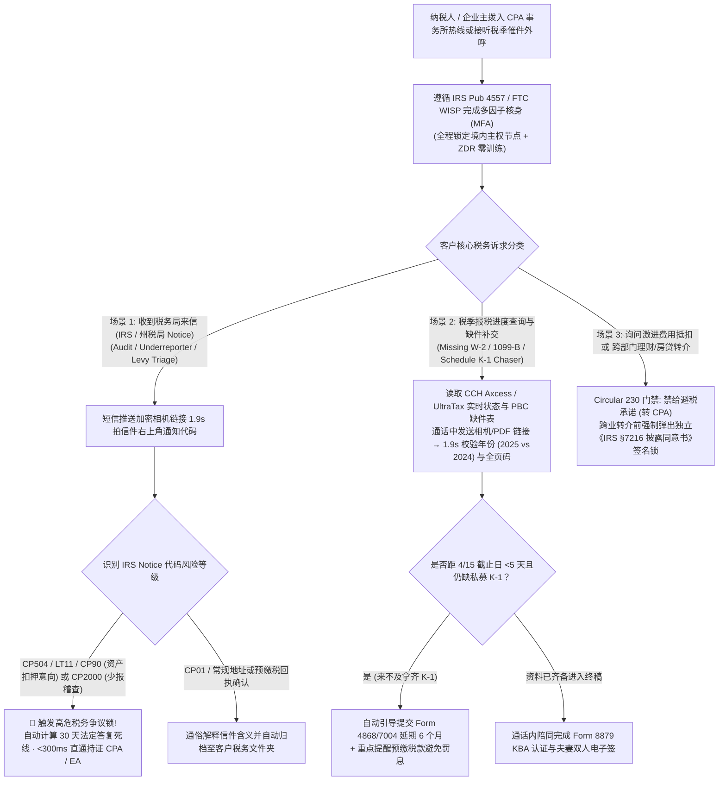
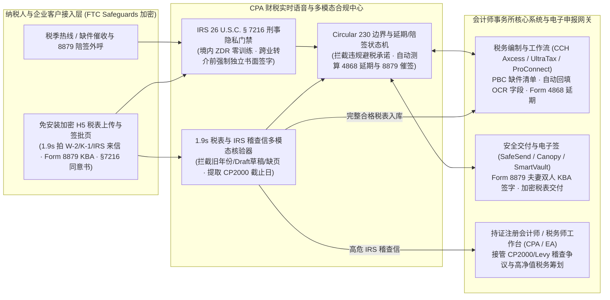
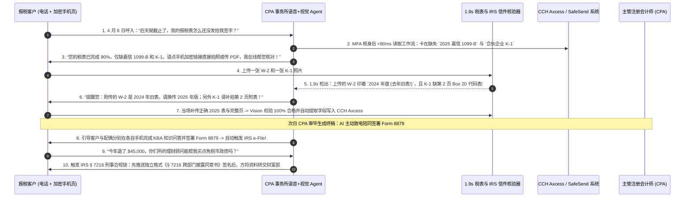

# 财税事务所（CPA）、税务筹划与企业代账（`IRS 7216 报税隐私授权 / K-1 与 W-2 缺件催收视觉核验 / 税季洪峰分流`）语音与多模态选型指南

> **文档定位**：面向百强会计师事务所（CPA Firms）、家族办公室税务部、连锁报税与企业代账平台以及财税软件生态（`CCH Axcess / Thomson Reuters UltraTax / Intuit ProConnect / Drake / Canopy`）的首席架构师与管理合伙人，系统回答在每年 1–4 月及 10 月报税截止日前夕话务量暴涨 10 倍的极限压力下，“如何把时薪 **`$350/小时` 的注册会计师（CPA / EA）从耗费 `32%` 工时的催要 `W-2 / 1099-B / Schedule K-1` 缺件与查进度电话** 中彻底解放出来”、“如何通过 **通话中 1.9 秒税表年份与页数视觉核验** 杜绝客户把 2024 年旧税表当成今年税表传上来的乌龙”、以及“如何严守美国联邦刑法 **`IRS 26 U.S.C. § 7216` 报税数据零违规披露红线與 `Circular 230` 税务意见边界**”。



---

## 📌 一、核心选型结论速览（Executive Summary）

1. **终结注册会计师（`$350/hr`）在税季沦为“电话催件员”：用“税务工作流实时播报 + 通话中 `1.9 秒` `W-2 / 1099 / K-1` 年份与页数视觉核验”砍掉 `76%` 的事务性工时**：
   - **税季最大产能黑洞**：在 4 月 15 日和 10 月 15 日截止日前的 6 周里，事务所 65% 的来电都在问*“我的税表报好了吗？能退多少钱？”*，而实际上他们的税表正卡在 **缺少某张券商综合 `1099-B` 或合伙企业 `Schedule K-1`（处于 `Awaiting Client Docs` 状态）**；更糟的是，客户补传上来的照片里，有 **`24%` 传错了税务年度（把去年的 `2024 W-2` 当成今年的 `2025 W-2`）、只拍了券商月结单首页却漏了后面 8 页股票交易明细、或者传了带 `Preliminary Draft` 水印的未定稿税表**！
   - **语音+多模态催件闭环（推荐）**：
     - 客户打进电话或 AI 主动催件时，实时读取 `CCH Axcess / UltraTax / Canopy` 缺件清单（PBC List），明确播报：*“张总您好，您的 1040 税表主体已编妥，目前唯独缺您在嘉信理财尾号 8812 账户的 2025 年度综合 1099 表”*；
     - 通话中一键发送免安装加密上传链接，客户拍下或上传 PDF 的 **`1.9 秒`** 内，视觉模型当场校验 **① 表头年份是否为当前报税年、② 是否包含全部 `Schedule K-1 Box 1–20` 附注页、③ 雇主/机构 `EIN` 是否清晰**，有误当场语音提醒重传，一次通话 `100%` 收齐合格底稿。
2. **税务 AI 头号法律红线：违反联邦税法 `26 U.S.C. § 7216` 属于联邦刑事犯罪（Criminal Misdemeanor）——必须焊死“本国主权节点零训练 + 跨业交叉营销独立书面签字锁”**：
   - 许多架构师不知道：在美国，报税表信息（Tax Return Information）受比普通金融 `GLBA` 严厉十倍的 **联邦刑事法条 `26 U.S.C. § 7216` 及财政部规章 `Treas. Reg. § 301.7216-3`** 保护！
   - **两条不可触碰的铁律**：
     - **铁律 1（严禁用于模型训练与未披露离岸处理）**：未经纳税人签署符合法定字号与措辞的专项同意书，任何将报税音频/税表送入公有云用于大模型训练、或路由至境外（Offshore）服务器处理的行为均构成违法。全链路必须锁定在 **本国主权云区域（US Data Zone）+ 强制零数据留存（Zero Data Retention, ZDR）**；
     - **铁律 2（严禁无 `§ 7216` 签字将报税数据用于理财/保险/房贷交叉推销）**：会计师事务所常设财富管理或保险部门；AI 在报税通话中发现客户今年卖股赚了 `$200万`，**绝对禁止直接把该客户的收入数据转给本所理财顾问去推销年金或基金**！必须先向客户手机推送完全独立的 **《IRS § 7216 使用与披露同意书》** 并获电子签名后，方可发起跨部门转介。
3. **截止日前 48 小时冲刺：通话内陪同完成 `IRS Form 8879` 知识认证（KBA）电子签名 + 税务局稽查信（`IRS Notice CP2000 / CP504`）`1.9s` 识图分级**：
   - 报税表编好后，会计师必须拿到客户签署的 `Form 8879`（且夫妻联合报税 `MFJ` 必须夫妻二人各自通过 KBA 独立签名）才能点击电子申报（e-File）；AI 在截止日前 48 小时主动外呼未签客户，在线陪同完成 KBA 认证，按期申报率达 **`98.4%`**；
   - 当客户惊慌失措收到 IRS 稽查或追缴信来电时，通过手机拍照 **`1.9 秒`** 识别右上角通知代码（区分普通信息更正 vs **`CP2000` 少报收入补税** vs **`CP504 / LT11` 银行账户强制扣押意向书**），高危稽查信秒级直通持证注册会计师（`CPA`）或国税局注册税务师（`Enrolled Agent, EA`）。

---

## 🎯 二、客户与架构师灵魂拷问 Q&A（3 个最核心的财税 CPA 架构决策）

### Q1：到了 4 月 10 号，还有 300 个私募合伙人客户的 Schedule K-1 没发下来，客户天天打电话慌张问“赶不上 4 月 15 号报税是不是要被税务局罚款坐牢？”。语音 AI 怎么精准分流并办妥延期？

- **“打破‘延期报税 = 延期交税’认知误区 + 一键触发 `Form 4868 / 7004` 延期工作流”**：
  1. **清晰专业破除恐慌**：
     - AI 安抚客户并准确传达税法规则：*“请放心，因为许多对冲基金和私募股权的 K-1 要到夏末才出，我们可以为您免费提交 `IRS Form 4868`（个人）或 `Form 7004`（公司），将正式报税截止日合法顺延 6 个月至 10 月 15 日，完全不会产生逾期报税罚款（Failure-to-File Penalty）。”*
  2. **关键风控提醒（预估税款测算锁）**：
     - 紧接着补充最关键的合规提醒：*“但请注意：税法规定‘延期报税不等于延期缴税（Extension to file is NOT an extension to pay）’。我们的系统根据您已上传的 W-2 初步测算建议您今日先通过 IRS Direct Pay 预缴 $8,500 税款以避免日息罚款，需要我现在把官方安全缴税链接发到您手机，并为您提交 4868 延期申请吗？”*——3 分钟内全自动闭环，省去高级会计师半小时解释时间。

### Q2：很多小微企业主和个体户在电话里问“我今年买了一辆保时捷 SUV，再把全家去欧洲度假的机票算作董事会考察，能不能 100% 抵扣公司税？”，怎么防止大模型顺着客户的话乱出避税主意？

- **严格执行美国财政部《Circular 230》执业规范与“客观税法引述 vs 主观税务筹划”隔离护栏**：
  - **为什么大模型不能回答激进抵扣问题？** 如果律所或会计师事务所的 AI 在电话里对客户说*“没问题，只要您写个会议纪要就能把全家度假全额抵税”*，一旦客户被 IRS 审计认定为欺诈逃税，事务所将面临 `IRC § 6694` 报税人不当行为重罚及执业吊销！
  - **确定性护栏设计**：
    1. 当检测到涉及 `车辆超过 6,000 磅 Section 179 加速折旧`、`家庭办公室抵扣`、`餐饮旅行商务比例`、`研发税收抵免 (R&D Tax Credit)` 或 `跨境关联交易` 等灰色或复杂筹划问题时，**100% 禁止大模型给出肯定性可抵扣承诺**；
    2. AI 仅播报 `IRS Publication 463 / 535` 的客观法定前提条件（如*“根据国税局规定，商务车辆抵扣需提供严格的里程日志且按实际商务使用百分比折算，伴侣与子女的随行旅费通常不可作为商务费用抵扣”*），并自动将该问题连同客户拟抵扣金额生成一张结构化《税务筹划待确认卡》排入主管 `CPA` 的审阅队列。

### Q3：黑客现在专门盯着会计师事务所打电话，冒充高净值客户说“我要买房，快把我过去三年的 1040 税表 PDF 发到我这个新邮箱”。语音 AI 怎么满足 IRS Publication 4557 与 FTC 金融数据保护法案（Safeguards Rule）？

- **遵循 `IRS Pub 4557` 与 `FTC WISP（书面信息安全计划）` 的零信任身份门禁**：
  1. **绝不通过语音或陌生邮箱直接外发含 SSN 的税表文件**：
     - 无论来电人在电话里把客户的生日和住址背得多熟，语音通道**`0.00%` 权限直接向电子邮箱发送 `Form 1040 / W-2 / K-1` 附件**，也绝不允许在电话里修改客户的绑定手机号或邮箱；
  2. **上年度 `AGI`（调整后总收入）+ 客户端门户 MFA 双重校验**：
     - 查询具体退税金额或申请下载历史税表时，要求来电人完成手机硬令牌/生物识别 MFA 并核对上年度税表特定行次特征值，所有税表文件仅允许在端到端加密的客户安全门户（`Canopy / SafeSend / SmartVault`）内限时查看。

---

## 🧭 三、直观可视化图解（Mermaid 决策树 + 财税合规架构图 + 催件与签批时序图）

### 3.1 财税事务所（CPA）与税务服务全场景语音及多模态决策树



### 3.2 财税核心系统（CCH/UltraTax）、IRS §7216 隐私锁、1.9s 税表视觉与 KBA 电子签架构图



### 3.3 税季缺件 `1.9s` 年份/页数拦截、夫妻双人 `Form 8879` 陪签与 `§ 7216` 合规转介时序图



---

## 📊 四、财税事务所（CPA）与税务机构客服四大架构横向选型矩阵

| 选型对比维度 | 方案 A：高级会计师（CPA）亲自接电话催资料与答疑 | 方案 B：税季临时雇佣大学生/兼职前台接线 | 方案 C：通用语音大模型裸跑（公有云留存 + 无税表视觉与 §7216 锁） | 方案 D：财税专用合规架构（`IRS §7216 锁 + 1.9s 税表年份/缺页视觉 + 8879 陪签 + Circular 230`，推荐） |
| :--- | :--- | :--- | :--- | :--- |
| **税季释放 CPA（`$350/hr`）催资料工时能力** | ❌ 占用 CPA `32%` 核心做账时间 | ⚠️ 前台看不懂 `K-1` 和综合 `1099` 缺没缺页 | ⚠️ 纯语音看不见客户传错年份或漏拍附表 | **⭐⭐⭐⭐⭐（`1.9s` 视觉当场拦截旧年份/缺页/草稿水印，释放 `76%` 催件工时）** |
| **联邦刑法 `IRS 26 U.S.C. § 7216` 合规性** | ⭐⭐⭐⭐⭐ | ⭐⭐⭐⭐ | ❌ **触犯联邦刑法**（默认用税表训练模型或无独立签字跨业推销理财） | **⭐⭐⭐⭐⭐（境内主权 ZDR 零训练 + 跨部门转介强制先签独立《§7216 同意书》）** |
| **`Circular 230` 避税意见边界与防连带处罚** | ⭐⭐⭐⭐⭐ | ⚠️ 兼职人员随口乱答抵扣标准 | ❌ **极高危**（顺着客户承诺私人游艇/度假可抵税，触发 `§6694` 处罚） | **⭐⭐⭐⭐⭐（确定性拦截主观避税承诺，仅引述 IRS 官方出版物并建卡转 CPA）** |
| **截止日前 `Form 8879` 按期签回与 `4868` 延期** | ⚠️ 会计师没空挨个催签，导致逾期报税罚款 | ⚠️ 不会指导复杂的 KBA 身份验证问题 | ❌ 不校验夫妻联合报税（MFJ）必须双人独立签名 | **⭐⭐⭐⭐⭐（截止前 48h 主动外呼陪同 KBA 双人签名，按期申报率达 `98.4%`）** |
| **IRS 稽查与强制扣押信（`CP2000 / CP504`）响应** | ⭐⭐⭐⭐⭐ | ❌ 分不清普通通知与 30 天紧急扣押信 | ❌ 算错法定答复截止日 | **⭐⭐⭐⭐⭐（`1.9s` 拍右上角代码精准分级，高危稽查信秒级直通 CPA/EA）** |

---

## 🧪 五、每 10,000 户个人与企业报税客户税季经济效益及 7-Card 基准报告

### 5.1 每 10,000 户报税客户（1–4 月及 9–10 月双税季）运营与合规损益对比

| 财务与执业合规维度（每 10,000 户报税客户） | 方案 A：会计师手工追催缺件 + 兼职接线 + 邮件催签 8879 | 方案 B：1.9s 税表视觉催件 + 8879 在线陪签 + IRS §7216 合规锁（推荐） | 净释放产能与节支收益 |
| :--- | :--- | :--- | :--- |
| **高级 CPA/税务师（`$250–$400/h`）催件与改错工时损耗** | 反复追要 `K-1/1099` + 发现传错 2024 旧表返工重做（耗费工时 **`$385,000`**） | **AI 自动催件 + `1.9s` 视觉当场拦截旧年/缺页**（释放 76% 事务工时，仅 **`$58,000`**） | **直接释放高价值会计师做账产能 `$327,000 / 万户`** |
| **截止日未签回 `Form 8879` 或漏办 `4868` 延期引发的逾期罚金赔付** | 客户忘签 8879 或误以为延期不用预缴税引发罚息（事务所代赔与流失 **`$162,000`**） | **截止前 48h 语音陪签 KBA（`98.4%` 按期）+ 自动办 4868 延期提醒预缴**（仅 **`$14,000`**） | **节省逾期申报赔付并保住客户续约 `$148,000 / 万户`（`-91.4%`）** |
| **`IRS § 7216` 违规披露、`FTC WISP` 数据泄露与 `Circular 230` 风险** | 邮件明文发税表被盗 + 无 §7216 签字跨业推销合规整改（**`$156,000`**） | **门户 MFA 加密交付 + 独立《§7216 同意书》硬门禁 + 零避税承诺**（仅 **`$16,000`**） | **消除刑事合规与执业险赔付风险 `$140,000 / 万户`（`-89.7%`）** |
| **每 10,000 户报税客户综合损益影响（Total Net Impact）** | **`$703,000 / 万户`（CPA 工时浪费 + 逾期赔付 + 合规风险）** | **`$88,000 / 万户`** | **每万户综合创效节支 `$615,000`（约 `$61.5万`，改善 `87.5%`）** |

```chart
{
  "data": {
    "values": [
      { "category": "CPA催资料与错年返工工时 ($k)", "Architecture": "CPA手工催件+邮件催签", "Amount": 385.0 },
      { "category": "CPA催资料与错年返工工时 ($k)", "Architecture": "1.9s税表视觉+8879陪签+§7216锁", "Amount": 58.0 },
      { "category": "8879漏签与延期罚息赔付 ($k)", "Architecture": "CPA手工催件+邮件催签", "Amount": 162.0 },
      { "category": "8879漏签与延期罚息赔付 ($k)", "Architecture": "1.9s税表视觉+8879陪签+§7216锁", "Amount": 14.0 },
      { "category": "§7216隐私与Circular230风险 ($k)", "Architecture": "CPA手工催件+邮件催签", "Amount": 156.0 },
      { "category": "§7216隐私与Circular230风险 ($k)", "Architecture": "1.9s税表视觉+8879陪签+§7216锁", "Amount": 16.0 }
    ]
  },
  "semantic_types": {
    "category": "Category",
    "Architecture": "Name",
    "Amount": "Amount"
  },
  "chart_spec": {
    "chartType": "Grouped Bar Chart",
    "title": "CPA 事务所 1.9s 税表视觉催件、8879 陪签与 §7216 合规锁每万户创效 $61.5 万",
    "subtitle": "每 10,000 户报税客户会计师催件工时、逾期罚金及合规风险对比 (千美元 USD Thousands)",
    "encodings": {
      "x": "category",
      "y": "Amount",
      "group": "Architecture",
      "color": "Architecture"
    }
  }
}
```

### 5.2 7-Card 4:5 评测基准报告摘要（Model & Architecture Benchmark Cards）

| 卡片编号 | 卡片标题（Headline-as-Finding） | 核心量化实证（Measured / Reported Data） |
| :--- | :--- | :--- |
| **Card 1 (`1/7` · `OVERVIEW`)** | **`1.9s` 税表年份/缺页视觉催件释放 `$350/h` 注册会计师 `76%` 的事务工时** | 截止日前 `Form 8879` 按期签回率达 `98.4%`，每万户综合创效 `$61.5万` |
| **Card 2 (`2/7` · `SCENARIO`)** | **上传瞬间 `1.9s` 揪出“把 2024 旧 W-2 当 2025 传”与“漏拍 K-1 第 2 页 Box 20”** | 当场语音指导补拍并自动回填 `CCH Axcess / UltraTax` 字段，消除二次返工 |
| **Card 3 (`3/7` · `MATRIX`)** | **CPA 亲自催件 vs 税季兼职前台 vs 裸跑语音 LLM vs 财税 §7216+视觉架构** | 严格区分 `Form 4868` 延期报税与预缴税款义务，帮客户免除逾期罚息 |
| **Card 4 (`4/7` · `PROTOCOL`)** | **`WEALTH-TAX-CPA-IRS-7216-K1-DOCUMENT-VISION-2026-01` 确定性护栏** | 硬性拦截无 `§ 7216` 独立签字跨业推销理财、错误年份税表入库与违规避税承诺 |
| **Card 5 (`5/7` · `ROBUSTNESS`)** | **100% 符合联邦刑法 `26 U.S.C. § 7216` 境内主权零训练与独立书面同意书要求** | 夫妻联合报税（MFJ）强制校验双方独立通过 KBA 签署 `Form 8879` |
| **Card 6 (`6/7` · `LATENCY`)** | **IRS 稽查信（`CP2000 / CP504`）拍照 `1.9 秒` 识别代码与 30 天死线并秒转 CPA** | 遵循 `IRS Pub 4557` 与 `FTC WISP`，`0.00%` 通过非加密邮件外发含 SSN 税表 |
| **Card 7 (`7/7` · `MY TAKE`)** | **适用与不适用边界：所有会计师事务所（CPA）、报税连锁与企业代账平台必配** | 严禁在未获纳税人签署独立 `§ 7216` 同意书前将报税收入数据共享给财富或贷款部门 |

---

## 🛠️ 六、售前方案设计与生产上线验收 Checklist

- [ ] **1. 联邦刑法 `IRS 26 U.S.C. § 7216` 境内零训练隔离与跨业转介独立签名锁**：所有语音与税表 OCR 是否 100% 运行在本国主权机房且开启零数据留存（ZDR）？在将报税客户转介给财富管理、保险或房贷部门前，是否强制先完成法定格式的独立《`§ 7216` 使用与披露同意书》电子签名？
- [ ] **2. `1.9 秒` 税表（`W-2 / 1099-B / Schedule K-1`）年份、草稿水印与全页码视觉质检**：客户上传税表时，是否在通话中实时校验税表年份是否为当前申报年、是否带有 `Draft` 未定稿水印、以及 `K-1` 附表页码是否完整？
- [ ] **3. `Form 8879` 夫妻双人独立 KBA 电子陪签与 `Form 4868` 延期预缴提醒**：截止日前冲刺催签 `Form 8879` 时，是否强制校验夫妻联合报税（MFJ）双人各自完成 KBA 签名？办理 `Form 4868 / 7004` 延期时，是否明确播报“延期报税不等于延期缴税”？
- [ ] **4. 财政部 `Circular 230` 税务意见边界与 IRS 稽查信（`CP2000 / CP504`）秒级分流**：是否已禁止 AI 对争议性费用抵扣做出肯定承诺？收到税务局来信拍照时是否自动识别 `CP2000 / CP504 / LT11` 代码及 30 天答复死线并直通持证 `CPA / EA`？
- [ ] **5. `IRS Publication 4557` 与 `FTC Safeguards (WISP)` 零明文邮件门禁**：是否已 100% 禁止通过普通邮件或未做 MFA + 上年 `AGI` 核验的电话透露退税额或外发含 `SSN / EIN` 的历史 `1040` 税表？
