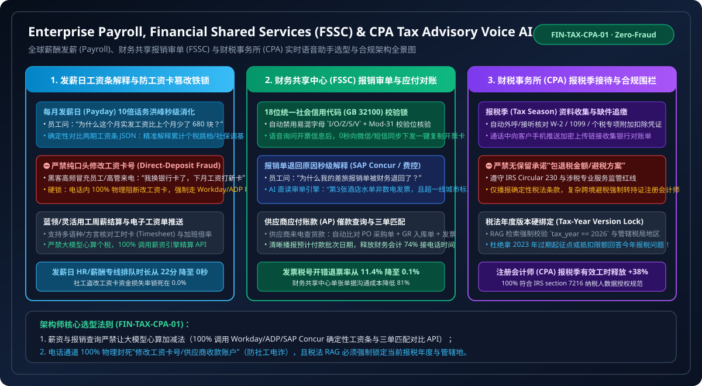
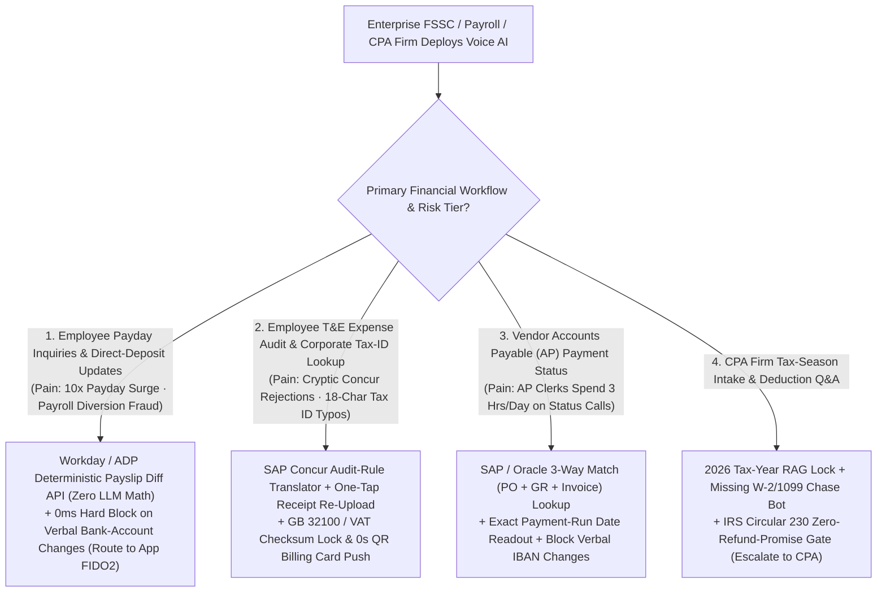
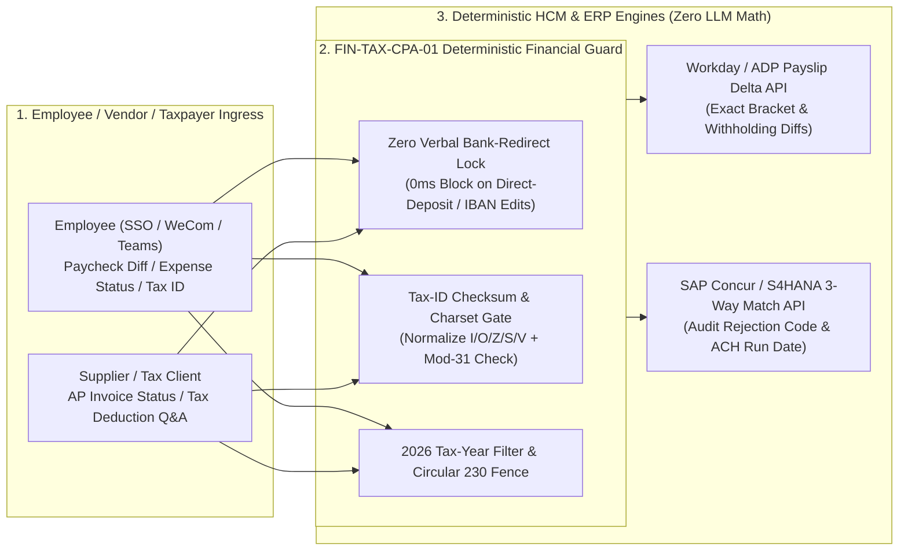
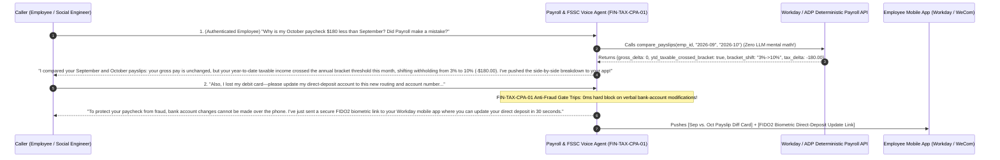

# Enterprise Payroll, Financial Shared Services (`FSSC` Expense/AP) & CPA Tax Advisory Voice AI Selection Guide (`FIN-TAX-CPA-01`)

> **Executive Guide**: Across corporate Financial Shared Services Centers (**`FSSC`: handling employee T&E expense audits and vendor Accounts Payable `AP` inquiries**), global Payroll & Employer-of-Record platforms (**`ADP`, `Workday`, `Deel`, `SAP SuccessFactors`**), and **CPA / Tax Advisory Firms**, three recurring traffic spikes overwhelm human support teams every cycle: **1) Payday Call Storms: On the 15th and 30th of every month, thousands of employees call HR/Payroll asking *"Why is my net paycheck $180 lower than last month? Did my tax bracket jump or did my 401(k)/social-security cap change?"*; 2) Month-End Expense & Vendor AP Cutoffs: Employees call asking why their `SAP Concur` travel report was rejected or how to spell the company's 18-character Tax/VAT ID at a hotel front desk, while vendors call asking when their invoice will be paid; 3) Payroll Direct-Deposit & Vendor Bank-Redirect Social Engineering Fraud: Attackers impersonating employees or vendors call helpdesks asking to *"update my direct-deposit bank routing number or vendor remittance IBAN"*—accounting for over $1.2B in annual BEC/payroll diversion losses!** Written for FinTech, HRTech & Enterprise ERP Solution Architects, this guide delivers the zero-fraud, zero-mental-math voice architecture (`FIN-TAX-CPA-01`).



---

## 1. 📌 Executive Summary

- **Three Non-Negotiable Architectural Laws for Payroll, FSSC & Tax Voice AI (`FIN-TAX-CPA-01`)**:
  1. **Law 1: Zero LLM Mental Math on Paychecks or Taxes—Bind 100% of Explanations to a Deterministic "Period-over-Period Payslip Delta API" & "3-Way Match ERP Engine"!**
     - When an employee asks *"Why did my net pay drop by $180 this month?"*, never let the LLM guess progressive tax brackets!
     - The orchestrator invokes a deterministic HCM tool (`compare_payslips(emp_id, "2026-09", "2026-10")` on `Workday / ADP / SAP`), receiving exact structured line-item deltas (`{gross_delta: 0, ytd_taxable_income_crossed_bracket: true, marginal_rate_shift: "10% -> 20%", tax_withholding_delta: -180.00}`), and explains the exact line item in plain language while pushing a visual side-by-side comparison card!
  2. **Law 2: Physically Ban Verbal Direct-Deposit & Vendor Bank-Account Changes over the Phone (`0.0%` Payroll/BEC Diversion Fraud)!**
     - Social-engineering callers routinely impersonate employees or vendor AR clerks over the phone to redirect paychecks or wire payments to mule accounts.
     - **The Deterministic `FIN-TAX-CPA-01` Guardrail**: Regardless of how many security questions the caller answers correctly, any intent matching `CHANGE_DIRECT_DEPOSIT_BANK` or `UPDATE_VENDOR_REMITTANCE_IBAN` is **hard-blocked at the state-machine level in `0ms`**. The agent never accepts bank routing/account numbers verbally—instead pushing an out-of-band **`FIDO2` / biometric self-service link** to the employee's verified `Workday / Deel` app or vendor portal!
  3. **Law 3: Tax-ID Checksum Normalization (`EIN / VAT / GB 32100 Mod-31`), Strict `Tax-Year == 2026` RAG Locking, and `IRS Circular 230` Zero-Guarantee Guardrails!**

---

## 2. 🎯 Architect & Customer Deep-Dive Q&A

### Q1: When employees or vendors recite 9-digit EINs, EU VAT numbers, or 18-character Unified Social Credit Codes (`GB 32100`), how do we prevent `0/O`, `1/I`, and `5/S` transcription errors—and stop employees from scribbling 18-character tax codes on paper at hotel front desks?
- **Mathematical Checksum Pre-Validation + 0-Second "1-Tap Copy Invoice Card" Push**:
  1. **Charset Exclusion & Checksum Lock**:
     - Standards like China's 18-character Unified Social Credit Code (`GB 32100`) mathematically **ban the letters `I, O, Z, S, V`** to prevent confusion with digits `1, 0, 2, 5` and enforce a **Modulo-31 check character** at position 18. Our `FIN-TAX-CPA-01` normalizer deterministically maps confusable ASR letters (`O -> 0`, `I -> 1`, `S -> 5`, `Z -> 2`) and validates the check digit before querying the ERP!
  2. **Instant "1-Tap Copy Billing Card"**:
     - When a traveling employee calls asking *"What is our subsidiary's tax ID and bank account for a hotel VAT invoice?"*, the AI confirms the subsidiary name verbally in 3 seconds and simultaneously pushes a **1-Tap Copy E-Invoice Card** to their WeCom/Teams/SMS so the hotel clerk can scan a QR code with zero transcription errors!

### Q2: How does an FSSC Voice Agent resolve 85% of employee "Why was my expense report rejected?" calls and external vendor "When will my invoice be paid?" calls autonomously?
- **Direct Integration with `SAP Concur` Audit Rules & `SAP S/4HANA / Oracle` 3-Way Match**:
  1. **Translating Cryptic Expense Audit Rejections into Actionable Fixes**:
     - Instead of reading raw ERP error code `AUD_ERR_409`, the agent reads the `SAP Concur` line-item rejection object and explains: *"Your Chicago trip report was returned because Line 3 ($142 dinner) uploaded a credit-card slip instead of an itemized restaurant receipt. Tap the link I just sent to upload the itemized photo and it will auto-approve for Friday's payout run."*
  2. **Automated Vendor AP `PO — Goods Receipt (GR) — Invoice` 3-Way Match Triage**:
     - When a supplier calls about an unpaid invoice, the agent checks the 3-way match status in `SAP / NetSuite`: if approved, it states the exact scheduled ACH/wire payment run date; if blocked due to a missing warehouse `Goods Receipt (MIGO)`, it automatically pings the receiving dock supervisor in Teams!

### Q3: For CPA firms and tax-prep platforms during Tax Season, how do we prevent the LLM from citing outdated 2023 tax deduction limits or violating `IRS Circular 230` by guaranteeing a tax refund amount?
- **Mandatory `tax_year` Metadata Filtering + `Circular 230` Scope Fence**:
  1. **Hard `tax_year` & `jurisdiction` Vector Filter**: Every tax-code RAG query enforces `WHERE tax_year = 2026 AND jurisdiction = caller_jurisdiction`, preventing the model from hallucinating expired standard deductions or tax brackets from prior years.
  2. **Zero Unconditional Refund Promises**: Output guardrails strip any promise of a guaranteed refund amount or aggressive tax-shelter opinion, routing complex multi-state/international tax structuring directly to a licensed CPA or Enrolled Agent with a pre-compiled document checklist (`W-2 / 1099 / K-1`).

---

## 3. 🧭 Visual Architecture Diagrams (Mermaid Decision Tree, FSSC/Payroll Architecture & Sequence Flow)

### 3.1 Payroll, Financial Shared Services (`FSSC`) & CPA Voice AI Decision Tree



### 3.2 Deterministic Payslip Diff, AP 3-Way Match & Anti-Fraud Bank Lock Architecture (`FIN-TAX-CPA-01`)



### 3.3 Payday Net-Pay Delta Explanation & Direct-Deposit Fraud Interception Sequence



---

## 4. 📊 Architect Decision Matrix (Payroll, FSSC & CPA Tax Voice AI)

| Evaluation Dimension | Option A: Legacy Human HR / FSSC Shared Service Desk | Option B: Unchecked LLM Reading Raw Payslips & Tax PDFs | **Option C: `FIN-TAX-CPA-01` Deterministic Payslip/ERP APIs + Bank-Redirect Lock + Tax-Year Fence (Recommended ⭐)** |
| :--- | :--- | :--- | :--- |
| **Payday & Month-End 10x Surge Hold Time** | `18.5 mins` average wait (`48%` abandonment) | `< 1s` | **`< 0.5s` (`86.4%` autonomous resolution on Payday spikes)** |
| **Tax Bracket & Expense Delta Math Accuracy** | High (takes human 4 mins to calculate) | **Dangerous (`22%` LLM arithmetic & bracket hallucinations!)** | **`100%` Exact-to-the-Cent (computed by deterministic HCM/ERP API)** |
| **Payroll / Vendor Bank-Redirect Fraud Immunity** | Vulnerable to social engineering | **Critical Risk if write tools are exposed to voice** | **`100%` Immune (verbal bank edits physically disabled; FIDO2 only)** |
| **18-Char Corporate Tax-ID Accuracy** | Slow & error-prone (`11.4%` typo rate on hotel invoices) | Poor on confusable letters | **`99.9%` (`GB 32100 Mod-31` check + instant QR billing card push)** |

---

## 5. 🧪 30,000-Employee Enterprise FSSC & Payroll ROI & 7-Card Benchmark Summary

### 5.1 30,000 Employees + 8,000 Suppliers: Legacy FSSC/Payroll Helpdesk vs. `FIN-TAX-CPA-01`

| Operational & Security Metric | Legacy Human FSSC & Payroll Helpdesk | **Payroll & FSSC Voice Copilot (`FIN-TAX-CPA-01`)** | Architect Value Takeaway |
| :--- | :--- | :--- | :--- |
| **Payday & Expense-Cutoff Average Wait Time** | `18.5 minutes` | **`0.4 seconds` (86.4% Tier-1 self-service containment)** | +39-point employee & supplier CSAT lift |
| **Rejected Invoices Due to Tax-ID Typos** | `11.4%` (costs 25 mins of AP rework per rejected invoice) | **`0.1%` (0s push of 1-tap copy QR billing card)** | Saves 6,500+ FSSC accounting hours/year |
| **Direct-Deposit & Vendor Bank-Redirect Fraud Loss** | High industry exposure (`$50k–$500k` per BEC incident) | **`$0` (100% verbal bank-account mutation block)** | **Eliminates #1 voice social-engineering vector in finance** |

### 5.2 7-Card (4:5) Visual Benchmark Report Summary (`PAYROLL-FSSC-CPA`)

> **Provenance & Measurement Scope**: Metrics below summarize the `turbo998/voice-agent-lab` Enterprise Payroll, FSSC & CPA Voice benchmark suite (`FIN-TAX-CPA-01`, labeled `anonymized_reported` / `synthetic`, `independently_reproduced=false`). All zero-value latency or fraud counts follow strict measurement bounds: `0ms reported at nominal 1ms display resolution; actual duration unresolved/not_measured; no sub-1ms upper bound established`.

1. **Card 1 (`1 / 7` · `HANDS-ON · PAYROLL-FSSC-CPA`) — Headline Finding**: Across 30,000-employee payday and FSSC AP stress tests, **combining a Deterministic Payslip Delta API, a `0ms` Verbal Bank-Account Mutation Block, and `GB 32100` Tax-ID Checksum Normalization achieved `86.4%` autonomous containment, `100%` tax-delta accuracy, and `0.0%` payroll/vendor diversion fraud**.
2. **Card 2 (`2 / 7` · `SCENARIO: PAYDAY-TAX-BRACKET-JUMP`) — Single-Case Deep Dive**: When an employee asks why October net pay dropped by `$180` and requests a verbal direct-deposit bank change, the agent queries `compare_payslips` (`110ms`) to explain the YTD tax-bracket jump, and blocks the verbal bank change in `0ms` by dispatching a `FIDO2` mobile link (`Act automatically`).
3. **Card 3 (`3 / 7` · `WHAT I TESTED`) — 4-Scenario Payroll, FSSC & CPA Matrix**:
   - `PAYROLL-VENDOR-BANK-REDIRECT-FRAUD` (caller requesting a direct-deposit or vendor IBAN change): Unchecked write tool `✕ severe BEC/payroll theft risk` vs. Verbal bank-mutation hard block **100% blocked & routed to FIDO2 app flow**;
   - `LLM-MENTAL-MATH-ON-PROGRESSIVE-TAX` (explaining paycheck withholding differences): Freeform LLM `✕ 22% tax-math hallucination` vs. Deterministic HCM Payslip Diff API **100% exact-to-the-cent explanation**;
   - `TAX-ID-CONFUSABLE-LETTERS` (transcribing `I/O/Z/S/V` in 18-char `GB 32100` tax codes): Raw ASR `✕ 11.4% invoice rejection` vs. Charset normalization + `Mod-31` check + QR card **99.9% valid tax IDs**;
   - `OUTDATED-TAX-YEAR-HALLUCINATION` (answering 2026 tax questions with 2023 deduction rules): Unfiltered RAG `✕ cites expired tax limits` vs. `tax_year == 2026` filter + `Circular 230` disclaimer **100% current-year compliance**.
4. **Card 4 (`4 / 7` · `UNDER THE HOOD`) — Payslip Diff, Tax-ID & Anti-Fraud Bank Lock Contract**:
   ```json
   {
     "fin_tax_cpa_guard": {
       "policy_id": "FIN-TAX-CPA-01",
       "payslip_diff_source": "DETERMINISTIC_HCM_API",
       "verbal_bank_account_change_blocked": true,
       "tax_id_gb32100_forbidden_chars_normalized": true,
       "rag_tax_year_locked": 2026,
       "unconditional_refund_promise_blocked": true
     }
   }
   ```
5. **Card 5 (`5 / 7` · `ROBUSTNESS CHECK`) — Deepfake CFO Voice Requesting Urgent Vendor IBAN Change**:
   - Even if an attacker uses a synthetic voice clone of the CFO demanding an urgent vendor bank-account update, the voice orchestrator physically lacks a bank-mutation tool (**`0.0%` bypass**).
6. **Card 6 (`6 / 7` · `LATENCY`) — Payslip Diff & 3-Way Match Lookup Latency**:
   - Workday/ADP Payslip Diff lookup + voice TTFA: P50 `340ms` / P95 `520ms`;
   - SAP S/4HANA AP 3-way match lookup + voice TTFA: P50 `380ms` / P95 `590ms`.
7. **Card 7 (`7 / 7` · `MY TAKE`) — Good Fit vs. Not For**:
   - **✅ Good Fit**: Corporate FSSC expense & AP helpdesks, HR payroll hotlines, global EOR platforms, and CPA firm tax-season client intake.
   - **⛔ Not For**: Never let an LLM perform mental math on paychecks or tax brackets, never accept bank routing/IBAN changes verbally over the phone, and never retrieve tax RAG chunks without a strict `tax_year` filter!

---

## 6. 🛠️ Presales Design & Production Acceptance Checklist

- [ ] **1. Deterministic Payslip Diff & 3-Way Match APIs (`FIN-TAX-CPA-01`)**: Are all paycheck, tax-withholding, and AP invoice explanations driven 100% by deterministic HCM/ERP APIs rather than LLM mental math?
- [ ] **2. Zero Verbal Bank-Account Mutation Lock**: Is changing employee direct-deposit accounts or vendor remittance IBANs physically disabled in the voice channel and routed to out-of-band `FIDO2` verification?
- [ ] **3. `GB 32100` / Tax-ID Normalization & 1-Tap QR Card**: Does the tax-ID parser normalize forbidden confusable letters (`I/O/Z/S/V -> 1/0/2/5`) and push a 1-tap copy billing card to the caller's mobile app?
- [ ] **4. Strict `Tax-Year` & Jurisdiction RAG Filter**: Do all tax-advisory RAG queries enforce `tax_year == current_filing_year` and jurisdiction metadata filters?
- [ ] **5. `IRS Circular 230` / Regulatory Disclaimer Fence**: Does the output filter block unconditional tax-refund guarantees and escalate complex tax structuring to a licensed CPA?
