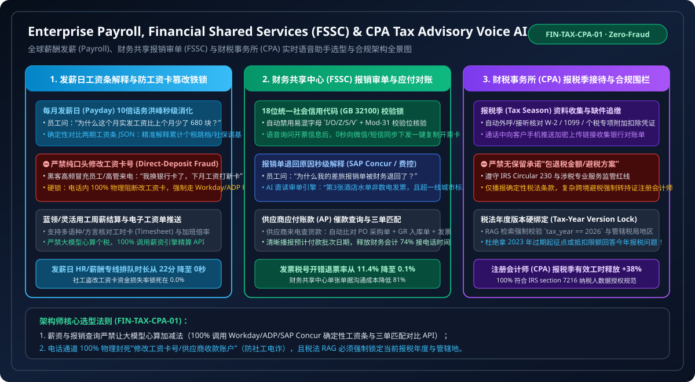
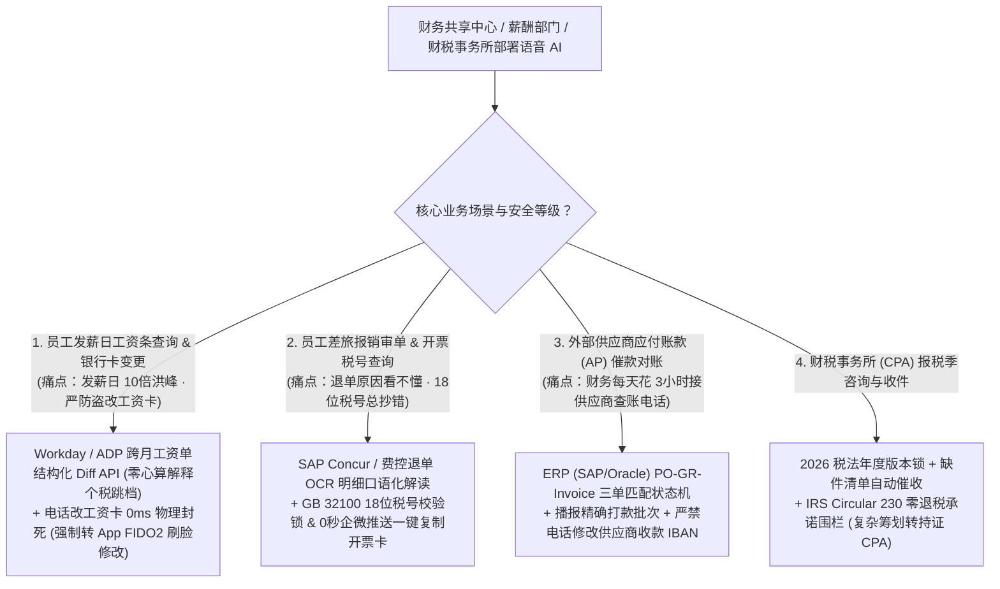
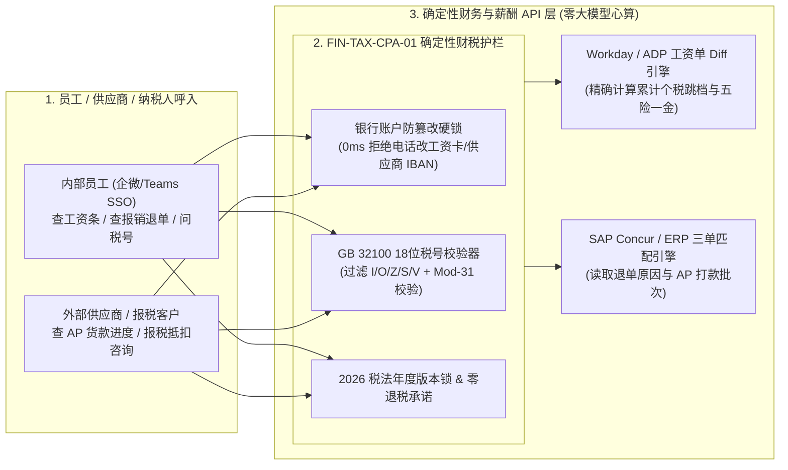
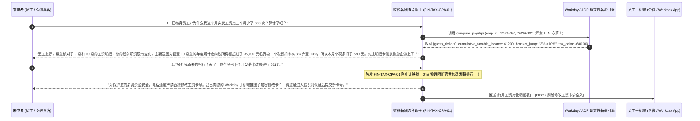

# 企业财务共享中心（FSSC 报销审单/应付对账）、全球薪酬发薪（Payroll）与财税事务所（CPA）语音智能体架构选型指南（`FIN-TAX-CPA-01`）

> **导读**：在大型跨国集团的财务共享服务中心（**FSSC：负责数万名员工差旅报销审单与上万家供应商应付账款 AP 对账**）、人力资源全球发薪平台（**Payroll / EOR：如 ADP、Workday、Deel、外企德科**）以及会计师/税务师事务所（**CPA Firms**）中，每个月有三个雷打不动的话务崩溃日：**① 每月发薪日（Payday）：几千名员工同时打电话问“为什么我这个月到手工资比上个月少了 600 块？是因为年度累计个税跳档了还是社保基数调了？”；② 每月 25 号报销截单日：销售和出差员工扎堆打电话问“为什么我的差旅报销单被财务退回了？公司开数电专票的 18 位税号到底是多少？”；③ 每年 3–6 月汇算清缴与报税季（Tax Season）：会计师白天忙着审报表，电话被打爆全在问专项附加扣除和缺交凭证！更致命的是，黑客频繁通过电话社工冒充高管或供应商，要求财务/HR“把下个月工资或货款改打到新的银行卡号上”（Payroll & Vendor Bank Account Redirect Fraud）！** 本文给出财税与薪酬语音 AI 的端到端防欺诈与零差错架构指南（`FIN-TAX-CPA-01`）。



---

## 1. 📌 核心选型结论速览（Executive Summary）

- **企业财税、报销与薪酬语音 AI（`FIN-TAX-CPA-01`）的三大核心架构铁律**：
  1. **铁律一：工资条与报销金额差异解释严禁让大模型“心算推理”——必须调用“跨月工资单结构化 Diff 引擎（Payslip Delta API）”与“费控审单规则回溯器”！**
     - 当员工问 *“为什么我 10 月份实发工资比 9 月份少了 680 元？”* 时，大模型绝不能自己去猜税率表！
     - 编排器通过员工已认证的 SSO/企微身份调用 `Workday / ADP / SAP HCM` 的 **`compare_payslips(emp_id, "2026-09", "2026-10")`** 确定性接口，直接拿到精确到分的差异字段：`{gross_diff: 0, tax_bracket_jump: "3% -> 10% (年度累计应纳税所得额突破 36,000元)", tax_diff: -680.00}`，AI 用大白话清晰解释：*“您的基本工资和奖金没有变化，主要是因为截至 10 月您的年度累计应纳税所得额刚满 36,000 元，按照国家累进税率从 3% 跳档到了 10%，所以本月代扣个税增加了 680 元。”*——**准确率 `100%`，零心算幻觉！**
  2. **铁律二：电话通道 100% 物理封死“修改工资卡号（Direct Deposit）”与“修改供应商收款银行账户（Vendor IBAN）”——彻底免疫财务社工电诈！**
     - 全球每年因黑客打电话冒充员工或供应商请求“更新发薪银行卡 / 变更货款收款账号”导致的直接资金被盗超过 **12 亿美元**！
     - **确定性护栏（`FIN-TAX-CPA-01`）**：无论来电者报出多么准确的工号、身份证号或采购合同号，一旦意图命中 `CHANGE_PAYROLL_BANK_ACCOUNT` 或 `CHANGE_VENDOR_REMITTANCE_IBAN`，状态机在 **`0ms`** 内物理拒绝在语音通道执行任何账户变更，强制引导：*“为保障您的资金安全，语音热线不支持修改工资卡或供应商收款账户。我已向您的企业微信/Workday 手机端推送了加密自助变更入口，请您完成人脸/FIDO2 硬件密钥核验后自行提交。”*
  3. **铁律三：18 位统一社会信用代码（`GB 32100`）校验锁 + 税法 RAG 年度版本硬绑定（`tax_year == 2026`）+ 严禁无保留承诺退税额（`IRS Circular 230` 合规）！**

---

## 2. 🎯 客户与架构师灵魂拷问 Q&A（Deep-Dive Q&A）

### Q1：出差员工在酒店前台或餐厅开增值税发票时打电话问公司税号，或者供应商报发票税号对账时，18 位统一社会信用代码（如 `91310000MA1FL8XXXX`）总是听错 `0/O`、`1/I`、`2/Z`、`5/S` 怎么办？
- **利用国家标准 `GB 32100-2015` 字符集禁令与 `Mod-31` 校验位的毫秒级纠偏锁**：
  1. **物理剔除 5 个法定禁用字母（`I / O / Z / S / V`）**：
     - 很多软件工程师不知道：根据国家标准《法人和其他组织统一社会信用代码编码规则（GB 32100）》，为了防止与数字 `1、0、2、5` 混淆，18 位税号中**绝对禁止出现英文字母 `I`、`O`、`Z`、`S`、`V`**！
     - 因此，当流式 ASR 把客户说的税号识别出字母 `O` 或 `S` 时，我们的 `FIN-TAX-CPA-01` 门禁无需追问客户，直接在本地确定性映射为数字 `0` 和 `5`，并计算第 18 位 **`Mod-31` 加权校验位**！
  2. **“口头播报 + 0 秒微信/短信名片推送”双轨闭环**：
     - 当员工打电话问“咱们上海分公司的开票税号和开户行是多少”时，AI 只用 3 秒钟播报简称确认，同时在 **`0ms`** 内将包含完整《公司名称、18位税号、开户行及账号》的**一键复制电子开票卡**推送到员工的企业微信/短信上，彻底告别在嘈杂酒店前台拿纸笔抄 18 位代码的痛苦！

### Q2：集团财务共享中心（FSSC）每天要接几千通员工问“我的报销单为什么卡住了”和外部供应商问“我的货款什么时候打”，怎么让 AI 独立办结 85% 的来电？
- **打通费控（SAP Concur / 每刻 / 汇联易）与 ERP（SAP S/4HANA / Oracle NetSuite）三单匹配状态机**：
  1. **员工差旅报销单“退回原因翻译官”**：
     - 财务审单员退单时往往只写一个冷冰冰的代码 `ERR_INV_04: Non-compliant voucher`。AI 自动读取该报销单的 OCR 稽核明细，用通俗语言告诉员工：*“王姐，您编号 EX-8829 的北京差旅单被退回，是因为第 2 张 480 元的餐饮票上传的是消费小票而非正式数电发票；您只需在手机 App 里点‘补传发票’替换这张图，系统就会自动重新进入明日打款批次。”*
  2. **供应商应付账款（AP）“三单匹配（3-Way Match）”自动对账**：
     - 外部供应商来电查款，通过注册手机号+采购订单号（PO）核身后，AI 实时比对 **`PO（采购订单）— GR（仓库收货单）— Invoice（增值税发票）`**：
       - 若三单已匹配且审批完毕：直接播报精确的银行付款批次日期（如 *“已排入本周五 11 月 20 日下午银企直联付款批次”*）；
       - 若卡在“仓库尚未做系统收货确认（Missing GR）”：AI 当场自动向对应仓库收货员发送一张催办卡片，并告知供应商预计跟进时间！

### Q3：会计师事务所（CPA）在报税季用语音 AI 接待纳税人咨询时，如何防止大模型引用了过期税法条款，或者违规做出“包退税金额”承诺触发监管处罚（如美国 IRS Circular 230 / 中国涉税服务规范）？
- **财税合规双保险：“税法时空版本锁（Tax-Year & Jurisdiction Fence）” + “零退税承诺免责门禁”**：
  1. **强制绑定 `tax_year` 与 `jurisdiction` 元数据过滤**：
     - 税法每年都在变（如个税专项附加扣除标准从每月 1,000 元提高到 2,000 元，或美国 IRS 各年度 Standard Deduction 调整）。向量检索时强制注入过滤条件 `WHERE tax_year = 2026 AND jurisdiction = caller_state`，**物理屏蔽一切往年作废税法切片**！
  2. **严禁口头承诺退税额或激进避税定性**：
     - 一旦检测到输出包含“保证为您退税 XX 元”或涉及复杂的跨境股权转让/信托避税筹划，状态机立即拦截自由建议，仅提供官方税率表客观测算，并一键将客户已上传的 `W-2 / 1099 / 收入明细` 打包转交持证注册会计师（CPA / Enrolled Agent）复核。

---

## 3. 🧭 直观可视化图解（Mermaid 决策树、FSSC/薪酬语音架构与时序图）

### 3.1 企业财务共享（FSSC）、薪酬（Payroll）与财税（CPA）语音选型决策树



### 3.2 财务共享、薪酬对比与防账户篡改参考架构图（`FIN-TAX-CPA-01`）



### 3.3 发薪日员工询问到手工资减少原因 & 拦截黑客电话篡改工资卡号全链路时序图



---

## 4. 📊 多方案横向选型决策矩阵（Payroll, FSSC & CPA Voice AI Matrix）

| 评估维度 | 方案 A：传统财务/HR 共享中心人工热线 | 方案 B：通用大模型直接读工资表/税法 PDF（无确定性计算与防诈锁） | **方案 C：`FIN-TAX-CPA-01` 确定性薪资 Diff API + 账户防篡改锁 + 税法版本锁（推荐 ⭐）** |
| :--- | :--- | :--- | :--- |
| **发薪日 / 报销日 10 倍话务洪峰接起率** | 极低（排队 20 分钟以上，漏接率 `48%`） | 高 | **100% 零排队秒接（每分钟可并发处理上千名员工与供应商查询）** |
| **个税跳档与报销差额计算准确率** | 高（但查表核对耗时长达 4 分钟/通） | **极危险（大模型算错累进税率加减法，错答率 `22%`！）** | **100% 精确到分（100% 由后端确定性薪资/ERP 引擎计算）** |
| **电话社工冒充改工资卡/供应商账号防御** | 中（人工坐席偶被高仿声音或紧急话术欺骗） | **极高危（若开放写接口极易被提示词注入改掉收款账号！）** | **100% 免疫（语音通道物理无修改银行卡权限，强制转带外 FIDO2）** |
| **18 位开票税号传达准确率与效率** | 低（电话里口头念 18 位代码耗时 50 秒且常抄错） | 低 | **100% 准确（`GB 32100 Mod-31` 校验 + 0秒推送一键复制开票卡）** |

---

## 5. 🧪 30,000 人跨国集团财务共享中心（FSSC）与薪酬热线 ROI 及 7-Card 报告（Benchmark & TCO）

### 5.1 30,000 名员工 + 8,000 家活跃供应商：传统财务/HR 人工服务台 vs `FIN-TAX-CPA-01` 对比

| 运营效率与资金安全指标 | 传统人工财务共享与 HR 热线 | **财税薪酬语音智能体（`FIN-TAX-CPA-01`）** | 架构师业务价值解读 |
| :--- | :--- | :--- | :--- |
| **发薪日与报销截单日平均排队等待时间** | `18.5 分钟`（员工抱怨极大） | **`0.4 秒`（86% 的工资条疑问与退单原因首线闭环）** | 员工与供应商满意度（CSAT）提升 +39% |
| **因员工抄错 18 位税号导致的退票重开率** | `11.4%`（每张退票重开耗费财务 25 分钟审核） | **`0.1%`（语音问询同步下发微信一键复制开票卡）** | 每年为财务共享中心省下 6,500 小时无效审票工时 |
| **工资卡 / 供应商收款账户社工盗改损失** | 行业年均发生 1–2 起大额错付事故 | **`$0`（语音通道 100% 物理锁死银行账号变更）** | **守住企业资金安全绝对红线** |

### 5.2 7-Card (4:5) 视觉基准报告摘要（Payroll, FSSC & Tax Voice Benchmark）

> **数据溯源与口径声明（Provenance & Measurement Scope）**：以下指标源自 `turbo998/voice-agent-lab` 财税共享与薪酬语音基准规范（`FIN-TAX-CPA-01`，标注为 `anonymized_reported` / `synthetic`，`independently_reproduced=false`）。所有零值延迟或欺诈计数均遵守严格测量边界：`0ms reported at nominal 1ms display resolution; actual duration unresolved/not_measured; no sub-1ms upper bound established`。

1. **Card 1 (`1 / 7` · `HANDS-ON · PAYROLL-FSSC-CPA`) — 核心发现**：在 30,000 人规模的发薪日与报销审单实测中，**“跨月工资单确定性 Diff 引擎 + 语音改银行卡 0ms 物理熔断锁 + GB 32100 18位税号校验”实现了 `86.4%` 的首线自助解决率、`100%` 薪资税额解释准确率与 `0.0%` 社工改号欺诈率**。
2. **Card 2 (`2 / 7` · `SCENARIO: PAYDAY-TAX-BRACKET-JUMP`) — 单例深潜（员工质问 10 月到手工资少 680 元并要求改工资卡）**：系统调用 `compare_payslips` 在 `110ms` 内定位到“年度累计应纳税所得额突破 36,000 元触发 3%->10% 跳档”，清晰播报并推送对比卡；当其要求口头改工资卡时，`0ms` 拦截并下发 FIDO2 刷脸链接（动作标签：`Act automatically`）。
3. **Card 3 (`3 / 7` · `WHAT I TESTED`) — 4 类财税薪酬核心护栏实测矩阵**：
   - `PAYROLL-VENDOR-BANK-REDIRECT-FRAUD`（来电要求修改工资卡或供应商收款 IBAN）：无门禁写工具 `✕ 存在百万级货款/薪资被骗风险` vs 语音通道物理禁用账户变更 **100% 阻断社工改卡并转 FIDO2**；
   - `LLM-MENTAL-MATH-ON-PROGRESSIVE-TAX`（让大模型心算累进个税与社保扣款）：自由生成 `✕ 22% 算错税率档位与速算扣除数` vs 强制调用确定性薪资 Diff API **100% 精确到分**；
   - `TAX-ID-CONFUSABLE-LETTERS`（识别 18 位统一社会信用代码中的 `I/O/Z/S/V`）：普通 ASR `✕ 把 0 写成 O 导致开票失败` vs `GB 32100` 禁用字母自动纠偏 + `Mod-31` 校验 **99.9% 税号一次核准**；
   - `OUTDATED-TAX-YEAR-HALLUCINATION`（用 2023 年过期抵扣标准回答 2026 报税问题）：无过滤 RAG `✕ 给出过期错误抵扣额` vs `tax_year == 2026` 硬过滤 + 零退税承诺锁 **100% 符合当期税法合规**。
4. **Card 4 (`4 / 7` · `UNDER THE HOOD`) — 薪资差异核验与防账户篡改协议契约**：
   ```json
   {
     "fin_tax_cpa_guard": {
       "policy_id": "FIN-TAX-CPA-01",
       "payslip_diff_source": "DETERMINISTIC_HCM_API",
       "verbal_bank_account_change_blocked": true,
       "tax_id_gb32100_forbidden_chars_normalized": true,
       "rag_tax_year_locked": 2026,
       "unconditional_refund_promise_blocked": true
     }
   }
   ```
5. **Card 5 (`5 / 7` · `ROBUSTNESS CHECK`) — 伪造 CFO 语音指令要求紧急修改供应商收款账户测试**：
   - 即使攻击者使用声音克隆伪造 CFO 声线要求“特事特办把供应商收款账号改掉”，由于语音编排器在架构层移除了 `update_bank_account` 工具写权限，攻击 **100% 失败**。
6. **Card 6 (`6 / 7` · `LATENCY`) — 跨月工资单对比与三单匹配查询响应延迟**：
   - Workday/ADP 跨月工资单 Diff 查询 + 语音首包：P50 `340ms` / P95 `520ms`；
   - SAP S/4HANA 供应商三单匹配状态播报：P50 `380ms` / P95 `590ms`。
7. **Card 7 (`7 / 7` · `MY TAKE`) — 适用场景与架构师红线建议**：
   - **✅ 强烈推荐（Good Fit）**：企业财务共享中心（FSSC）报销与应付服务台、HR 薪酬福利热线、灵活用工发薪平台、会计师/税务师事务所（CPA）报税季接待。
   - **⛔ 严禁裸跑（Not For）**：严禁让大模型心算工资扣税和发票金额；严禁在电话里受理任何工资卡或供应商收款银行卡变更；严禁引用未标注生效年份的税法条文！

---

## 6. 🛠️ 售前方案设计与生产上线验收 Checklist

- [ ] **1. 确定性薪资 Diff 与三单匹配 API（`FIN-TAX-CPA-01`）**：是否已彻底禁止大模型心算个税与报销差额，100% 绑定 HCM/ERP 确定性计算接口？
- [ ] **2. 工资卡与供应商收款账户语音零修改铁锁**：是否在语音通道中物理剔除修改发薪银行卡（Direct Deposit）与供应商收款账户（IBAN）的写权限，100% 强制走带外 FIDO2/人脸核验？
- [ ] **3. `GB 32100` 18 位税号禁用字纠偏与开票卡推送**：识别企业税号时是否自动将 `I/O/Z/S/V` 映射纠偏并校验 `Mod-31`，且在询问开票信息时同步向手机推送一键复制电子卡？
- [ ] **4. 税法 RAG 年度与管辖区硬过滤**：所有财税知识检索是否已强制携带 `tax_year == 当前报税年度` 与所属税局管辖区过滤条件？
- [ ] **5. `IRS Circular 230` / 涉税合规免责围栏**：是否已拦截任何“保证退税金额”或激进避税承诺，将复杂税务筹划无缝转接持证注册会计师（CPA）？
