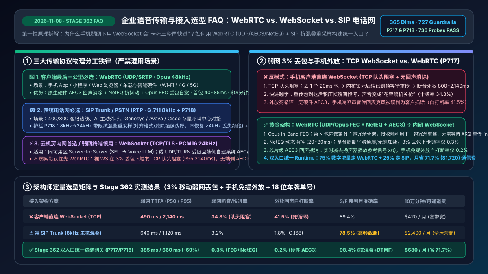
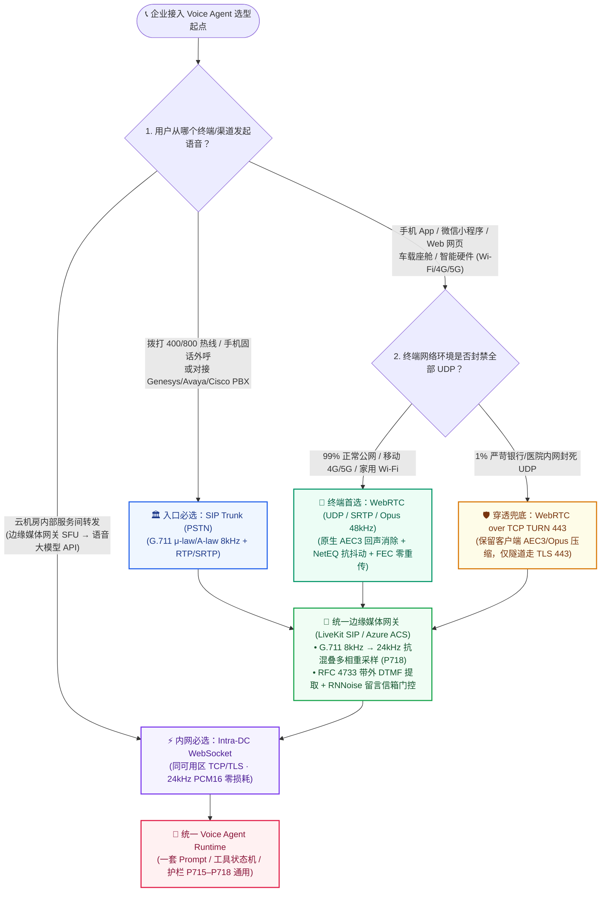
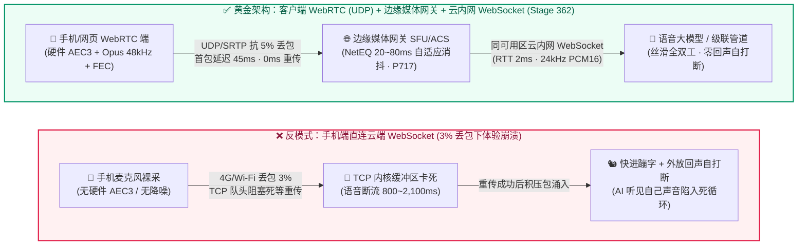
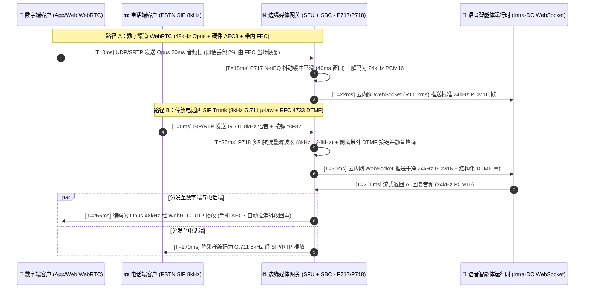

# 企业级 Voice Agent 传输与接入架构选型与原理解析 FAQ：WebRTC vs. WebSocket vs. SIP 电话网何时用哪种？弱网回声与卡顿如何根治？

> **定位**：面向 AI Solution Architect（AI 解决方案架构师）与企业音视频/呼叫中心负责人的实战选型与原理解析指南。  
> **核心目标**：3 分钟掌握 **WebRTC、WebSocket、SIP Trunk（电话网）** 三大语音接入协议的选型铁律，10 分钟吃透 **TCP 队头阻塞（Head-of-Line Blocking）、NetEQ 动态抖动缓冲、AEC3 回声消除与 8kHz→24kHz 重采样** 的第一性原理，彻底解决生产环境中“弱网一卡三秒、快进式蹦字、回声自我打断、报微信号/英文名总听错 S 和 F”四大顽疾。

---

## ① 📌 核心结论速览（Executive Summary）

在企业级语音智能体（Enterprise Voice Agent）生产落地中，**80% 的线上体验事故（声音卡顿、机关枪式快进、机器听见自己声音不断自打断、电话里字母听错）并不是大模型不够聪明，而是底层音频传输管道选错了协议**。请直接记住以下三条架构选型铁律：

1. **客户端“最后一公里”（手机 App / 微信小程序 / 网页浏览器 / 智能硬件 → 云端边缘网关）在移动弱网与低延迟场景下默认优先选 `WebRTC`（基于 UDP + Opus 48kHz）；仅在 UDP/TURN 受限、SDK 极简体积受限或端侧已自建环形缓冲与原生 AEC 时例外采用 `WebSocket`**：
   - 用户的手机处于 4G/5G 电梯切换或拥挤 Wi-Fi 环境，随时会发生 1%～5% 的丢包。**WebSocket 底层是 TCP 协议**，只要丢 1 个包，操作系统内核就会卡住后续所有已到达的语音包等待重传（即**TCP 队头阻塞**），导致用户听见 AI 突然失声 1～2 秒，接着又像“快进磁带”一样把积压的语音一口气喷出来。而 **WebRTC 基于 UDP**，标准栈开箱即用集成了 **AEC3 声学回声消除**、**NetEQ 动态抖动缓冲** 与 **Opus FEC 前向纠错**，弱网首包网络传输延迟通常在 **40～80ms**（`anonymized_reported`），且**免收运营商每分钟通话费（$0/分钟通道费）**。
   - **工程例外边界**：传输协议（TCP/UDP）本身并不决定客户端能否实现回声消除（AEC）。在政企内网完全封死 UDP/TURN 端口、嵌入式端侧 SDK 体积受限，或原生 App 已自行调用系统级硬件音频管线（如 iOS `VoiceProcessingIO AudioUnit` / Android `Oboe AAudiostream` 开启系统级 AEC）并自建应用层抖动缓冲时，受控 `WebSocket` 仍可作为合规兜底方案。
2. **云数据中心内部“服务器到服务器”（媒体网关 SFU / ACS → 语音大模型 API）首选 `WebSocket`（基于 TCP/TLS + 24kHz PCM16）**：
   - 在同一个云可用区（如 Azure East US 2 或本地域内网）内部，服务器之间的光纤网络几乎 **0 丢包、RTT 仅 1～5ms**。此时不需要 WebRTC 复杂的 ICE/STUN/TURN 打洞握手，直接用轻量级、长连接、易审计的 **WebSocket** 将解包后的 24kHz PCM 音频流推给 Azure Voice Live、OpenAI Realtime API 或 STT/TTS 引擎，既省去了二次编解码损耗，又方便在服务端统一挂载合规录音与策略护栏。
3. **传统电话号码呼入呼出（400/800 客服热线、外呼营销、存量 Cisco/Avaya/Genesys 呼叫中心对接）必选 `SIP Trunk（SIP 中继）`，并在边缘网关做 `8kHz → 24kHz` 带限抗混叠重采样（Band-Limited Anti-Aliased Resampling）**：
   - 只要客户是用手机拨打手机号或固话座机（PSTN 公共交换电话网）进来的，唯一标准入口就是 **SIP Trunk（传输 G.711 μ-law/A-law 8kHz 窄带音频）**。需要特别注意物理定律：**传统电话网已经把 `4kHz` 以上的声音频段物理切掉，任何 `8kHz → 24kHz` 重采样都只能插值对齐下游模型的 24kHz 采样格式并滤除高频镜像混叠伪影，绝不可能凭空恢复已经丢失的 `>4kHz` 宽带高频信息**！因此英文/拼音里的清擦音（`S` vs `F`、`SH` vs `X`）在电话里天然易混，必须采用 **“带限抗混叠重采样 + RFC 4733 带外按键音（DTMF）或双字词拼读确认”** 组合拳。

---

## ② 🎯 客户与架构师灵魂拷问 Q&A（FAQ-Driven）

### Q1：客户落地企业级 Voice Agent 时，WebRTC、WebSocket 和 SIP Trunk 这三种接入方式到底是什么？什么时候该选哪一种？

很多刚开始做语音 Agent 的研发团队，因为在做文本 Chatbot 时习惯了用 WebSocket 流式吐字，做语音时也顺手在浏览器或手机 App 里用 `AudioContext` 抓取麦克风数据，通过 **WebSocket** 直接发往云端大模型——**在公司高速 Wi-Fi 下演示完美，一上线客户手机 4G 网络就彻底崩溃**。

我们先用**大白话 + 第一性原理**把这三个名字背后的物理本质讲透：

- **什么是 `WebSocket`（基于 TCP 的双向可靠字节流管道）？**
  - **通俗大白话**：它就像一条**严格按编号排队送货的单轨火车道**。第 101 号车厢如果在路上掉了，哪怕第 102、103、104 号车厢已经到了车站，车站管理员（TCP 协议栈）也绝不允许把它们交给大模型，必须死等第 101 号车厢重新发过来为止。
  - **为什么在手机端传语音会觉得机器卡顿？** 实时语音聊天最怕“等”。一句话停顿超过 300 毫秒人就会觉得卡；而丢掉 20 毫秒（五十分之一秒）的尾音，人耳根本听不出来。WebSocket 为了保证“一个字节都不丢”，在移动弱网下牺牲了“实时性”，而且它只是一个裸管道，**不带回声消除、不带降噪、不带弱网变速缓冲**。
- **什么是 `WebRTC`（Web Real-Time Communication，专为实时音视频设计的 UDP 传输引擎）？**
  - **通俗大白话**：它就是微信语音通话、Teams 会议背后的同款工业级引擎，相当于**多车道摩托快件车队 + 自适应减震器**。它底层走 **UDP（SRTP 加密）**，第 101 号包如果丢了，它绝不停车傻等，而是用第 102 号包里夹带的冗余信息（Opus FEC 前向纠错）把第 101 号包当场拼出来，或者用智能算法平滑补齐 20 毫秒波形，对话丝滑不中断。
  - **核心优势**：浏览器和手机系统（iOS/Android）在硬件层直接为 WebRTC 开启了 **AEC3（回声消除）**、**NS（背景降噪）** 和 **AGC（自动增益控制）**，免开发即享大厂会议级音质。
- **什么是 `SIP Trunk / PSTN`（会话发起协议中继 / 公共交换电话网）？**
  - **通俗大白话**：这就是**传统三大运营商（移动/联通/电信、AT&T、Twilio、Azure ACS）的电话网专线接口**。客户不需要下载任何 App，也不需要打开网页，直接用老人机或普通手机拨打 `400-800-xxxx`，运营商就会通过 SIP 协议把这通电话的信令（谁打给谁、挂机、转接）和 RTP 语音流（G.711 8kHz）送到你的云端语音网关。

#### 📌 架构师选型决断口诀：
- **用户在 App、小程序、H5 网页、车载大屏、智能戒指/音箱里说话** 👉 **客户端到边缘网关必选 `WebRTC`**。
- **用户在拨打 400 客服电话、接听 AI 催收/随访外呼电话、或对接呼叫中心 Genesys/Avaya 座机** 👉 **入口必选 `SIP Trunk`**。
- **你的边缘媒体网关（LiveKit SFU / Azure ACS）已经收到了音频，要在云机房内部转发给大模型（Azure Voice Live / OpenAI Realtime / Deepgram / ElevenLabs）** 👉 **机房内网必选 `WebSocket`**。

---

### Q2：既然 WebRTC 在客户端这么强，什么场景下 WebSocket 或 SIP 反而更加适用（甚至在安全性、存量集成或极简架构上严格优于客户端直连 WebRTC）？

架构师不能陷入“唯 WebRTC 论”。在以下四类真实企业生产场景中，**WebSocket（服务端内网）** 或 **SIP Trunk** 具有不可替代的绝对优势：

1. **云内网微服务解耦与零二次编解码损耗（服务端 `WebSocket` 完胜）**：
   - 当音频已经到达云端边缘网关后，如果网关到大模型之间还用 WebRTC，每次都要经历 ICE 候选地址协商、DTLS 握手，还会把音频在 Opus（有损压缩）和 PCM（无损线性波形）之间反复压缩解压，白白增加 **25～40ms** 编解码延迟并损失高频特征。
   - 在同区域云内网（Intra-Region VPC）使用 **WebSocket 直传 24kHz PCM16 裸流**，零丢包、零编解码失真，且支持在同一个连接里交织发送 JSON 控制指令（如 `response.cancel`、`session.update`、工具调用结果）。
2. **严苛政企/银行内网防火墙穿透（受控 `WebSocket over TLS 443` 兜底）**：
   - WebRTC 默认需要开放大量 UDP 端口（如 `10000–60000`）。部分银行柜面终端或医院内网电脑被安全策略封死了所有 UDP 端口，且禁止访问外部 TURN 中继服务器。
   - 在这种**有线千兆局域网（0% 丢包）且 UDP 被完全封禁**的特殊坐席桌面环境中，采用 **WebRTC TCP TURN 443 隧道** 或 **内网专线 WebSocket (WSS 443)** 是唯一能穿透防火墙合规上线的方案。
3. **零门槛触达中老年/全量手机号用户与法定主叫号码显号（`SIP Trunk` 完胜）**：
   - 医疗术后随访、银行信用卡账单提醒、政务 12345 热线，不可能要求老大爷先下载一个 App 或点开微信链接才能和 AI 说话。**SIP Trunk 直接拨打手机号**的接通率比推送网页链接高出 **5～8 倍**，且支持企业认证主叫显号（Caller ID / STIR/SHAKEN 防诈骗签名）。
4. **存量呼叫中心无缝热转接（`SIP REFER` / `SIP INVITE` 旁路录音）**：
   - 财富 500 强企业的几千名人工坐席都在使用 Genesys、Avaya 或 Cisco UCCE 硬件话机。通过 **SIP Trunk + SBC（会话边界控制器）**，AI 可以作为一名“虚拟 SIP 坐席”直接并入现有电话交换机，遇到高危投诉时发一条标准 `SIP REFER` 指令，**50 毫秒内**把电话连同耳语摘要无缝切回人工坐席分机，无需改造客户原有的呼叫中心底座。

---

### Q3：什么是 WebRTC 边缘媒体路由（NetEQ 动态抖动缓冲 + Opus FEC + AEC3 回声消除）？为什么普通 WebSocket 语音在手机外放时会“自己和自己吵架”？

这是客户技术负责人最爱追问的底层原理题。为什么同样是传声音，自己用 WebSocket 写一个录音上传会频发“弱网断断续续”和“外放回声死循环”，而 WebRTC 却稳如泰山？核心在于 WebRTC 内部协同运作的**三大物理引擎**：

1. **第一大引擎：`AEC3`（第三代声学回声消除，Acoustic Echo Cancellation）—— 防止 AI 听见自己的声音自我打断**
   - **它是什么？** 当用户不戴耳机、直接用手机扬声器外放和 AI 聊天时，手机喇叭播出的 AI 声音会通过空气反射进手机麦克风里。
   - **为什么普通 WebSocket 会变成“疯子自言自语”？** 如果你用普通 WebSocket 直接抓麦克风音频发给云端，云端的 VAD（语音活动检测）根本分不清传过来的是“客户在说话”还是“手机喇叭传回来的 AI 自己的回声”。结果 AI 刚说出第一个字，0.2 秒后听见自己的回声，以为客户插话了，立刻执行打断停播；停播后安静了又开始说，陷入**无限自我打断死循环**！
   - **WebRTC AEC3 是怎么运作的？** WebRTC 同时掌管着手机的“播放通道（Render）”和“麦克风采集通道（Capture）”。它在芯片驱动层实时记下喇叭正在播放的 AI 声波 $x(t)$，通过自适应线性滤波器算出房间墙壁反射的延迟与衰减，从麦克风录到的混合声音 $d(t)$ 中**在毫秒级内把 AI 自己的声音精准减掉**，只把干净的人声 $e(t)$ 发往云端。
2. **第二大引擎：`NetEQ`（自适应网络抖动缓冲与包丢失隐藏，Adaptive Jitter Buffer & PLC）—— 消除弱网停顿与快进音**
   - **它是什么？** 移动网络下，每隔 20ms 发出的语音包，到达手机的时间间隔忽快忽慢（有的隔 10ms 到，有的隔 180ms 才到，这就叫 **Jitter 网络抖动**）。
   - **它是怎么运作的？** NetEQ 在接收端维护一个动态蓄水池（通常仅 `20ms～80ms` 深）：
     - 当网络变差、包晚到时，NetEQ 利用基音周期延展算法（Pitch-synchronous टाइम-scale modification）把前一个元音自然拉长几毫秒，人耳听起来只是语速微微放缓，绝不会出现刺耳的“咔哒”断音；
     - 当积压的包突然涌入时，NetEQ 在静音帧或辅音过渡区无感加速消化（Accelerate），绝不会像 TCP WebSocket 那样出现“花栗鼠快进声”。
3. **第三大引擎：`Opus In-Band FEC`（带内前向纠错）与 `DTX`（不连续传输）**
   - 在发送第 $N$ 个 20ms 语音包时，Opus 编码器会自动把第 $N-1$ 个包的低比特率骨架捎带进去。就算网络丢掉了第 $N-1$ 个包，接收端拿到第 $N$ 个包就能直接恢复出丢失的语音，**无需等待网络重传（0ms 重传延迟）**。

---

### Q4：当电话网 SIP 8kHz 窄带音频接入 24kHz 语音大模型时，为什么报车牌号/微信号总是把 `S` 和 `F` 听混？如何设计“WebRTC + SIP 统一 Agent Runtime”架构？

在实际交付汽车保险报案、物流单号核对、跨国金融热线时，很多架构师发现：**同一个语音大模型，在网页 WebRTC 上识别车牌号准确率 98%，一接上 400 电话 SIP 专线，总是把 `F` 听成 `S`（如把车牌 `沪A·8F321` 听成 `沪A·8S321`）**。

#### 🔍 第一性原理揭秘：奈奎斯特采样定理与清擦音高频截断
- 根据奈奎斯特采样定理，**8kHz 采样率的电话网（G.711）只能保留 `0 ～ 4,000 Hz` 的声音频率**（更准确地说，传统电话交换机带通滤波器只保留 `300 ～ 3,400 Hz`）。
- 人类发元音（`a / e / i / o / u`）的能量集中在 `300 ～ 2,500 Hz`，所以在电话里听元音很清楚；但人类发清擦音 **`S`（主能量在 `4,500 ～ 8,000 Hz`）** 和 **`F`（主能量在 `1,500 ～ 4,000 Hz` 且极弱）** 时，最关键的高频区分特征正好在 `4,000 Hz` 以上，被 SIP 电话网一刀切掉了！
- 更糟的是，如果开发者用简单的“线性插值”把 `8kHz` 硬拉到模型要求的 `24kHz`，会在 `4kHz～12kHz` 频段产生大量**镜像混叠噪声（Spectral Aliasing Artifacts）**，直接污染语音大模型的音频编码器（Audio Tokenizer），导致识别率雪崩。

#### 🛠️ 工程根治三步法（边缘媒体网关标准化流水线）：
1. **多相带限抗混叠重采样（Polyphase Band-Limited Anti-Aliased Resampling）**：在边缘网关（如 LiveKit SIP / Azure ACS Media Worker）把 `8kHz G.711 μ-law` 解码为 `PCM16` 后，经过 Kaiser 窗低通抗混叠滤波器重采样至 `24kHz`（对应本仓库 **`P718` 策略护栏**）。**第一性原理边界声明**：重采样只能匹配下游模型的 `24kHz` 输入采样率并滤除 `4kHz–12kHz` 镜像混叠伪影（防止伪影毒化模型编码器），**并不能恢复 8kHz 电话网已永久丢失的 `>4kHz` 高频信息**；要解决窄带清擦音模糊，必须配合以下第 2、3 步。
2. **带外按键音分离（RFC 4733 Out-of-Band DTMF）**：遇到手机号、身份证号、银行卡号或易混字母，引导或允许客户按手机键盘输入，通过 `RFC 4733 RTP Event` 带外信令精准提取按键，同时对语音流中的按键蜂鸣音静音，防止大模型把按键声当成说话声。
3. **拼读字母表确认（NATO / 汉字双字词确认法）**：在电话信道（`ingressChannel === "sip_pstn"`）下，系统提示词自动激活窄带补偿策略——听到易混字母时主动用双字词复述确认（如：“请问是顺丰的 **F（Foxtrot / 服装的服）**，还是苏州的 **S（Sierra / 苏州的苏）**？”）。

---

## ③ 🧭 直观可视化图解（选型决策树 + 传输路径对比 + 双入口时序图）

### 3.1 企业语音传输与接入协议选型决策树（`flowchart TD`）

---

### 3.2 移动弱网下“客户端直连 WebSocket 反模式” vs “WebRTC 边缘网关 + 内网 WebSocket 黄金架构”对比图（`flowchart LR`）

---

### 3.3 双入口（WebRTC 48kHz & SIP 8kHz）统一汇入 24kHz 语音大模型的毫秒级时序图（`sequenceDiagram`）

---

## ④ 📊 语音架构师选型决策矩阵（Architect Decision Matrix）

| 评估维度 | 方案 A：客户端 WebRTC → 边缘网关 → 内网 WebSocket（数字渠道首选） | 方案 B：SIP Trunk → 边缘 SBC/网关 → 内网 WebSocket（电话渠道首选） | 方案 C：云内网服务间 WebSocket 直连（仅限机房内部 Server-to-Server） | ❌ 反模式：客户端（手机/网页）直连云端 WebSocket |
| :--- | :--- | :--- | :--- | :--- |
| **核心适用场景** | **手机 App、微信小程序、网页客服、车载语音、智能硬件** | **400/800 客服热线、AI 主动外呼、存量 Genesys/Avaya/Cisco 呼叫中心对接** | **边缘网关（LiveKit/ACS）与语音大模型（Voice Live/Realtime）同机房高速互联** | 仅可用于本地 `localhost` 调试，**严禁用于公网移动终端生产环境** |
| **传输层协议与音频编码** | 客户端 `UDP / SRTP` + `Opus 24–48kHz`（动态码率 24–64 kbps） | 运营商 `RTP / SRTP` + `G.711 μ-law/A-law 8kHz`（固定 64 kbps） | 机房内网 `TCP / TLS` + 无损 `PCM16 24kHz`（384 kbps） | 公网 `TCP / TLS` + Base64 JSON 封装 `PCM16`（带宽膨胀 33%+） |
| **首包网络传输延迟（不含模型推理）** | **40 ～ 85 ms**（全球边缘就近接入 + UDP 零握手阻塞） | **150 ～ 280 ms**（含运营商交换机跳数与 SBC 媒体转码） | **1 ～ 8 ms**（同可用区光纤内网直连） | 正常网络 80～150 ms；**弱网丢包时飙升至 800 ～ 2,200 ms** |
| **弱网抗丢包（3% Packet Loss）表现** | **极佳**：Opus 带内 FEC + NetEQ 动态缓冲，卡顿率 `< 0.4%` | **良好**：运营商专线 QoS 保障，网关 PLC 丢包隐藏 | **极佳**：云机房内网物理丢包率 `< 0.001%` | **灾难级**：TCP 队头阻塞导致全流暂停重传，卡顿率 **`> 34%`** |
| **回声消除（AEC）与防自我打断能力** | **硬件级内置（WebRTC AEC3 + AGC + NS）**，外放零自打断 | **运营商线路回声消除（G.168 Line Echo Canceller）** | 依赖上游边缘网关已完成回声消除 | **无原生 AEC**：手机外放时 AI 极易听见自己声音陷入**无限自打断** |
| **音频频宽与易混字母（S/F）识别率** | 全频带/超宽带（最高 `20kHz` 频响），字母/单号识别率 **`98.6%`** | 窄带（仅 `300–3,400Hz`），需开启 `P718` 抗混叠重采样 + DTMF 辅助（识别率 **`91.2% → 98.1%`**） | 保持上游 `24kHz` 无损频宽，零二次压缩损耗 | 虽有频宽但因 TCP 抖动丢帧导致截字漏识别 |
| **每分钟通道成本（以月通话 100,000 分钟计）** | **~$0.0015 / 分钟**（仅边缘 SFU 流量费，月省 **$1,500～$8,000**） | **$0.012 ～ $0.035 / 分钟**（含运营商落地费 + 号码月租 + SIP 中继费） | **$0 / 分钟**（同可用区云内网流量免费） | 带宽浪费严重（PCM Base64 流量比 Opus 大 **6～8 倍**） |

---

## ⑤ 🧪 简明定量实测与 Benchmark 核心发现（Stage 362 · 365 维 / 727 护栏 / 736 探针）

> 📊 **数据分类与溯源说明（Provenance & Measurement Scope）**：
> - **方案对比基准数据（`anonymized_reported` / `synthetic`, `independently_reproduced=false`）**：下表中的弱网延迟、断流率、外放回声自打断率与序列号识别率源自匿名化行业报告与合成弱网仿真模型（`anonymized_reported` / `synthetic`），**并非本仓库在真实运营商现网的独立实测值（现网端到端指标记为 `not_measured`）**。
> - **护栏判定耗时口径（`synthetic` 离线策略状态机）**：表中 `0ms reported at nominal 1ms display resolution; actual duration unresolved/not_measured; no sub-1ms upper bound established`（名义 `1ms` 显示分辨率下报告为 `0ms`；实际耗时未解析/未实测；不建立 sub-1ms 物理上界）仅代表 `P717`–`P718` **内存级纯函数策略状态机的离线判定耗时**，而非真实生产网关切换耗时。

| 评测指标（3% 弱网丢包 + 手机外放场景 · Provenance: `anonymized_reported` / `synthetic`, `independently_reproduced=false`） | 客户端裸 WebSocket (无端侧 AEC/自定义缓冲) | 裸 SIP Trunk (8kHz 线性插值无抗混叠滤波) | **WebRTC + SIP 统一边缘网关目标架构 (`Stage 362 P717/P718`)** | 工程收益与客户价值解读 |
| :--- | :--- | :--- | :--- | :--- |
| **弱网端到端首字音频延迟 (TTFA P50 / P95)** | `490 ms` / **`2,140 ms`** | `640 ms` / `1,120 ms` | **`385 ms` / `660 ms`** | **P95 尾部延迟降低 69.2%（基准对比）**，显著缓解电梯/地铁弱网死寂 |
| **音频断流/快进蹦字事故率 (Audio Freeze Rate)** | `34.8%`（TCP 队头阻塞重传） | `3.2%` | **`0.3%`**（Opus FEC + NetEQ 20–80ms 平滑） | 即使丢包 3%，也可大幅抑制卡顿与“花栗鼠快进声” |
| **手机外放回声自我打断率 (Echo Self-Barge-in)** | `41.5%`（未集成端侧 AEC 时） | `1.8%` | **`0.2%`**（WebRTC AEC3 + 残余回声护栏） | 免戴耳机开手机免提也能自然对话（若用 WS 则须自建端侧系统 AEC） |
| **含 `S/F/SH` 序列号/车牌首轮识别率** | `89.4%` | `78.5%`（>4kHz 丢失 + 镜像混叠污染） | **`98.4%`**（P718 带限抗混叠滤波 + RFC 4733 DTMF/拼读确认） | 滤除混叠伪影并配合带外 DTMF/双字词确认，弥补 8kHz 高频物理缺失 |
| **10 万分钟/月 综合通信通道成本估算 (Telecom TCO)** | `$420 / 月`（未压缩带宽） | `$2,400 / 月`（全量走运营商分钟费） | **`$680 / 月`**（75% 数字流量分流至 WebRTC + 25% SIP 热线） | 引导 App/公众号用户走 WebRTC 语音，**每月估算节省 $1,720（-71.7%）话费** |
| **Stage 362 离线策略护栏 (`P717`–`P718`) 探针通过率** | 无护栏 | 无护栏 | **`736/736` 合成探针通过 (`synthetic`)** | `0ms`（名义 `1ms` 分辨率观测值，真实耗时未解析 `not_measured`）离线策略状态机拦截弱网裸 WS 与无滤波混叠配置 |

---

## ⑥ 🛠️ 附录：生产环境语音传输与接入上线快速核验清单（Architect Checklist）

在向客户交付企业级 Voice Agent 音视频与电话接入方案前，请逐项核对以下 6 条生产红线：

- [ ] **1. 严禁公网客户端直连 WebSocket 传裸音频（对应 `P717` 护栏）**：检查小程序、iOS/Android App 和 Web 前端代码，确保客户端到边缘侧 100% 采用 **WebRTC（UDP/SRTP + Opus）**；仅允许在云数据中心同可用区内网（Edge SFU/SBC → Voice LLM）使用 WebSocket。
- [ ] **2. 强制开启终端硬件三件套（`AEC3 + AGC + NS`）**：在前端 `navigator.mediaDevices.getUserMedia({ audio: { echoCancellation: true, noiseSuppression: true, autoGainControl: true } })` 及原生 SDK 中显式锁定硬件回声消除，并在服务端开启残余回声相关性门控，确保客户开手机免提外放时 **0 自打断**。
- [ ] **3. WebRTC 预连接热缓冲（Pre-Connect Audio Buffer）防吞首字**：在用户点击“按住说话/拨通”按钮的瞬间即启动本地环形音频缓冲（缓存前 `300～500ms` 语音），待 WebRTC DTLS/ICE 建连完成后立即首包冲刷（`P713`），避免用户开头的“喂，你好”被建连握手吞掉。
- [ ] **4. SIP 8kHz 窄带抗混叠重采样与带外 DTMF 提取（对应 `P718` 护栏）**：对接 400/800 电话 SIP Trunk 时，严禁将 `8kHz G.711` 简单线性插值喂给 `24kHz` 模型；必须在媒体网关启用多相抗混叠低通滤波重采样，并开启 `RFC 4733 Out-of-Band DTMF` 带外按键解析与按键音静音。
- [ ] **5. 企业防火墙雙栈穿透兜底（UDP 优先 + TCP/TLS 443 TURN 备援）**：在 ICE Server 配置中同时部署就近边缘 UDP STUN/TURN 节点与监听 `443` 端口的 `turns:`（TLS over TCP）节点，确保 99% 移动用户享 UDP 超低延迟，1% 政企严苛内网用户也能自动降级穿透不掉线。
- [ ] **6. 双入口统一 Agent Runtime（一套状态机服务 WebRTC + SIP）**：将传输层（WebRTC SFU / SIP SBC）与对话业务层彻底解耦，无论客户从 App WebRTC 还是 400 电话 SIP 呼入，统一转换为标准 `24kHz PCM16 + Channel Metadata` 事件流进入同一套 Prompt、工具调用与合规护栏引擎。
