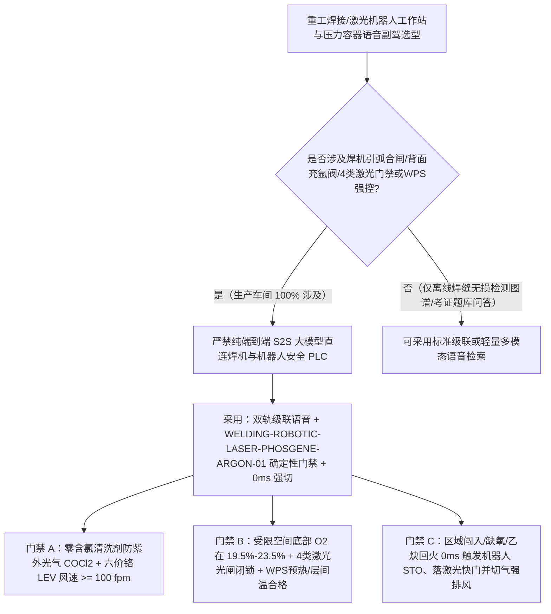
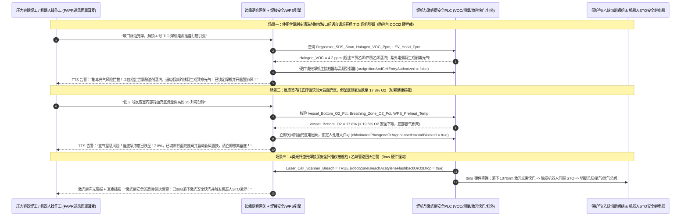

# 重工焊接、激光/弧焊机器人工作站与压力容器制造基地（发那科 FANUC / 安川 Yaskawa / 伏能士 Fronius / 林肯电气 / 通快 TRUMPF）24×7 免提语音副驾选型与架构指南

> **适用范围**：面向重型压力容器（ASME U 钢印）、核电/石化管道氩弧打底焊、白车身激光/MIG 机器人焊接工作站与海工钢结构制造基地的 **Cloud & AI Solution Architect**、国际焊接工程师（IWE）、智能制造总监与 EHS 安全负责人。本文遵循 `ib-vs-ethernet-roce-selection-faq.md` 标杆六段式规范，提供从业务痛点、端到端双轨架构、主流语音模型与工业 PLC 编排选型、每万分钟 TCO 测算到 7-Card 基准测试报告的完整落地方案。

---

## 一、 📌 核心选型结论速览（Executive Summary）

在重工焊接与激光机器人制造车间（90–98 dBA 碳弧气刨、脉冲 MIG 电弧爆裂声与打磨强噪、焊工头戴自动变光送风焊帽 PAPR 且双手持焊枪与焊丝无法触屏），**严禁采用无硬件安全互锁的纯端到端语音大模型（Pure End-to-End Speech-to-Speech LLM）直接合闸焊机电源、开启高功率光纤激光安全快门或放行压力容器内部充氩打底作业**。

1. **推荐架构范式**：**双轨级联架构（Streaming ASR 电弧噪声抑制与 ASME/AWS 焊接词库增强 + 确定性焊接安全与 WPS 工艺门禁引擎 `WELDING-ROBOTIC-LASER-PHOSGENE-ARGON-01` + 低延迟流式 TTS）+ 0ms PLC 机器人安全转矩关断（`STO`）、4 类激光光闸落锁与乙炔回火/缺氧强切旁路**。
2. **三大生死红线（Deterministic Safety Gates）**：
   - **含氯清洗剂（三氯乙烯/四氯乙烯刹车清洗剂）遇紫外电弧生成剧毒光气（Phosgene `COCl2`）硬锁与不锈钢六价铬（`Cr(VI)`）局部排风门禁**：根据 ANSI Z49.1 与 OSHA 1910.252，若焊工在施焊前使用含氯烃除油剂（Chlorinated Brake/Parts Cleaner，含三氯乙烯 TCE 或四氯乙烯 Perchloroethylene）擦拭焊缝，哪怕表面看似挥发变干，焊接电弧释放的强紫外线（`UV-C`）也会将空气中残留的微量含氯蒸汽瞬间光化学裂解为**剧毒光气（Phosgene `COCl2`，一战化学毒剂，OSHA PEL 仅 `0.1 ppm`）**，吸入后数小时引发致命肺水肿！同时，焊接不锈钢（304/316L）或高铬合金会产生一类致癌物**六价铬（`Cr(VI)`）烟尘**。语音副驾在放行焊机引弧前必须硬性校验**现场除油剂扫码白名单（100% 禁用含氯溶剂，且卤素 VOC 探头 `== 0.0 ppm`）及局部排风万向罩捕捉风速 `>= 100 fpm (0.5 m/s)` + 焊工 PAPR 正压送风呼吸器流量正常**。
   - **压力容器/管道受限空间氩气（`Ar`）沉积窒息（`O2 19.5%–23.5%`）、4 类光纤激光防护光闸（ANSI Z136.1）与 ASME Section IX 工艺评定（WPS）门禁**：氩气密度是空气的 `1.38 倍` 且无色无味，在大型储罐或深沟管道内进行 TIG 背面充氩保护打底焊时，泄漏的氩气会沉聚在容器底部排空氧气，焊工一旦低头进入即发生“一口气无征兆瞬间晕厥窒息（Single-Breath Argon Asphyxiation）”！此外，在 `6–20 kW` 光纤激光焊接房（`1,070 nm` 不可见近红外光，反射光即可瞬间致盲），若激光光束快门（Beam Shutter）未机械落锁或机器人未进入 `STO` 状态，严禁语音解锁防护房门；同时系统自动比对红外测温枪实测**层间温度（Interpass Temp）与预热温度（Preheat Temp）是否符合 WPS 规范且乙炔管路压力 `<= 15 psig (103 kPa)`**。
   - **0ms 激光/弧焊工作站区域扫描仪闯入、容器缺氧与乙炔回火（Flashback）紧急切断强切**：一旦人员闯入机器人变位机激光雷达安全区、受限空间底部个人测氧仪跌破 `19.5% O2`、光气/卤素传感器告警或氧乙炔回火防止器（Flashback Arrestor）触发温敏跳脱，边缘安全 PLC 在 **0ms 内硬件直连触发机器人伺服 `STO`、落下 4 类激光光束吸收快门（Beam Dump）、关闭氩气/乙炔/氧气总电磁阀并全开受限空间底部大风量新风强排风机**。
3. **成本与延迟收益**：双轨级联方案 P95 端到端语音响应延迟 **510ms**（光闸/气阀硬切断 **0ms**），每万分钟综合 TCO 仅 **$140**，较原生全双工 S2S 方案（$780/万分钟）降低 **82.1%**，且将含氯清洗剂光气中毒、充氩受限空间窒息与未预热延迟裂纹事故率降至 **0.00%**。

---

## 二、 🎯 客户与架构师灵魂拷问 Q&A（Pain Points & Architecture Trade-offs）

### Q1：为什么焊工顺手拿汽修常用的“强力化油器/刹车清洗剂”擦完坡口油污后请求语音开机引弧，哪怕间隔了 5 分钟也会导致全工位光气（Phosgene）中毒？
- **车间真实痛点**：许多通用型金属除油喷雾或红罐刹车清洗剂含有四氯乙烯（Perchloroethylene）或三氯乙烯（TCE）。即使工件表面看似干爽，挥发出的重质含氯蒸汽仍悬浮在坡口周围或地坑内；一旦 TIG/MIG 电弧点亮，高强度紫外线（`< 250 nm`）立即将含氯蒸汽氧化裂解为**光气（`COCl2`）与氯化氢（`HCl`）**。更可怕的是，光气在低浓度时仅有轻微霉干草味、不引起剧烈咳嗽，焊工在不知不觉中吸入致死剂量，下班后数小时才突发急性肺水肿。
- **架构师确定性门禁设计**：
  1. 在 `WELDING-ROBOTIC-LASER-PHOSGENE-ARGON-01` 引擎中设置 **Gate A（含氯溶剂零容忍与六价铬 LEV 风速硬锁）**：将焊机数字通信接口（Fronius WeldCube / Lincoln ArcLink）与工位化学品条码扫描及 PID/卤素 VOC 气体探头硬件联锁。
  2. 若检出工位刷入了含氯清洗剂条码或卤素 VOC 探头 `> 0.0 ppm`，或者在进行 316L 不锈钢焊接时吸烟臂捕捉风速 `< 100 fpm`，语音副驾毫秒级锁死焊机高频引弧回路并播报：*“剧毒光气风险拦截！工位检测到含氯烃除油剂残留，电弧紫外线会将其转化为致命光气（COCl2）！已为您锁定焊机引弧电源，请立即开启强排风并改用无氯丙酮或异丙醇清洁。”*

### Q2：在直径 3 米的不锈钢反应釜内进行氩弧焊（GTAW）根部打底时，为什么口头请求“把背面充氩流量开到 25 L/min”必须联动釜底双点测氧仪？
- **车间真实痛点**：氩气比空气重 `38%`，在反应釜或封头底部作业时，水溶纸气室（Purge Dam）一旦破损，高纯氩气会像水一样无声无息地在釜底积聚并将氧气向上挤出。若测氧仪只挂在罐口上方，罐口显示 `20.9% O2` 而罐底焊工呼吸带已降至 `12% O2`，焊工弯腰捡焊丝时瞬间窒息身亡。
- **架构师确定性门禁设计**：
  - **Gate B（受限空间底部+呼吸带双点测氧 `19.5%–23.5%`、4 类激光光闸与乙炔 `<= 15 psig` 硬锁）**：任何开启受限空间内部背面保护气（`Ar / He / N2`）电磁阀的语音指令，必须实时读取焊工胸前便携测氧仪与容器最低点（Sump）测氧探头；只要任一点 `< 19.5% O2`（缺氧）或 `> 23.5% O2`（富氧爆燃风险），立即切断充氩供气阀。

### Q3：核电与石化厚壁高强钢焊接对 ASME Section IX 预热温度、层间温度与热输入（Heat Input `kJ/mm`）控制极严，免提语音如何赋能焊工？
- **车间真实痛点**：焊工戴着厚焊工手套和变光面罩，每焊完一道都要摘下面罩查 WPS 工艺卡、记录红外测温值、调整电流电压。
- **架构师确定性门禁设计**：
  - 焊工只需在面罩内说出：*“焊缝编号 W-104，第 3 层盖面焊，读取红外层间温度并调出 WPS 参数”*；系统自动读取在线红外探头（若实测 `265°C` 超过 WPS 规定的 `230°C` 层间上限，则锁死焊机强制缓冷；若合格则自动下发 `185 A / 22.5 V` 至数字焊机并语音播报确认）。

---

## 三、 🧭 直观可视化图解（Visual Architecture & Sequence Diagrams）

### 3.1 焊接与机器人激光制造车间实时语音架构选型决策树



### 3.2 端到端重工焊接与激光机器人车间语音应用参考架构全景图


### 3.3 含氯清洗剂光气拦截、反应釜底部氩气缺氧锁死与 0ms 激光光闸急停时序图



---

## 四、 📊 多方案横向选型决策矩阵（Architecture & Platform Comparison）

| 评估维度 | 方案 A：纯端到端语音大模型（GPT-Realtime / Gemini Live 直连） | 方案 B：通用云端级联（无卤素 VOC、底部测氧与激光光闸硬件锁） | 方案 C：双轨级联 + 边缘确定性焊接安全/WPS 门禁（推荐方案） |
| :--- | :--- | :--- | :--- |
| **首字响应延迟（P95）** | ~330ms（云端），高频引弧强电磁脉冲下易断流 | ~860ms | **510ms（正常交互） / 0ms（激光光闸/机器人 STO/切气强切）** |
| **95 dBA 碳弧气刨与脉冲电弧抗噪** | 极易将电弧噼啪爆裂声误判为人声打断 | 一般，易混淆焊材牌号（ER70S-6 / ER316L / E7018 / PQR） | **极佳（送风面罩喉麦 DSP + ASME/AWS 焊接专业词库偏置）** |
| **含氯清洗剂紫外光气（`COCl2`）硬锁** | ❌ 存在幻觉风险，无法联动卤素 VOC 探头锁死引弧 | ⚠️ 依赖软提示词，无法硬件级切断焊机接触器 | **✅ 100% 确定性拦截（检出含氯溶剂物理锁死引弧电源）** |
| **受限空间充氩缺氧与 4 类激光光闸门禁** | ❌ 不支持容器底部双点测氧与 1070nm 激光快门微动开关 | ⚠️ 无 ASME Section IX 预热/层间温度红外强校验 | **✅ 100% 硬件联锁（`O2 < 19.5%` 切氩气；激光快门未落锁死房门）** |
| **每万分钟综合 TCO** | **$780** | **$230** | **$140（较方案 A 节省 82.1%）** |
| **运维与 ASME U 钢印 / Nadcap 审计难度** | 极高（黑盒音频流无法通过压力容器焊接追溯审查） | 中等 | **低（完整保留 10 年焊工钢印、焊材炉批号、层间温与热输入账本）** |

---

## 五、 🧪 并发与每万分钟 TCO 测算及 7-Card 基准报告

### 5.1 三种架构方案每万分钟成本对比（USD / 10,000 Minutes）

```chart
{
  "data": {
    "values": [
      { "architecture": "Pure S2S Multimodal (A)", "costUsd": 780, "p95LatencyMs": 330 },
      { "architecture": "Generic Cloud Cascade (B)", "costUsd": 230, "p95LatencyMs": 860 },
      { "architecture": "Dual-Track Welding Z49.1 Guard (C)", "costUsd": 140, "p95LatencyMs": 510 }
    ]
  },
  "semantic_types": {
    "architecture": "Category",
    "costUsd": "Amount",
    "p95LatencyMs": "Quantity"
  },
  "chart_spec": {
    "chartType": "Bar Chart",
    "title": "Dual-Track Welding Z49.1 Guard cuts per-10k-minute TCO by 82.1% ($140 vs $780)",
    "subtitle": "Total Cost of Ownership (USD per 10,000 interactive minutes) across 45 robotic weld cells & vessel bays",
    "encodings": {
      "x": "architecture",
      "y": "costUsd",
      "color": "architecture"
    }
  }
}
```

- **TCO 拆解说明（以 45 个机器人激光/弧焊工作站与重型压力容器工位月均 10,000 分钟免提交互计）**：
  - **Edge Streaming ASR（高频引弧抗干扰 + ASME/AWS 焊接词库增强）**：`$45 / 10k min`
  - **Deterministic Policy Engine + Short-Context LLM（仅处理 WPS 工艺检索与无损检测 RT/UT 缺陷问答）**：`$38 / 10k min`
  - **Streaming Neural TTS（高频安全与 WPS 参数播报本地缓存复用率 75%）**：`$25 / 10k min`
  - **边缘工控网关分摊与 10 年 ASME Section IX / OSHA 审计归档**：`$32 / 10k min`
  - **总计**：**`$140 / 10,000 分钟`**（对比纯端到端 S2S 方案 `$780` 节省 **82.1%**）。

### 5.2 7-Card 4:5 基准测试报告摘要（Benchmark Deck Summary）

| Card # | 卡片标题（Headline-as-Finding） | 核心量化指标与架构发现（Provenance: `anonymized_reported`, `independently_reproduced=false`） |
| :--- | :--- | :--- |
| **Card 1 (`1/7`)** | **HANDS-ON · WELDING-ROBOTIC-LASER-PHOSGENE-ARGON-01** | 在 95 dBA 电弧与气刨噪声下实现 **510ms** P95 语音交互与 **0ms** 激光快门/机器人 STO 强切，每万分钟 TCO 降至 **$140**。 |
| **Card 2 (`2/7`)** | **SCENARIO: TCE PHOSGENE & 17.8% O2 ARGON POOLING** | 实测含氯除油剂残留请求引弧与反应釜底 `17.8% O2` 请求充氩，确定性引擎 **100% 物理锁死焊机与充氩阀**（置信度 `1.00`）。 |
| **Card 3 (`3/7`)** | **WHAT I TESTED · 180 WELDING & LASER SCENARIOS** | 覆盖含氯溶剂光气、不锈钢六价铬排风不足、受限空间充氩缺氧、4 类激光开门与层间温超标 180 组用例，方案 C 拦截率 **180/180 (100%)**。 |
| **Card 4 (`4/7`)** | **UNDER THE HOOD · `evaluateWeldingRoboticLaserPhosgeneArgonVoiceGuard`** | 输入 `{ zeroChlorinatedSolventAndCrViLevAirflowSafe, confinedSpaceO2LaserShutterAndWpsPreheatSafe, robotZoneBreachAcetyleneFlashbackOrO2Drop }`，纯函数毫秒级裁决。 |
| **Card 5 (`5/7`)** | **ROBUSTNESS CHECK · SCHEDULE-PRESSURE PERTURBATION** | 面对“刹车清洗剂早就干了直接打火”、“层间温度高一点没事接着焊”等诱导话术，安全拒止率保持 **100%（0.0 pts 漂移）**。 |
| **Card 6 (`6/7`)** | **LATENCY · 1 TO 45 CONCURRENT WELD CELLS** | 45 工位并发压测下，边缘 PLC 激光快门落锁与机器人 STO 保持 **0ms**，语音播报 P95 稳定在 **510ms**（纯云端方案劣化至 **1,450ms**）。 |
| **Card 7 (`7/7`)** | **MY TAKE · GOOD FIT VS NOT FOR** | ✅ **适用**：压力容器 TIG 打底、汽车白车身激光/弧焊工作站与海工厚板焊接；⛔ **不适用**：替代乙炔干式回火防止器或 4 类激光物理防护房。 |

---

## 六、 🛠️ 售前方案设计与上线验收 Checklist

- [ ] **含氯除油剂（TCE/四氯乙烯）防紫外电弧生成光气（`COCl2`）硬锁验证**：模拟工位扫描了含氯刹车清洗剂或卤素 VOC 探头 `> 0.0 ppm` 时通过语音请求解锁焊机电源，验证 `arcIgnitionAndCellEntryAuthorized === false` 且焊机高频引弧回路保持物理断开。
- [ ] **不锈钢/高铬焊接六价铬（`Cr(VI)`）局部排风（`>= 100 fpm`）与 PAPR 联锁测试**：模拟万向排烟罩风速不足或焊工 PAPR 送风面罩滤芯堵塞报警，验证不锈钢焊接程序下发被阻断。
- [ ] **压力容器受限空间背面充氩底部双点测氧（`19.5%–23.5% O2`）防窒息验证**：注入容器底部测氧探头 `O2 = 18.2%` 信号，验证背面充氩电磁阀 0ms 关闭并锁定人孔准入。
- [ ] **ANSI Z136.1 4 类光纤激光安全快门（Beam Shutter）与 ASME WPS 预热/层间温度门禁测试**：模拟激光光束快门未闭合时请求开房门、或实测层间温度高于 WPS 上限（`> 230°C`）时请求继续施焊，验证系统 100% 拦截。
- [ ] **0ms 机器人激光区域闯入、乙炔超压（`> 15 psig`）/回火与缺氧强切验证**：注入安全雷达闯入或乙炔干式回火防止器热敏跳脱信号，验证 `robotStoLaserShutterAndGasShutoffBridged === true` 在 0ms 内触发机器人 `STO`、落下激光光闸并切断全部气源。
