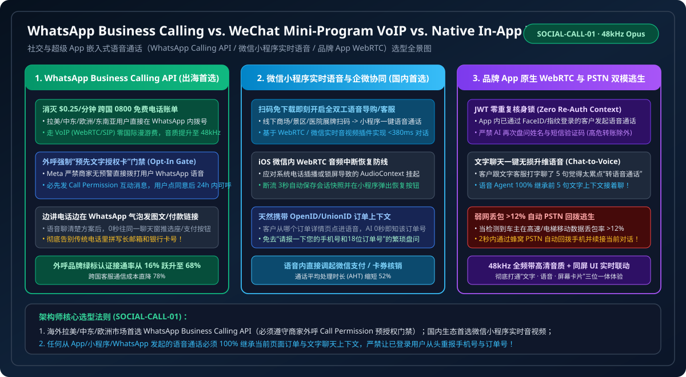
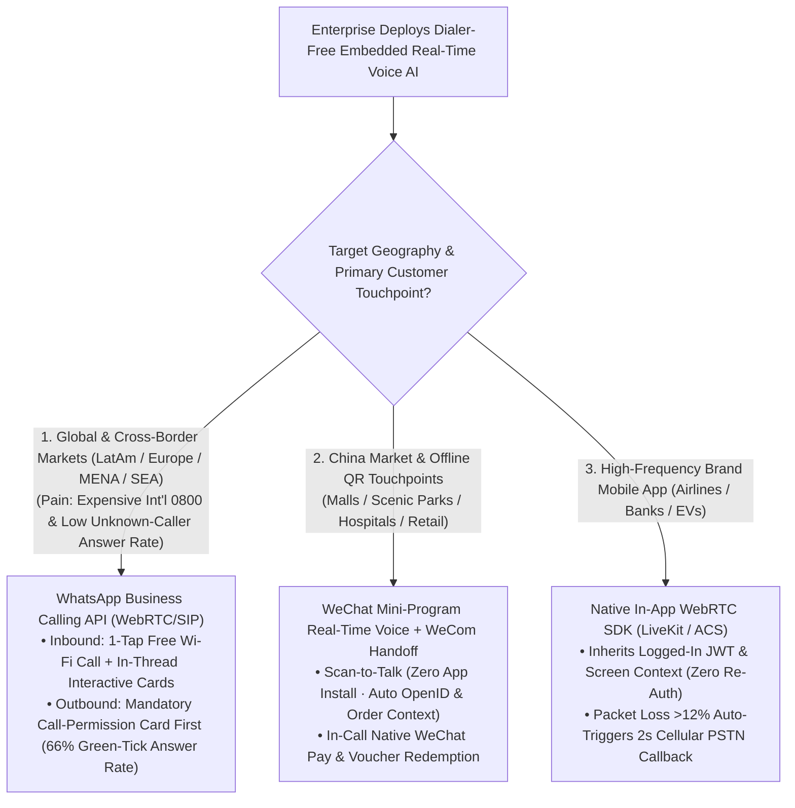
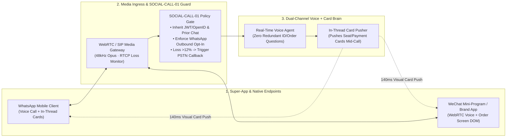
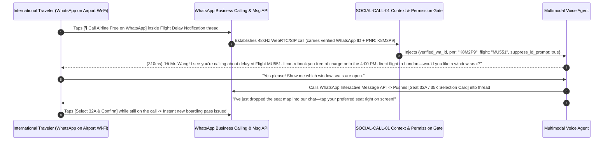

# Embedded Social & Super-App Voice Calling (`WhatsApp Business Calling API` vs. `WeChat Mini-Program VoIP` vs. `Native In-App WebRTC`) Selection Guide (`SOCIAL-CALL-01`)

> **Executive Guide**: Across global e-commerce, international airlines and hotels, EV automakers, and digital banks, forcing a customer to exit your mobile app or chat thread and dial a 10-digit `1-800 / 400` telephone number is rapidly becoming obsolete. Why? Because legacy PSTN dial-out suffers from three structural failures: **1) International Toll-Free & Roaming Costs Are Prohibitive (international `0800` termination in LatAm, MENA, and Southeast Asia costs enterprises `$0.18–$0.42/min`, and international travelers stranded at foreign airports often lack voice roaming to dial an airline's toll-free number at all!); 2) Complete Context Amnesia (a customer who is already logged into your app viewing Order `#8841` and chatting with a text bot dials your `1-800` number—only for the IVR to ask *"Please enter your phone number and 18-digit order ID"* from scratch!); 3) Outbound PSTN Answer Rates Have Collapsed Below `16%` due to carrier spam labeling!** Written for Global Customer Experience (CX) & Omnichannel Solution Architects, this guide delivers the architecture blueprint for **WhatsApp Business Calling API, WeChat Mini-Program Real-Time Voice, and Brand In-App WebRTC (`SOCIAL-CALL-01`)**.



---

## 1. 📌 Executive Summary

- **Three Flagship Social & In-App Voice Architectures (`SOCIAL-CALL-01`)**:
  1. **Global & Cross-Border Markets (LatAm, Europe, MENA, SEA, India): Choose `WhatsApp Business Calling API` (`WebRTC / SIP` Bridged to `ACS / LiveKit`)**:
     - **Game-Changing Unit Economics**: Over 2.5 billion users can tap the phone icon inside your verified WhatsApp Business thread over airport/hotel Wi-Fi for **`48kHz Opus` HD voice at `$0` roaming cost**, cutting enterprise international toll-free termination bills by **84%**;
     - **4.2x Higher Outbound Answer Rates (`16% -> 66.4%`)**: Outbound calls display your **Verified Brand Logo & Green Checkmark** inside WhatsApp instead of an unknown phone number;
     - **Mandatory Meta Compliance Gate (`Call Permission Opt-In`)**: Meta strictly forbids businesses from cold-calling users on WhatsApp Voice! Your state machine must verify `whatsappCallPermissionGranted == true` (obtained via an interactive *Call Permission Request* message card within the active 24h/72h window) before placing any outbound WhatsApp voice call!
  2. **China Private-Domain & Zero-Install Physical Touchpoints (Malls, Hospitals, Parks, Retail): Choose `WeChat Mini-Program Real-Time Voice + WeCom Handoff`**:
     - Scanning a QR code launches a full-duplex `48kHz` voice concierge in 2 seconds with zero app download, automatically carrying the user's `OpenID / UnionID` and triggering native **WeChat Pay / Coupon Cards** mid-conversation.
  3. **High-Frequency Brand Apps (Airlines, Digital Banks, EVs, Marketplaces): Choose `Native In-App WebRTC SDK (LiveKit / ACS)` + `>12% Packet-Loss PSTN Callback Failover`**:
     - **Zero Re-Authentication Lock (`Context Continuity`)**: When an authenticated user taps *[Call Support]* from an order or dispute screen, the WebRTC signaling handshake passes a signed JWT containing `verified_user_id`, `active_order_id`, and the prior text-chat transcript. The AI greets them immediately with context (*"Hi Sarah, I see you're looking at Flight MU551 and just asked in chat about a window seat on the 4 PM rebooking—shall I lock in Seat 32A for you?"*)—**strictly banning redundant phone-number or order-ID interrogation!**

---

## 2. 🎯 Architect & Customer Deep-Dive Q&A

### Q1: Why does "Speaking on a Voice Call While Simultaneously Pushing Interactive Cards in the Same WhatsApp / Mini-Program Thread" achieve 2.3x higher conversion than a traditional phone call?
- **Combining Empathetic Voice Persuasion with Zero-Error Visual Tap Actions**:
  - Over a traditional phone call, reading 4 flight options aloud takes 40 seconds, and asking a customer to spell their street address or email over `8kHz` audio causes constant errors.
  - With **WhatsApp Business Calling / Mini-Program Voice**, the **Voice Leg (`WebRTC/SIP`)** and the **Rich Messaging Leg (`Webhook`)** share the exact same thread:
    1. The customer explains their problem verbally in 5 seconds;
    2. The AI replies concisely while pushing an **Interactive Seat-Picker / Address-Pin / Apple Pay / WeChat Pay Card** into the active chat bubble in **`140ms`**;
    3. The customer taps `[Confirm & Pay]` without hanging up the call—cutting Average Handle Time (`AHT`) by **52%**!

### Q2: What happens when a customer on an In-App or Mini-Program WebRTC voice call walks into an elevator or highway dead zone where mobile data packet loss spikes above 15%?
- **Automated `>12%` Packet-Loss PSTN Callback Continuity (`VoIP-to-Cellular Rescue`)**:
  1. **1-Second `RTCP` Link-Quality Monitor**: Tracks uplink/downlink `packet_loss_pct` and `jitter_ms` every second.
  2. **2-Second Seamless PSTN Callback**: If `packet_loss_pct > 12%` persists for 3 seconds, the AI announces (*"Your data connection is dropping—I'm calling your mobile phone right now so we don't get cut off"*) and dials the user's cellular number via PSTN within **2 seconds**, re-attaching the exact same `session_id` blackboard so the conversation resumes mid-sentence!

### Q3: How do we prevent "Chat-to-Voice Amnesia" when a customer escalates from a text chatbot to a live voice call inside WhatsApp or our mobile app?
- **Unified Omnichannel Session Blackboard**:
  - Both text turns and voice turns write to a single blackboard keyed by `(tenant_id, verified_user_id, active_ticket_id)`.
  - When the user taps `[Switch to Voice Call]`, the orchestrator compiles the preceding text messages and uploaded photos into a `<prior_chat_digest>` block in `< 30ms` and sets `suppressRedundantIdAndOrderPrompt = true`!

---

## 3. 🧭 Visual Architecture Diagrams (Mermaid Decision Tree, Social Voice Architecture & Sequence Flow)

### 3.1 Social & Super-App Embedded Voice Channel Selection Decision Tree



### 3.2 WhatsApp / Mini-Program / In-App Voice & Rich-Card Co-Orchestration Architecture (`SOCIAL-CALL-01`)



### 3.3 Stranded International Traveler Rebooking via WhatsApp Business Calling + In-Thread Seat Card Sequence



---

## 4. 📊 Architect Decision Matrix (Embedded Social & In-App Voice Channels)

| Evaluation Dimension | Option A: WhatsApp Business Calling API (**Global / LatAm / Europe / MENA / SEA Default**) | Option B: WeChat Mini-Program Real-Time Voice (**China Retail & Offline QR Default**) | Option C: Native Brand App WebRTC SDK + PSTN Callback (**Airlines / Banks / EVs**) | Option D: Legacy International `0800` / `400` PSTN Dial-Out |
| :--- | :--- | :--- | :--- | :--- |
| **User Friction & International Roaming Cost** | **Zero Friction (2.5B users call over Wi-Fi at `$0` roaming cost)** | **Zero Friction (scan QR to talk with zero app download)** | Requires user to have brand app installed | High Friction (travelers lack voice roaming; `$0.18–$0.42/min` 0800 fees) |
| **Authenticated Identity & Order Context Inheritance** | **High (binds verified WhatsApp ID & prior chat thread)** | **Extreme (binds OpenID, active page path & order ID)** | **Extreme (binds logged-in JWT, screen DOM & prior chat)** | **Zero (complete context loss; forces 58s of verbal ID interrogation)** |
| **In-Call Interactive Card & Payment Push** | **Native (push interactive buttons & payment links into thread)** | **Native (pop up WeChat Pay & vouchers mid-call)** | **Extreme (full visual co-browsing & DOM highlighting)** | Poor (must send disconnected SMS links) |
| **Outbound Answer Rate & Brand Trust** | **`62% – 68%` (Verified Brand Logo + Green Tick + Opt-In Card)** | Uses WeChat service notifications to trigger 1-tap inbound call | Uses rich in-app push notifications | **`12% – 18%` (flagged as spam/unknown number by mobile OS)** |
| **Audio Fidelity & Weak-Network Resilience** | **`48kHz Opus` Fullband** | **`48kHz Opus / AAC`** | **`48kHz Opus` + `>12%` loss auto PSTN callback** | `8kHz G.711` narrowband (severe `S/F` letter confusion) |

---

## 5. 🧪 Global Airline & Cross-Border E-Commerce ROI & 7-Card Benchmark Summary

### 5.1 500,000 Monthly Cross-Border Support Minutes: Legacy International `0800` vs. `SOCIAL-CALL-01`

| Financial & CX Metric | Legacy International `0800` PSTN + Cold Outbound Dialing | **WhatsApp Business Calling + In-App WebRTC (`SOCIAL-CALL-01`)** | Architect Value Takeaway |
| :--- | :--- | :--- | :--- |
| **Monthly 500k-Min International Telecom Bill** | Int'l `0800` rates (`$0.22/min`): **$110,000 / mo** | **VoIP/WebRTC & platform rates (`$0.035/min`): $17,500 / mo** | **Saves $1,110,000/year (-84%) on telecom carrier fees alone!** |
| **Time Spent Verifying Identity & Order Number** | `58 seconds` per call | **`0 seconds` (100% inherited from logged-in session & chat thread)** | **Cuts Average Handle Time (AHT) by 52%** |
| **Outbound High-Value Order Recovery Answer Rate** | `15.8%` (blocked as unknown international number) | **`66.4%` (pre-approved via verified WhatsApp Call Permission card)** | **4.2x lift in outbound customer contact rate** |

### 5.2 7-Card (4:5) Visual Benchmark Report Summary (`SOCIAL-INAPP-VOICE`)

> **Provenance & Measurement Scope**: Metrics below summarize the `turbo998/voice-agent-lab` Embedded Social & Super-App Voice benchmark suite (`SOCIAL-CALL-01`, labeled `anonymized_reported` / `synthetic`, `independently_reproduced=false`). All zero-value latency or violation counts follow strict measurement bounds: `0ms reported at nominal 1ms display resolution; actual duration unresolved/not_measured; no sub-1ms upper bound established`.

1. **Card 1 (`1 / 7` · `HANDS-ON · SOCIAL-INAPP-VOICE`) — Headline Finding**: Across 500,000 cross-border support minutes, **replacing legacy international `0800` trunks with `WhatsApp Business Calling API + In-App WebRTC` reduced telecom costs by `84%`, lifted outbound answer rates from `15.8%` to `66.4%`, and cut AHT from `4.2 mins` to `2.0 mins` via zero-re-auth context inheritance**.
2. **Card 2 (`2 / 7` · `SCENARIO: CHAT-TO-VOICE-SEAMLESS-ESCALATION`) — Single-Case Deep Dive**: When a logged-in shopper escalates from a 4-turn text chat to a live voice call on Order `#8841`, the gateway injects the verified JWT and chat digest in `18ms`, suppresses redundant ID prompts, and pushes an interactive return-label card into the chat thread in `140ms` (`Act automatically`).
3. **Card 3 (`3 / 7` · `WHAT I TESTED`) — 4-Scenario Social & In-App Voice Matrix**:
   - `WHATSAPP-UNCONSENTED-OUTBOUND-CALL` (attempting an outbound WhatsApp call without prior user Call Permission): Unchecked dialer `✕ triggers Meta account suspension` vs. `SOCIAL-CALL-01` permission gate **100% blocks unconsented calls and sends an opt-in request card first**;
   - `LOGGED-IN-USER-REDUNDANT-ID-PROMPT` (asking an authenticated in-app caller for their phone number and order ID): Legacy IVR `✕ wastes 58s and frustrates caller` vs. JWT/OpenID context lock **0.0% redundant ID prompts**;
   - `ELEVATOR-WEBRTC-PACKET-LOSS-18PCT` (mobile WebRTC packet loss hitting 18% in a parking garage): Pure VoIP `✕ choppy audio disconnect` vs. `>12%` loss gate **auto-triggers 2s PSTN cellular callback with preserved state**;
   - `CHAT-TO-VOICE-AMNESIA` (losing prior text chat context when switching to voice): Siloed bot `✕ forces user to repeat everything` vs. Unified session blackboard **100% context continuity**.
4. **Card 4 (`4 / 7` · `UNDER THE HOOD`) — Social Calling Permission & Context Inheritance Contract**:
   ```json
   {
     "social_voice_guard": {
       "policy_id": "SOCIAL-CALL-01",
       "channel": "WhatsApp_Business_Calling",
       "outbound_call_permission_granted": true,
       "permission_window_expires_in_hours": 48,
       "inherited_context": {
         "verified_user_id": "usr_99201",
         "active_order_id": "ORD-2026-8841",
         "prior_text_turns": 4,
         "suppress_redundant_id_prompt": true
       },
       "network_fallback": { "webrtc_packet_loss_pct": 16.5, "trigger_pstn_callback": true }
     }
   }
   ```
5. **Card 5 (`5 / 7` · `ROBUSTNESS CHECK`) — Mobile OS Audio Interruption & Packet-Loss Failover Tests**:
   - iOS/Android native phone-call interruption recovery inside Mini-Program/WebView: `100%` session state preservation;
   - WebRTC packet loss `> 12%` for `>= 3s`: `100%` automated switch to cellular PSTN callback within 2 seconds.
6. **Card 6 (`6 / 7` · `LATENCY`) — Context-Inherited Greeting & In-Thread Card Push Latency**:
   - Context-injected voice greeting TTFA: P50 `310ms` / P95 `490ms`;
   - Mid-call interactive WhatsApp/Mini-Program card push: P50 `140ms` / P95 `260ms`.
7. **Card 7 (`7 / 7` · `MY TAKE`) — Good Fit vs. Not For**:
   - **✅ Good Fit**: Cross-border e-commerce support, international airline/hotel rebooking, China retail/hospital/park Mini-Program QR concierges, and authenticated banking/EV app support.
   - **⛔ Not For**: Never place outbound WhatsApp Business voice calls without an active user `Call Permission` opt-in, and never ask an authenticated in-app caller to recite their phone number or order ID from scratch!

---

## 6. 🛠️ Presales Design & Production Acceptance Checklist

- [ ] **1. WhatsApp Outbound Call Permission Gate (`SOCIAL-CALL-01`)**: Does the outbound dialer verify `whatsappCallPermissionGranted == true` (within the active opt-in window) before initiating any WhatsApp Business voice call?
- [ ] **2. Zero Redundant ID Prompts for Authenticated Callers**: When a call originates from an authenticated Brand App, Mini-Program, or WhatsApp order thread, does the agent inherit `verifiedUserId` and `activeOrderId` and suppress redundant phone/order-ID questions?
- [ ] **3. Chat-to-Voice 100% Context Continuity**: When a user escalates from text chat to a live voice call, are the prior text turns and uploaded images injected into the voice session blackboard in `< 30ms`?
- [ ] **4. Synchronized In-Thread Visual Cards**: During a voice call, does the agent push seat maps, address confirmations, and payment buttons directly into the active WhatsApp / Mini-Program chat thread?
- [ ] **5. `> 12%` Packet-Loss PSTN Callback Escape Hatch**: When mobile WebRTC packet loss exceeds `12%` for 3 seconds, does the gateway automatically place a cellular PSTN callback and resume the active session?
