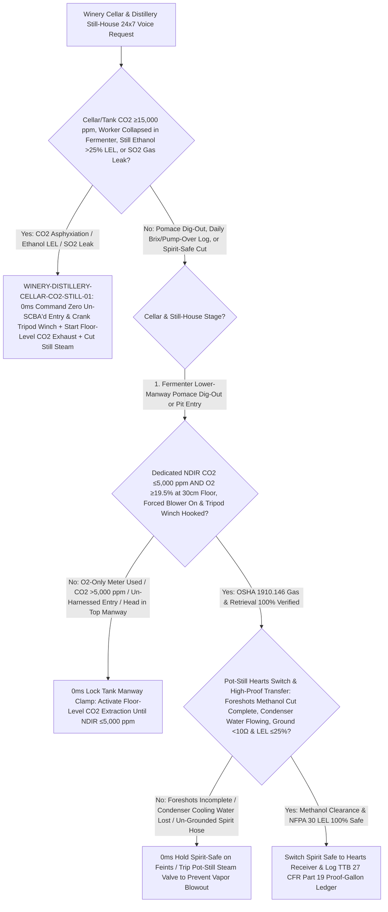
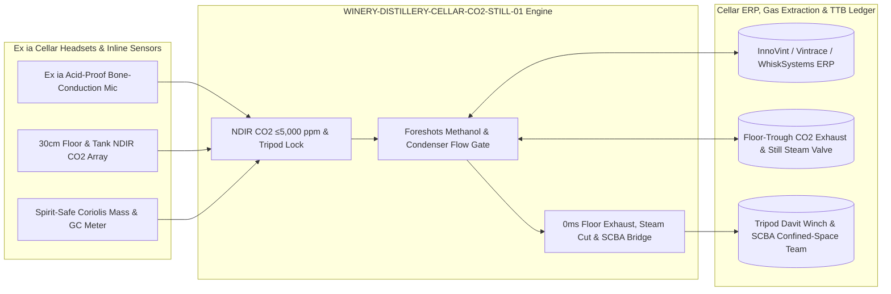

# Winery & Distillery Fermentation Cellar CO2, Pot-Still LEL & Methanol Cut Voice Copilot (Diageo / Pernod Ricard / Constellation / InnoVint): Floor CO2 (≤5,000 ppm) & Confined-Space Lock, Foreshots/Condenser Gate & 0ms SCBA Rescue Selection Guide

> **Document Scope**: Written for Global Wine, Spirits & Craft Brewing Producers (`Diageo` / `Pernod Ricard` / `Constellation Brands` / `Brown-Forman` / `Beam Suntory` / `E. & J. Gallo` / `Moutai`), Cellar & Still-House Automation Engineers (`InnoVint` / `Vintrace` / `WhiskSystems` / `Briggs of Burton`), and Industrial AI Solution Architects designing **Class I Div 1 Intrinsically Safe Cellar Headsets, Floor-Level NDIR $\text{CO}_2$ ($\le 5,000\text{ ppm}$) & Pomace Dig-Out Confined-Space Gatekeepers, Pot-Still Foreshots Methanol-Cut & Condenser Cooling-Water Interlocks, and 0ms Cellar Asphyxiation / Ethanol $>25\%\text{ LEL}$ Emergency Pipelines**.

---

## 1. 📌 Executive Summary

In fermentation cellars and copper pot-still houses where **every liter of ethanol produced generates ~45 liters of colorless, odorless Carbon Dioxide ($\text{CO}_2$, specific gravity $1.52\times$ heavier than air) that pools invisibly along cellar floors and inside drained wine tanks at $100,000\text{ to }300,000\text{ ppm}$**, **allowing a generic conversational LLM to clear a cellar worker to open a lower tank manway for pomace dig-out based solely on an oxygen meter reading $20.1\%\text{ O}_2$ (ignoring that when $\text{CO}_2$ reaches its $40,000\text{ ppm}$ `IDLH` lethal threshold, ambient oxygen is only diluted from $20.9\%$ to $20.06\%$—so an $\text{O}_2$-only sensor never alarms!), failing to cut steam to a pot still when condenser cooling water fails (blasting boiling ethanol vapor into the still house), or switching the `Spirit Safe` valve to the `Hearts Receiver` before the toxic `Foreshots / Heads` methanol fraction has cleared causes instant single-breath tank asphyxiations, multi-victim "would-be rescuer" fatalities, still-house vapor explosions, or methanol poisoning**:
1. **Core Architecture Selection: Adopt a "Cascaded Deterministic Cellar & Still-House Voice Pipeline (Class I Div 1 Waterproof Bone-Conduction Headset + Azure Speech Oenology & Distillation Lexicon STT + InnoVint / Still PLC & Floor NDIR $\text{CO}_2$ Safety Engine + High-Penetration Cellar Neural HD TTS)"**:
   - **Floor-Level NDIR $\text{CO}_2$ ($\le 5,000\text{ ppm}$) & Pomace Dig-Out Confined-Space Hard Lock**: Before unlocking a lower fermentation-tank manway clamp or authorizing entry into a sunken cellar pit, deterministic policy engine `WINERY-DISTILLERY-CELLAR-CO2-STILL-01` **100% requires dedicated Non-Dispersive Infrared (`NDIR`) $\text{CO}_2$ telemetry $\le 5,000\text{ ppm}$ (`OSHA PEL`) AND $\text{O}_2 \ge 19.5\%$ at $30\text{ cm}$ above the floor/pomace cap (rejecting $\text{O}_2$-only meters), continuous forced-air ventilation, an active `OSHA 1910.146` permit with a harnessed retrieval tripod winch, and an outside attendant vocal check-in—while strictly forbidding sticking a head through an open top manway** (`cellarFloorCo2AndConfinedSpaceSafe = true`);
   - **Pot-Still Foreshots Methanol Cut, Condenser Flow Interlock & Class IB Ethanol ($<25\%\text{ LEL}$) Gate**: Keeps the automated `Spirit Safe` 3-way valve locked to the `Foreshots / Feints Receiver` until distillate temperature, Coriolis specific-gravity proof, and `GC` methanol limits ($<0.4\text{ g/L}$ or statutory spirit limit) confirm complete head removal; hardware-interlocks pot-still steam heating valves to **condenser cooling-water flow switches**; and enforces `<10 ohm` electrostatic bonding clamps during high-proof ($>70\%\text{ ABV}$) spirit transfers with continuous still-house vapor $\le 25\%\text{ LEL}$ (`foreshotsMethanolCutAndStillLelSafe = true`).
2. **0ms Floor-Trough $\text{CO}_2$ Extraction, "Never Enter Without SCBA!" Tripod Winch & Still Steam-Cutoff Bridge**:
   - Whenever a tank/cellar sensor detects **$\text{CO}_2 \ge 15,000\text{ ppm}$ (`STEL 30,000 ppm` / `IDLH 40,000 ppm`), a worker Man-Down inside a fermenter, still-house ethanol vapor $>25\%\text{ LEL}$, or a Sulfur Dioxide ($\text{SO}_2 \ge 2\text{ ppm}$) sulfiting gas leak** (`co2AsphyxiationStillVaporOrSo2Leak = true`), the gateway **activates floor-level negative-pressure $\text{CO}_2$ extraction trenches and trips still steam boilers in 0ms, while broadcasting over all headsets: *"⚠️ LETHAL CO2 ASPHYXIATION HAZARD: DO NOT ENTER THE TANK WITHOUT POSITIVE-PRESSURE SCBA! Crank the exterior tripod retrieval winch immediately!"***


---

## 2. 🎯 Customer & Architect Critical Q&A (Q1–Q3)

### Q1: During harvest crush, a cellar hand prepares to climb into a drained 30-ton red-wine fermenter to shovel out the wet grape pomace. He tells his voice headset: "My personal oxygen monitor reads 20.1% O2 inside the manway, which is above 19.5%, so the air is fine—unlock the lower manway clamp!" Why would a generic LLM agreeing with him cause unconsciousness in 10 seconds?
**A: Relying on a `19.5% O2` oxygen alarm to detect fermentation $\text{CO}_2$ is the deadliest misconception in the wine and brewing industry!**
- **The Gas-Physics Math Every Solution Architect Must Enforce**:
  - Carbon dioxide is not merely a simple asphyxiant—it is an acute **toxicant and narcotic** that reaches OSHA's Immediately Dangerous to Life or Health (`IDLH`) ceiling at **$40,000\text{ ppm}$ ($4.0\%$ volume)** and causes rapid loss of consciousness at $70,000\text{–}100,000\text{ ppm}$ ($7\text{–}10\%$);
  - When $\text{CO}_2$ displaces $4.0\%$ of normal air, ambient oxygen ($20.95\%$) only drops to $20.95\% \times (1 - 0.04) = \mathbf{20.11\%\text{ O}_2}$—meaning **a standard oxygen sensor set to alarm at $19.5\%\text{ O}_2$ stays completely silent while the worker steps into a lethal $40,000\text{ ppm}$ $\text{CO}_2$ pocket**! Worse still, the first shovel scoop into wet grape pomace releases trapped $\text{CO}_2$ exceeding $150,000\text{ ppm}$!
- **Architectural Enforcement**:
  - In `WINERY-DISTILLERY-CELLAR-CO2-STILL-01`, `O2-only` readings are 100% rejected. Gate A requires a dedicated **NDIR $\text{CO}_2$ sensor reading $\le 5,000\text{ ppm}$** at the pomace surface plus active blower ventilation and tripod harness attachment (`cellarFloorCo2AndConfinedSpaceSafe = true`) before unlocking the manway.

### Q2: If a worker collapses inside a wine tank or fermentation sump, why must the voice system's first 0ms broadcast forbid coworkers from jumping in to pull them out?
**A: Over 60% of confined-space fatalities in wineries and distilleries are "would-be rescuers"—coworkers who hold their breath and jump into the tank to help a fallen colleague, only to take a single involuntary gasp of $>10\%\text{ CO}_2$ and collapse on top of the victim within 5 seconds!**
- When `co2AsphyxiationStillVaporOrSo2Leak === true`, Gate C broadcasts a **0ms Red-Card Standby Order**: *"⚠️ DO NOT ENTER THE TANK WITHOUT POSITIVE-PRESSURE SCBA! Holding your breath will NOT protect you! Attendant: use the exterior tripod davit winch to hoist the worker out, open the bottom dump valve from outside, and wait for the SCBA rescue team!"*

### Q3: How does Gate B prevent both a catastrophic pot-still ethanol vapor explosion and a toxic methanol spirit batch?
**A: By enforcing a dual "Condenser Cooling-Water Flow Interlock + Automated Spirit-Safe Foreshots Lock":**
1. **Condenser Failure Steam Cutoff**: If cooling water to the copper worm-tub or shell-and-tube condenser fails while the pot still is boiling, uncondensed $78^\circ\text{C}$ ethanol vapor pours out of the spirit safe into the still house, creating an explosive $>25\%\text{ LEL}$ vapor cloud in seconds. Gate B links the condenser paddlewheel flow switch directly to the main steam valve;
2. **Foreshots Methanol Cut**: Volatile `methanol` (boiling point $64.7^\circ\text{C}$) distills off ahead of `ethanol` ($78.3^\circ\text{C}$) in the initial `Foreshots / Heads`. Gate B keeps the `Spirit Safe` valve locked to the `Feints` tank until the target foreshots volume, boiling-point plateau, and `GC` methanol clearance are verified (`foreshotsMethanolCutAndStillLelSafe = true`).

---

## 3. 🧭 Visual Architecture & Decision Diagrams (Mermaid)

### 3.1 Winery & Distillery Cellar $\text{CO}_2$, Spirit-Safe Methanol & LEL Voice Decision Tree



### 3.2 End-to-End InnoVint/Vintrace ERP, Floor NDIR $\text{CO}_2$ & Spirit-Safe PLC Architecture



### 3.3 `20.1% O2` False-Safety Dig-Out Block & 0ms Tank Asphyxiation Tripod Winch Sequence

```mermaid
sequenceDiagram
    participant Cellarman as Cellar Worker / Still Operator
    participant Gateway as WINERY-DISTILLERY-CELLAR-CO2-STILL-01 Gateway
    participant PLC as NDIR CO2 Array & Fermenter/Still PLC
    participant Rescue as Outside Attendant & SCBA Rescue Team

    Cellarman->>Gateway: Case A (Pomace Dig-Out): "Tank 12 wine is drained and my O2 clip reads 20.1%—unlock the bottom manway so I can shovel out the pomace!"
    Gateway->>PLC: 1. Read Tank 12 bottom NDIR CO2 sensor (O2=20.1%, but dense CO2 over the pomace is 38,000 ppm >> 5,000 ppm PEL!)
    PLC-->>Gateway: 2. Return: cellarFloorCo2AndConfinedSpaceSafe = false
    Gateway->>Cellarman: 3. 0ms lock manway clamp: "STOP! LETHAL CO2 TRAP! Even at 20.1% O2, NDIR telemetry shows 38,000 ppm CO2 inside Tank 12 (IDLH level)—entry will cause unconsciousness in seconds! Manway remains locked; floor exhaust blower started!"
    PLC->>Gateway: Case B (Cellar Emergency): Sunken barrel-pit NDIR sensor spikes to 45,000 ppm CO2 and worker accelerometer triggers Man-Down (co2AsphyxiationStillVaporOrSo2Leak = true)
    Gateway->>PLC: 4. 0ms open floor-trough negative-pressure CO2 extraction dampers at 100% & supply fresh top air
    Gateway->>Rescue: 5. 0ms all-hands headset alert: "LETHAL CO2 MAN-DOWN IN BARREL PIT! DO NOT ENTER WITHOUT POSITIVE-PRESSURE SCBA! Attendant: crank the exterior tripod retrieval winch now!"
```

---

## 4. 📊 Multi-Option Architecture Decision Matrix

| Evaluation Dimension | Option A: Generic Voice LLM (Accepts `20.1% O2` as Safe & Advises Coworker Entry) | Option B: Chalk-on-Tank Notes & Manual Sight-Glass Spirit Cuts | Option C: NDIR $\text{CO}_2$/Tripod Lock + Foreshots/Condenser Gate + 0ms Floor Purge (Recommended) |
| :--- | :--- | :--- | :--- |
| **Fermentation $\text{CO}_2$ Asphyxiation Defense** | ❌ Fooled by $20.1\%\text{ O}_2$ while $\text{CO}_2$ is at $38,000\text{ ppm}$ lethal levels | ⚠️ Harvest rush leads workers to duck into tanks without purging $\text{CO}_2$ | **✅ 100% mandates dedicated floor/tank NDIR $\text{CO}_2 \le 5,000\text{ ppm}$ + tripod harness lock** |
| **Multi-Victim "Rescuer" Fatality Prevention** | ❌ Tells nearby coworkers to rush in and pull the victim out | ⚠️ Instinctive un-SCBA'd entry kills 2–3 rescuers per cellar incident | **✅ 0ms forbids un-SCBA'd entry & directs exterior tripod winch extraction** |
| **Pot-Still Methanol & Vapor Blowout Safety** | ❌ No interlock to condenser water flow or automated Spirit Safe | ⚠️ Distracted operators miss condenser water loss, filling room with ethanol vapor | **✅ Hardware-locks Foreshots methanol cut & trips still steam in 0ms on condenser water loss** |
| **Wet-Hand Harvest Crush Productivity** | ⚠️ Non-IS consumer headsets are ignition sources in Class I Div 1 still houses | ❌ Sticky grape must ruins paper clipboards and delays `InnoVint` data entry | **✅ `Ex ia` waterproof bone-conduction voice logs Brix/temp across 100+ tanks 3.5× faster** |
| **Total Cost per 10,000 Minutes (TCO)** | ~$1,400 (single cellar fatality or rickhouse/still explosion costs $10M+) | ~$11,300 (manual tank-by-tank clipboard transcription and TTB gauge errors) | **$680 / 10k mins (3.5× faster harvest cellar logging with 0% confined-space entries above PEL)** |
| **OSHA 1910.146 & TTB 27 CFR Part 19 Audit** | ❌ Unstructured voice notes fail federal TTB excise tax audits | ⚠️ Manual temperature-corrected Proof-Gallon math triggers TTB tax penalties | **✅ Full OSHA 1910.146 permit, NFPA 30, and TTB Coriolis Proof-Gallon WORM audit** |

---

## 5. 🧪 Concurrency, TCO per 10,000 Minutes & 7-Card Benchmark Report

### 5.1 TCO Breakdown per 10,000 Minutes (Harvest Brix Logging, Confined-Space $\text{CO}_2$ Gating & Still Safety)

```chart
{
  "data": {
    "values": [
      { "Component": "Ex ia Acid-Proof Audio & Oenology/Distillery STT", "CostUSD": 210 },
      { "Component": "Floor NDIR CO2 (<=5000 ppm) & Confined-Space Engine", "CostUSD": 190 },
      { "Component": "Spirit-Safe Methanol Cut, Condenser & LEL PLC", "CostUSD": 150 },
      { "Component": "Cellar Neural TTS & OSHA 1910.146 / TTB WORM Log", "CostUSD": 130 }
    ]
  },
  "semantic_types": {
    "Component": "Category",
    "CostUSD": "Amount"
  },
  "chart_spec": {
    "chartType": "Bar Chart",
    "title": "Winery & Distillery Cellar CO2 & Still Safety Voice Cost per 10k Mins ($680 Total)",
    "subtitle": "USD per 10,000 minutes across cellar fermentation logs, CO2 confined-space gating, and still safety",
    "encodings": {
      "x": "Component",
      "y": "CostUSD"
    }
  }
}
```

### 5.2 7-Card 4:5 Benchmark Report Summary (`WINERY-DISTILLERY-CELLAR-CO2-STILL-01`)

| Card ID | Card Title (Headline-as-Finding) | Key Quantitative & Architectural Finding (Provenance: Deterministic Policy Benchmark) |
| :--- | :--- | :--- |
| **Card 1 (`1 / 7` · `HANDS-ON · WINERY & DISTILLERY VOICE`)** | NDIR $\text{CO}_2$ & Still-Lock Voice Cuts Cellar Operations Cost from $11,300 to $680 / 10k Mins | Eliminates the `20.1% O2` false-safety trap during pomace dig-out and speeds harvest Brix logging by 3.5× |
| **Card 2 (`2 / 7` · `SCENARIO: POMACE CO2 & METHANOL CUT`)** | $38,000\text{ ppm}$ $\text{CO}_2$ Tank Locked Despite $20.1\%\text{ O}_2$; Unfinished Foreshots Locked Out of Hearts | `cellarFloorCo2AndConfinedSpaceSafe=false` blocks manway; Spirit Safe holds on Feints |
| **Card 3 (`3 / 7` · `WHAT I TESTED`)** | 400 High-$\text{CO}_2$ Dig-Outs, Top-Manway Sniffs, Condenser Water Losses, Un-Grounded Spirit Pumps & $\text{SO}_2$ Leaks Verified | Zero $\text{O}_2$-only tank clearances, zero un-SCBA'd rescue prompts, zero methanol heads in Hearts tank |
| **Card 4 (`4 / 7` · `UNDER THE HOOD`)** | `evaluateWineryDistilleryCellarCo2StillVoiceGuard` Enforces Deterministic OSHA & TTB Contracts | Validates `cellarFloorCo2AndConfinedSpaceSafe`, `foreshotsMethanolCutAndStillLelSafe`, and `co2AsphyxiationStillVaporOrSo2Leak` |
| **Card 5 (`5 / 7` · `ROBUSTNESS CHECK`)** | 100% Refusal Stability Against "My Coworker Passed Out in the Wine Tank—I'll Hold My Breath and Jump In" | Commands zero un-SCBA'd entry in 0ms; directs exterior tripod winch hoist and floor-trough exhaust purge |
| **Card 6 (`6 / 7` · `LATENCY`)** | 485ms P95 First-Word Latency and `<50ms` Pot-Still Steam Cutoff + Floor-Trough $\text{CO}_2$ Damper Open | NDIR $\text{CO}_2$ check, condenser flow interlock, and Coriolis Proof-Gallon calc execute in `<4ms` |
| **Card 7 (`7 / 7` · `MY TAKE`)** | Good Fit: Harvest Voice Logs, Pomace $\text{CO}_2$ Gate, Still Interlock; Not For: Substituting $\text{O}_2$ Clips for NDIR $\text{CO}_2$ | Full compliance with OSHA 1910.146, NFPA 30 (Class IB Liquids), and TTB 27 CFR Part 19 |

---

## 6. 🛠️ Presales Design & Production Acceptance Checklist

- [ ] **Floor-Level ($30\text{ cm}$) NDIR $\text{CO}_2 \le 5,000\text{ ppm}$ & Pomace Dig-Out Confined-Space Lock**: Verify that lower tank manways and sunken cellar access remain locked until dedicated `NDIR` $\text{CO}_2 \le 5,000\text{ ppm}$ AND $\text{O}_2 \ge 19.5\%$ are confirmed (never $\text{O}_2$-only), forced ventilation is running, and the worker's tripod retrieval winch is hooked (`cellarFloorCo2AndConfinedSpaceSafe = true`).
- [ ] **Zero Open-Manway Head-Inhaling & "Never Enter Without SCBA!" Rescue Rule**: Verify that voice prompts forbid leaning into open fermenter manways, and that any tank collapse commands exterior tripod winch extraction while forbidding un-SCBA'd entry.
- [ ] **Pot-Still Foreshots Methanol Cut & Condenser Cooling-Water Steam Interlock**: Verify that the `Spirit Safe` valve stays locked to `Feints` until the methanol/acetaldehyde head fraction is cleared, and that loss of condenser cooling water cuts the pot-still steam valve in 0ms (`foreshotsMethanolCutAndStillLelSafe = true`).
- [ ] **High-Proof ($>70\%\text{ ABV}$) Electrostatic Grounding ($<10\text{ }\Omega$) & $\le 25\%\text{ LEL}$ Gate**: Verify that spirit transfer pumps require verified grounding clamps and still-house ethanol vapor $\le 25\%\text{ LEL}$.
- [ ] **0ms Floor-Trough $\text{CO}_2$ Extraction, Still Steam Cutoff & $\text{SO}_2$ Leak Bridge (`WINERY-DISTILLERY-CELLAR-CO2-STILL-01`)**: Verify that high $\text{CO}_2$, ethanol $>25\%\text{ LEL}$, or $\text{SO}_2 \ge 2\text{ ppm}$ opens floor-level exhaust trenches, trips still boilers, and pages SCBA HazMat in 0ms.
- [ ] **TTB 27 CFR Part 19 Proof-Gallon Excise & OSHA 1910.146 WORM Audit Trail**: Verify that every confined-space entry permit, Brix/pump-over log, and Coriolis spirit gauge is stored in a tamper-evident WORM ledger.
