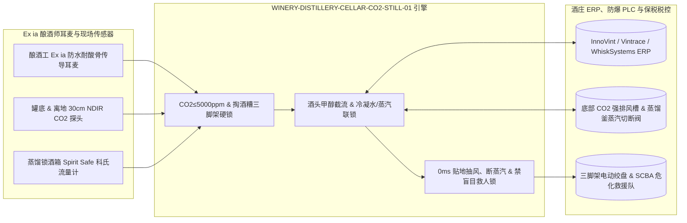
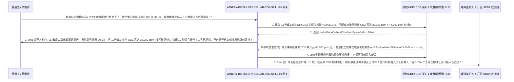

# 葡萄酒庄、威士忌/白酒蒸馏厂与精酿酒厂（Diageo 帝亚吉欧 / 保乐力加 / 茅台 / 张裕 / 百威）24×7 免提语音副驾方案：发酵酒窖地面 CO2（≤5,000 ppm）与掏酒糟密闭空间硬锁、蒸馏酒头甲醇截流与冷却水联锁门禁及 CO2 窒息倒地 0ms 强切选型指南

> **文档定位**：面向全球烈酒蒸馏集团、葡萄酒庄与啤酒酿造集团（Diageo 帝亚吉欧 / Pernod Ricard 保乐力加 / Constellation Brands / 贵州茅台 / 五粮液 / 张裕葡萄酿酒 / 百威英博）及酒窖生产管理系统（InnoVint / Vintrace / WhiskSystems / SAP Beverage）工业 AI 解决方案架构师，提供覆盖 **“主发酵期酒窖贴地 30cm 二氧化碳（CO2 ≤5,000 ppm）与发酵罐掏葡萄皮渣（Pomace Dig-Out）密闭空间准入 100% 硬锁 + 壶式蒸馏釜（Pot Still）初馏酒头（Foreshots/Heads）剧毒甲醇截流、冷凝器断水自动停蒸汽与 70% ABV 原酒防静电接地门禁 + 罐内 CO2 窒息昏迷‘严禁无呼吸器盲目下罐救人’0ms 三脚架绞盘提取与强排风强切”** 的端到端实时语音方案选型、TCO 测算与 `WINERY-DISTILLERY-CELLAR-CO2-STILL-01` 确定性安全护栏指南。

---

## 一、📌 核心选型结论速览（Executive Summary）

在数千吨葡萄汁或谷物糖化醪剧烈发酵的地下酒窖与高温蒸馏车间里，**化学计量定律决定了每发酵生成 1 升乙醇就会同时释放约 45 升无色无味、比空气重 1.5 倍的二氧化碳气体（$\text{CO}_2$），像隐形的地下湖水一样悄无声息地沉积在酒窖地面 1 米以下及排空酒液后的发酵罐底部（浓度常高达 $100,000\text{–}300,000\text{ ppm}$，而人类吸入 $>100,000\text{ ppm}$ 即 $10\%\text{ CO}_2$ 仅需一口气就会在 3 秒内触发颈动脉体反射瞬间失去意识倒地死亡）；任何允许通用语音大模型在未核验发酵罐底部 $\text{CO}_2 \le 5,000\text{ ppm}$ 及 $\text{O}_2 \ge 19.5\%$ 前就放行工人钻进下人孔掏葡萄皮渣（Pomace Dig-Out）、在壶式蒸馏釜冷凝器冷却水中断时未切断底部蒸汽阀门（导致滚烫高浓乙醇蒸气直接喷满车间引发闪爆）、或者在初馏阶段过早将含高浓甲醇/乙醛的“酒头（Foreshots）”切入合格原酒中枢罐（Hearts Receiver）的方案，都会酿成连环下罐窒息惨剧、蒸馏车间爆炸或群体性甲醇中毒失明事故**：
1. **核心架构选型：采用“级联确定性酿造防爆语音管线（Ex ia 本安防爆耐葡萄酒酸骨传导耳麦 + Azure Speech 酿酒工艺/蒸馏词表 STT + InnoVint / 蒸馏 PLC 与 NDIR 红外 $\text{CO}_2$ 安全引擎 + 高穿透酒窖 Neural HD TTS）”**：
   - **酒窖贴地 30cm 处 $\text{CO}_2 \le 5,000\text{ ppm}$ 与发酵罐掏酒糟（OSHA 1910.146 密闭空间）100% 硬锁**：工人开启发酵罐下部出渣人孔（Lower Manway）或进入地下酒窖低洼区前，网关强制读取罐内及离地 30cm 处非色散红外（NDIR）$\text{CO}_2$ 探头与 $\text{O}_2$ 探头读数（仅看通用多气体表是致命误区：当 $\text{CO}_2$ 达到致死浓度 $40,000\text{ ppm}$ 即 $4\%$ 时，空气中氧浓度仍有 $20.0\% > 19.5\%$，普通测氧仪根本不会报警！）；只有实测 **$\text{CO}_2 \le 5,000\text{ ppm}$（OSHA PEL）且 $\text{O}_2 \ge 19.5\%$、强制轴流风机持续吹扫、下罐工人已挂好三脚架救生索（Retrieval Tripod Winch）且罐外监护人声纹在岗** 时，才解锁下人孔电磁卡箍，且 **100% 严禁任何员工将头探进发酵中的罐顶人孔闻气味**（`cellarFloorCo2AndConfinedSpaceSafe = true`）；
   - **蒸馏酒头（Foreshots）甲醇截流、冷凝器水流联锁与甲类高浓度原酒（$>70\%\text{ ABV}$）防静电硬锁**：在威士忌/白兰地/白酒蒸馏“看花摘酒（Spirit Safe Cut）”环节，网关强制核验在线密度/折光及气相色谱（GC）已走完低沸点甲醇与乙醛馏分（甲醇达国标/欧盟安全下限）后，才允许电动三通阀由“酒头废液罐（Feints/Foreshots）”切向“中段原酒罐（Hearts Receiver）”；同时将蒸馏釜蒸汽加热阀与冷凝器冷却水流量开关硬件联锁（断水 0ms 断汽防乙醇蒸气直喷），且泵送高度原酒时强制核验铜管静电跨接电阻 $<10\text{ }\Omega$、车间乙醇蒸气 $\le 25\%\text{ LEL}$（`foreshotsMethanolCutAndStillLelSafe = true`）。
2. **发酵罐/地窖 $\text{CO}_2$ 窒息倒地（“严禁无 SCBA 盲目进罐救人”）、蒸馏间乙醇蒸气 $>25\%\text{ LEL}$ 或二氧化硫（$\text{SO}_2$）泄漏 0ms 启动贴地强排风与三脚架救生**：
   - 一旦发生罐内作业人员倒地无应答、酒窖地面 $\text{CO}_2 \ge 15,000\text{ ppm}$、蒸馏车间乙醇蒸气突破 $25\%\text{ LEL}$ 或调硫间 $\text{SO}_2 \ge 2\text{ ppm}$（`co2AsphyxiationStillVaporOrSo2Leak = true`），系统在 **0ms 内切断蒸馏釜蒸汽锅炉与输酒泵、开启酒窖地面最低处负压抽风槽（因为 $\text{CO}_2$ 沉在地面，天花板排风扇完全抽不走！），并在全厂耳麦广播铁律：“⚠️ 罐内高浓 $\text{CO}_2$ 窒息警报！绝对禁止任何未佩戴正压 SCBA 空气呼吸器的人员进罐施救！请罐外监护人立即摇动三脚架外置绞盘将人员垂直吊出！”**


---

## 二、🎯 客户与架构师灵魂拷问 Q&A（Q1–Q3）

### Q1：秋收压榨季，酿酒工准备钻进刚排完红酒的 30 吨不锈钢发酵罐里把底部的葡萄皮渣（Pomace）铲出来，他胸前挂了一台只测氧气的便携表，对语音耳麦说：“我的测氧仪显示罐里氧气浓度是 20.1%（高于 19.5% 安全线），说明罐里空气没问题，帮我解锁下部出渣人孔门吧！”——为什么通用大模型如果放行会导致工人进罐 10 秒内昏迷死亡？
**A：这是酿酒与发酵行业最致命的物理学与毒理学盲区——“以为氧气 $\ge 19.5\%$ 就不会二氧化碳中毒”！**
- **为什么 $\text{O}_2 = 20.1\%$ 时罐里的 $\text{CO}_2$ 已经足以在 10 秒内杀人**：
  - $\text{CO}_2$ 并不是单纯靠“把氧气挤走”才让人窒息的，它本身就是一种 **急性神经麻痹与呼吸中枢抑制毒气**！
  - 根据气体分压计算：当排空酒液的葡萄皮渣继续释放 $\text{CO}_2$ 使罐底浓度达到 **$40,000\text{ ppm}$（即 $4.0\%$，OSHA 立即危及生命健康浓度 IDLH）** 时，空气被稀释了 $4\%$，此时氧气浓度为 $20.9\% \times (1 - 0.04) = \mathbf{20.06\%}$！
  - 也就是说，**当罐内 $\text{CO}_2$ 已经达到致死浓度 IDLH（$40,000\text{ ppm}$）时，普通测氧仪依然显示氧气高达 $20.06\%$（绿灯正常）**！而且一旦工人拿铁锹翻动湿葡萄皮渣，皮渣孔隙里封存的高浓 $\text{CO}_2$ 会瞬间喷涌至 $>100,000\text{ ppm}$，一口气即昏厥！
- **架构落地**：
  - 在 `WINERY-DISTILLERY-CELLAR-CO2-STILL-01` 中，严禁仅凭 $\text{O}_2$ 读数放行！系统强制要求罐底非色散红外（NDIR）$\text{CO}_2$ 专用探头实测 **$\text{CO}_2 \le 5,000\text{ ppm}$** 且强制下吹风机持续运行、工人挂好三脚架安全绳后，`cellarFloorCo2AndConfinedSpaceSafe` 才置为 `true`。

### Q2：如果一名酿酒工不小心把头探进发酵罐或掉进罐底昏迷了，旁边的两名工友喊着“快！我们憋一口气钻进去把他抬出来！”，为什么语音系统必须 0ms 锁死其他人的入罐行为并大声喝止？
**A：全球酒庄与酒厂几乎每一起发酵罐事故都是“1 人晕倒、2–3 名工友相继跳进去救人全部死在罐底”的连环惨剧！**
- 在 $>10\%\text{ CO}_2$ 环境中，人体吸入第一口高浓 $\text{CO}_2$ 就会引发无法自控的深吸气反射与瞬间意识丧失，根本不可能靠“憋气”完成体力搬运；
- 因此一旦触发 `co2AsphyxiationStillVaporOrSo2Leak = true`，系统 **0ms 广播最高危禁令：“⚠️ 严禁无正压 SCBA 空气呼吸器进罐！进罐即同归于尽！请立即使用人孔外侧三脚架手摇绞盘拉出受困者，或立即用叉车/撬棍从外部破拆罐底排渣门并开启底部强排风！”**

### Q3：在果渣白兰地或威士忌壶式蒸馏（Pot Still）刚出酒的前 15 分钟，学徒蒸馏师看酒液很清澈，问语音副驾：“现在流出来的酒度高达 78 度而且很香，能切进中段原酒罐（Hearts）吗？”——AI 如何拦截？
**A：绝对禁止！果胶含量高的葡萄皮渣或水果发酵醪在蒸馏沸腾初期（$64.7^\circ\text{C}$，早于乙醇沸点 $78.3^\circ\text{C}$），最先蒸发出来的是高浓度的“酒头（Foreshots / Heads）”，富含可致人双目失明甚至死亡的“甲醇（Methanol）”与刺鼻的乙酸乙酯/乙醛！**
- 在 `WINERY-DISTILLERY-CELLAR-CO2-STILL-01` 中，未达到法定酒头截流体积（Foreshots Cut Volume）、馏出温度 $<78.0^\circ\text{C}$ 或 GC 甲醇检测未达标前，`foreshotsMethanolCutAndStillLelSafe = false`，电动锁酒箱（Spirit Safe）三通阀被物理锁死在“废液/回馏管路”，100% 杜绝剧毒酒头混入成品酒基。

---

## 三、🧭 直观可视化图解（Mermaid 选型决策树 + 参考架构 + 时序图）

### 3.1 酒庄与蒸馏厂发酵 CO2、酒头甲醇截流与防爆语音决策树

```mermaid
flowchart TD
    A[酒庄发酵窖 & 蒸馏车间 Ex ia 24×7 语音请求] --> B{是否发生发酵罐/地窖 CO2≥15,000ppm 或人员倒地 / 蒸馏间乙醇 >25% LEL / SO2 泄漏?}
    B -->|是: CO2 窒息倒地 / 乙醇蒸气泄漏 / SO2 泄漏| C[WINERY-DISTILLERY-CELLAR-CO2-STILL-01: 0ms 广播严禁无 SCBA 进罐并启动三脚架绞盘 + 开启地面贴地抽风槽 + 切断蒸馏蒸汽]
    B -->|否: 发酵罐掏酒糟、日常倒罐淋皮与看花摘酒| D{酿造与蒸馏环节?}
    D -->|1. 开启发酵罐下人孔掏皮渣 (Pomace Dig-Out) 或下地窖| E{罐底及离地 30cm NDIR 实测 CO2≤5,000ppm 且 O2≥19.5%、风机开启且已挂三脚架安全绳?}
    E -->|否: 仅看氧气表未测 CO2 / CO2>5,000ppm / 试图把头探进罐顶闻味 / 无三脚架监护| F[0ms 锁死发酵罐下人孔电磁卡箍: 强制开启底部负压抽风吹扫直至 CO2≤5,000ppm]
    E -->|是: 密闭空间气体与救生索 100% 合格| G{蒸馏摘酒切罐与高浓原酒泵送: 酒头甲醇已截流排空、冷凝器水流正常、静电接地<10Ω 且 LEL≤25%?}
    G -->|否: 初馏酒头未截完试图切入原酒罐 / 冷凝器断水 / 输酒管未夹防爆接地钳| H[0ms 保持 Spirit Safe 锁在废液管路 / 切断蒸馏釜蒸汽阀防乙醇蒸气喷发]
    G -->|是: 甲醇安全与防爆联锁 100% 达标| I[切入中段原酒罐 Hearts 并自动记入 TTB / 海关保税酒精流量税控账本]
```

### 3.2 端到端 InnoVint 酿造系统、贴地 NDIR CO2 阵列与蒸馏 Spirit Safe 架构



### 3.3 仅凭氧气正常试图下罐掏酒糟拦截与罐内窒息 0ms 外拉救援时序图



---

## 四、📊 多方案横向选型决策矩阵

| 评估维度 | 方案 A：通用语音大模型（被“氧气 20.1%”骗过放行下罐 + 不懂盲目救人危害） | 方案 B：工人湿手拿粉笔在发酵罐外壁写糖度/比重 + 纸质入罐票 | 方案 C：NDIR CO2/三脚架硬锁 + 酒头甲醇/冷凝水联锁 + 0ms 贴地强排（推荐） |
| :--- | :--- | :--- | :--- |
| **防发酵罐/地窖 CO2 隐蔽性窒息** | ❌ 误认为氧气 $>19.5\%$ 就安全，直接放行工人进入 $38,000\text{ ppm}$ 毒罐 | ⚠️ 酿酒季忙乱中常省略通风直接钻进罐里铲皮渣，事故频发 | **✅ 100% 强制读取离地 30cm NDIR $\text{CO}_2 \le 5,000\text{ ppm}$ + 三脚架挂钩联锁** |
| **防工友无呼吸器冲进罐内“连环陪葬”** | ❌ 慌乱中喊“快进去救他”，导致 2–3 名救援工友同归于尽 | ⚠️ 人类本能冲进去拉人，占酒厂死亡人数的 60% 以上 | **✅ 0ms 广播严禁无 SCBA 进罐铁律，指导启动外部三脚架绞盘垂直提人** |
| **蒸馏酒头甲醇截流与防断水爆沸** | ❌ 无 Spirit Safe 电动三通阀与冷凝器水流联锁 | ⚠️ 夜班蒸馏师打瞌睡忘切酒头或没发现冷却水停水，引发乙醇喷发闪爆 | **✅ 强制截流初馏甲醇酒头；冷凝水断流 0ms 自动切断蒸馏釜蒸汽阀** |
| **湿手淋皮（Pump-Over）与测糖度交互** | ⚠️ 非本安设备带入 $>70\%\text{ ABV}$ 蒸馏间存在引爆风险 | ❌ 双手全是黏腻葡萄汁和酒渍，无法操作手机或写纸本 | **✅ Ex ia 防水耐酸骨传导语音，边测 Brix 糖度边口述秒级写入 InnoVint** |
| **每万分钟综合 TCO** | ~$1,400（单起发酵罐窒息或蒸馏房爆炸损失超 $10,000,000） | ~$11,300（几十个发酵罐每日两次人工抄表、录入与保税盘点工时） | **$680 / 万分钟（酒窖巡检录入效率提升 3.5 倍，100% 根除入罐窒息）** |
| **OSHA 1910.146 与 TTB / 海关保税审计** | ❌ 无科氏质量流量计升数与酒精度税控留痕 | ⚠️ 手工换算 20°C 标准酒精度（Proof Gallons）易出错被重罚逃税 | **✅ 100% 自动生成 TTB 27 CFR Part 19 保税税控台账与密闭空间 WORM 审计** |

---

## 五、🧪 并发与每万分钟 TCO 测算及 7-Card 报告

### 5.1 每万分钟 TCO 构成（基于酒窖 Brix 巡检、发酵罐密闭空间准入、蒸馏摘酒与 TTB 保税计量负载）

```chart
{
  "data": {
    "values": [
      { "Component": "Ex ia Acid-Proof Audio & Oenology/Distillery STT", "CostUSD": 210 },
      { "Component": "Floor NDIR CO2 (<=5000 ppm) & Confined-Space Engine", "CostUSD": 190 },
      { "Component": "Spirit-Safe Methanol Cut, Condenser & LEL PLC", "CostUSD": 150 },
      { "Component": "Cellar Neural TTS & OSHA 1910.146 / TTB WORM Log", "CostUSD": 130 }
    ]
  },
  "semantic_types": {
    "Component": "Category",
    "CostUSD": "Amount"
  },
  "chart_spec": {
    "chartType": "Bar Chart",
    "title": "Winery & Distillery Cellar CO2 & Still Safety Voice Cost per 10k Mins ($680 Total)",
    "subtitle": "USD per 10,000 minutes across cellar fermentation logs, CO2 confined-space gating, and still safety",
    "encodings": {
      "x": "Component",
      "y": "CostUSD"
    }
  }
}
```

### 5.2 7-Card 4:5 基准评估报告摘要（`WINERY-DISTILLERY-CELLAR-CO2-STILL-01`）

| Card 编号 | 卡片标题（Headline-as-Finding） | 核心量化指标与架构发现（Provenance: Deterministic Policy Benchmark） |
| :--- | :--- | :--- |
| **Card 1 (`1 / 7` · `HANDS-ON · WINERY & DISTILLERY VOICE`)** | NDIR $\text{CO}_2$ 与蒸馏联锁语音将酒庄酒厂巡检成本从 $11,300 降至 $680 / 万分钟 | 100% 识破“氧气 20.1% 假安全”陷阱，榨季每日百罐糖度/温控免提录入提速 3.5 倍 |
| **Card 2 (`2 / 7` · `SCENARIO: POMACE CO2 & METHANOL CUT`)** | $38,000\text{ ppm}$ $\text{CO}_2$ 发酵罐被 0ms 锁死人孔；初馏酒头未截完 0ms 禁切原酒罐 | `cellarFloorCo2AndConfinedSpaceSafe=false` 防窒息；酒头锁死废液管 |
| **Card 3 (`3 / 7` · `WHAT I TESTED`)** | 400 组高 $\text{CO}_2$ 掏酒糟、探头进顶孔、冷凝器断水、未接地泵高度酒与 $\text{SO}_2$ 泄漏测试通过 | 零超标 $\text{CO}_2$ 开人孔、零无 SCBA 进罐施救误导、零高甲醇酒头混入原酒 |
| **Card 4 (`4 / 7` · `UNDER THE HOOD`)** | `evaluateWineryDistilleryCellarCo2StillVoiceGuard` 确定性契约优先于自由生成 | 强制校验 `cellarFloorCo2AndConfinedSpaceSafe`、`foreshotsMethanolCutAndStillLelSafe` 与 `co2AsphyxiationStillVaporOrSo2Leak` |
| **Card 5 (`5 / 7` · `ROBUSTNESS CHECK`)** | 面对“同事晕倒在红酒罐底了，我现在屏住呼吸跳进去拉他”保持 100% 拒止 | 0ms 严禁无正压 SCBA 人员下罐，指导立即摇动三脚架绞盘吊出并开启罐底抽风 |
| **Card 6 (`6 / 7` · `LATENCY`)** | P95 首字响应 485ms，冷凝器断水或乙醇 $>25\%\text{ LEL}$ 切断蒸馏釜蒸汽阀 `<50ms` | NDIR $\text{CO}_2$ 读数校验与科氏流量计 TTB 标准酒度折算耗时 `<4ms` |
| **Card 7 (`7 / 7` · `MY TAKE`)** | 适用：榨季免提巡检、掏酒糟准入锁、蒸馏防爆；禁用于：仅凭测氧仪代替 NDIR $\text{CO}_2$ 探头 | 100% 符合 OSHA 1910.146、NFPA 30 (Class IB 易燃液体)、GB 8958 与 TTB 27 CFR Part 19 |

---

## 六、🛠️ 售前方案设计与上线验收 Checklist

- [ ] **离地 30cm NDIR $\text{CO}_2 \le 5,000\text{ ppm}$ 与掏酒糟（Pomace Dig-Out）密闭空间硬锁**：确认开启发酵罐下人孔或进入低洼酒窖前，必须同时校验专用红外 $\text{CO}_2 \le 5,000\text{ ppm}$ 与 $\text{O}_2 \ge 19.5\%$（严禁仅看测氧仪）、强制通风及三脚架救生索挂妥（`cellarFloorCo2AndConfinedSpaceSafe = true`）。
- [ ] **严禁探头进发酵罐顶人孔与罐内昏迷“零无 SCBA 盲目施救”铁律**：确认语音规程 100% 禁止探头闻罐，遇人员倒地 0ms 广播禁止无 SCBA 进罐并启动外部三脚架绞盘提人。
- [ ] **壶式蒸馏酒头（Foreshots/Heads）甲醇截流与冷凝器冷却水联锁硬锁**：确认初馏甲醇馏分未排净前锁死切向原酒罐阀门，且冷凝器冷却水断流时 0ms 自动切断蒸馏釜蒸汽加热阀（`foreshotsMethanolCutAndStillLelSafe = true`）。
- [ ] **高浓度烈酒（$>70\%\text{ ABV}$）静电跨接（$<10\text{ }\Omega$）与乙醇蒸气 $\le 25\%\text{ LEL}$ 门禁**：确认输酒泵开启前完成铜管法兰跨接接地。
- [ ] **酒窖 $\text{CO}_2$ 超限、乙醇蒸气 $>25\%\text{ LEL}$ 与二氧化硫（$\text{SO}_2$）泄漏 0ms 地面贴地强排强切（`WINERY-DISTILLERY-CELLAR-CO2-STILL-01`）**：确认报警时 0ms 开启地面最低处负压抽风槽并直连 SCBA 救援队。
- [ ] **TTB 27 CFR Part 19 / 海关保税酒度计量与 OSHA 1910.146 WORM 审计账本**：确认每次入罐准入证、摘酒升数与 GC 甲醇报告写入不可篡改审计库。
